# IResearch 类与模块设计全景:模式、模块组成、写入/检索的类图、设计经验

个人学习笔记。目标是在已经读过的写入路径(`study/field_write_memory_flush_pipeline.md`、`writer_threads_collaboration.md`、`consolidation_merge_workflow.md`)和检索路径(`search_retrieval_pipeline.md`)之上,补一张**"类与类怎么组织"**的地图:

- 先说清整个库**怎么分层**、**反复出现的设计模式**(尤其是 stream 里的 attribute 机制);
- 再把每个模块**由哪些要素构成**列全(附录有从源码自动抽取的**全量类型清单**,避免漏);
- 然后分别画出**索引构建**和**检索**两条主线上的类图、实体和配置;
- 最后总结:做类似的检索工程,这份代码给了哪些可借鉴的经验。

> **事实来源**:除非特别标注,本文每一条结论都来自我读过的头文件/实现文件(文中给出文件和行号)。数字(文件数、类型数、依赖边数)由脚本统计,不是估计。标注"推断"的地方是我的理解,代码里没有明说。

---

## 0. 导读

### 0.1 本文和其它笔记的关系

| 笔记 | 视角 | 本文怎么用它 |
|---|---|---|
| [READING_GUIDE.md](study/READING_GUIDE.md) | 阅读路线(按层、按文件) | 本文是它的"类关系版":读完某层再回来对照类图 |
| [writer_threads_collaboration.md](study/writer_threads_collaboration.md) | 写入时三类线程怎么协作 | 本文 4.3 引用其中的 `FlushContext` 结论 |
| [field_write_memory_flush_pipeline.md](study/field_write_memory_flush_pipeline.md) | 写入数据在内存、文件里的字节布局 | 本文 4 只画类和配置,字节细节指向它 |
| [consolidation_merge_workflow.md](study/consolidation_merge_workflow.md) | 段合并 | 本文 4.4 画 `MergeWriter` 在类图里的位置 |
| [search_retrieval_pipeline.md](study/search_retrieval_pipeline.md) | 检索流程(加载→查询→过滤→NRT) | 本文 5 只画类和配置,执行轨迹指向它 |
| [query_score_tree.md](study/query_score_tree.md) | 一个查询怎样从 filter 树变成 prepared 树、迭代器树、分数树 | 本文 5.5 的 prepare/execute 步骤、7.5/7.6 的组合与打分,细节指向它 |

### 0.2 一页纸结论

1. **库的骨架是"接口 + 注册表 + 属性袋"**:`format`、`analyzer`、`Scorer`、`directory`、`filter` 都是接口,具体实现靠**静态注册表**按名字挂进来;而所有迭代器、流都靠一个统一的 **`attribute_provider`** 暴露"我能提供什么数据"。
2. **写入侧是 "多层缓冲 + 一次性序列化"**:`IndexWriter` → `Transaction` → `Document` → `segment_writer` → `fields_data / BufferedColumn` → flush 时才通过 `format` 产出的 writer 落成文件。
3. **检索侧是 "编译一次、逐段执行"**:`filter`(用户态、只描述条件)→ `prepare()` 得到 `prepared`(收集了统计和 term 状态)→ 对每个 `SubReader` `execute()` 得到 `doc_iterator` 树。
4. **两侧共用的粘合剂**:`doc_iterator` / `term_iterator` / `term_reader` / `column_reader` 这些**读取接口**(在 `index/iterators.hpp` 与 `formats/formats.hpp`),`format` 的实现既产出写入器,也产出读取器。
5. **代码并不是严格分层**:真实的 include 依赖里 `utils` 依赖了 `store`/`formats`/`index`/`search`,`formats` 与 `index` 互相依赖(见 1.2)。这是因为 "接口所需的数据类型" 和 "实现" 被放在相邻目录里,不要按 "下层不依赖上层" 去推断。

---

## 1. 整体分层与模块依赖

### 1.1 仓库顶层

| 目录 | 内容 | 规模 |
|---|---|---|
| `core/` | 库本体(下文所有模块) | 76 K 行,7 个模块目录 + 3 个根文件 |
| `core/utils` | 语言工具箱 + 若干索引工具 | 102 个文件,20.5 K 行 |
| `core/store` | 抽象文件系统 `directory` 与 IO 流 | 22 个文件,5.0 K 行 |
| `core/analysis` | 分词器(`token_stream` 家族) | 35 个文件,8.1 K 行 |
| `core/formats` | 磁盘格式(编解码器) | 20 个文件,15.6 K 行 |
| `core/index` | 写入、读取、元数据 | 38 个文件,11.3 K 行 |
| `core/search` | 过滤器、迭代器、打分器 | 81 个文件,15.4 K 行 |
| `core/error` | 异常类型 | 2 个文件 |
| `core/resource_manager.hpp` `types.hpp` `shared.hpp` | 全局基础类型、内存记账接口 | - |
| `utils/`(仓库根) | 命令行程序:`index-put`、`index-search`、`index-dump`、`index-convert`… | 应用层示例 |
| `tests/`、`microbench/`、`python/` | 测试、微基准、Python 绑定 | - |
| `external/` | 第三方:`abseil-cpp`、`function2`、`frozen`、`openfst`(FST)、`simdcomp`、`highway`、`snowball`(词干)、`fastText`、`velocypack`、`kaldi`、`sse2neon`、`text` | - |

### 1.2 `core/` 内部模块的**实际** include 依赖

用脚本统计每个模块的 `#include "..."` 指向哪个模块(只数 core 内部,行 = 使用者,列 = 被使用者,单位:include 次数):

| 使用者 \ 被使用者 | utils | error | store | analysis | formats | index | search |
|---|---|---|---|---|---|---|---|
| **utils** | - | 3 | **16** | 1 | 3 | 3 | 2 |
| **error** | 1 | - | 0 | 0 | 0 | 0 | 0 |
| **store** | 54 | 5 | - | 0 | 0 | 0 | 0 |
| **analysis** | 62 | 0 | 3 | - | 0 | 2 | 0 |
| **formats** | 65 | 1 | 18 | 7 | - | **25** | 13 |
| **index** | 86 | 1 | 8 | 12 | **8** | - | 4 |
| **search** | 68 | 1 | 0 | 19 | 10 | **35** | - |

读法:

- `store`、`error` 几乎只依赖 `utils`,是真正的底层。
- **`utils` 反向依赖了 `store`(16 次)**:`utils/directory_utils`(`TrackingDirectory`)、`utils/encryption`、`utils/index_utils`(合并策略)本质上是 "建立在 directory/IndexWriter 之上的工具",只是放在了 `utils/`。
- **`formats` ↔ `index` 互相依赖**(25 与 8):`formats.hpp` 里的接口用到 `index` 的元数据(`SegmentMeta`、`field_meta`、`IndexFeatures`、`DocMap`),而 `index` 的写入/读取要调用 `format` 提供的 writer/reader。
- `index` → `search`(4)只有 `filter`(删除/替换要按过滤器匹配文档)和 `Scorer`(wand);`formats` → `search`(13)主要是 `score_function`(wand)。
- `search` 依赖 `index`(35)、`analysis`(19)、`formats`(10)。

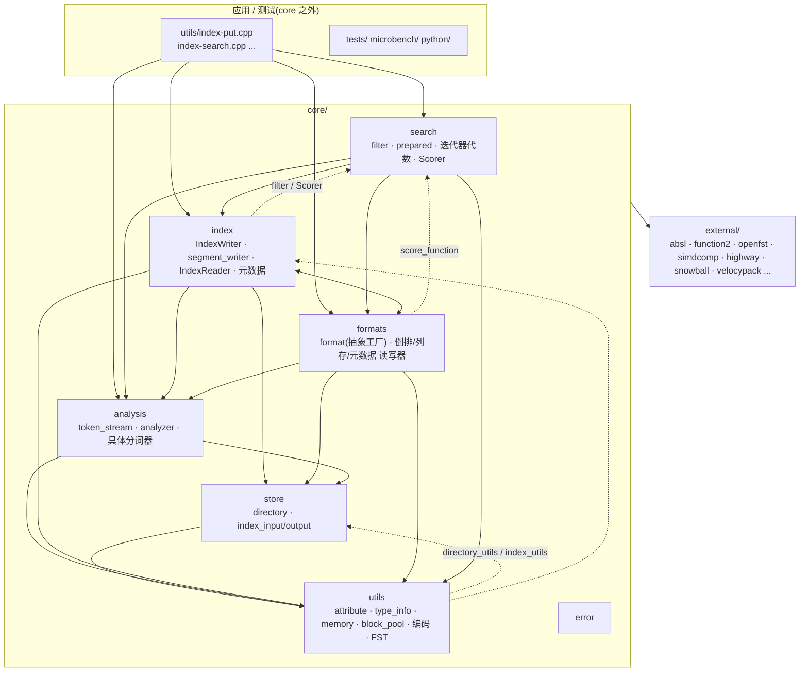

### 1.3 读写两条主线在模块图里的位置

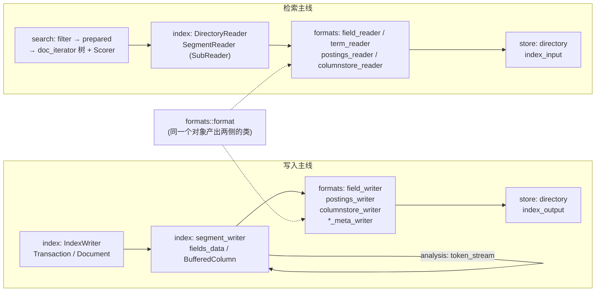

---

## 2. 贯穿全库的设计模式

这一章先讲 "套路",后面每个模块都是这些套路的具体应用。每条都给出代码依据。

### 2.1 属性袋(attribute / attribute_provider)——最核心的一个

**问题**:一个迭代器能提供哪些数据(文档号、词频、位置、分数、代价……)因类型而异。如果每种迭代器都定义自己的虚接口,接口会爆炸;如果用 `dynamic_cast`,每次取数据都慢。

**做法**(`utils/attribute_provider.hpp`、`utils/type_id.hpp`、`utils/attribute_helper.hpp`):

```cpp
struct attribute {};                                  // 空基类,不是多态的
struct attribute_provider : memory::Managed {         // 能力袋
  virtual attribute* get_mutable(type_info::type_id) = 0;   // 按类型 id 取指针
};
template<class T> const T* get(const Provider& p);    // irs::get<frequency>(*it)
```

要点:

- **类型标识用函数指针**:`type_info::type_id = type_info(*)() noexcept`,`type<T>::id()` 返回 `&type<T>::get`。每个 `T` 实例化出一个独立的函数,地址就是唯一标识——不需要 RTTI,可跨 DLL 比较,还能 `constexpr`([type_info.hpp](core/utils/type_info.hpp)、[type_id.hpp](core/utils/type_id.hpp))。
- **实现者通常是一个 `std::tuple<...> attrs_` 加一行转发**:`get_mutable(id)` 里调 `irs::get_mutable(attrs_, id)`,编译期展开成线性比较([attribute_helper.hpp:52-75](core/utils/attribute_helper.hpp#L52-L75))。属性列表是**固定的、很短**(1~5 个),所以线性查找比哈希更快。
- **`attribute_ptr<T>`**:元素可以是 "值" 也可以是 "指向别处的指针"(迭代器把自己的属性指向内部成员,或指向下层迭代器的属性——合取/析取就靠这个把子迭代器的 `score` 暴露出去)。
- **属性本身是小 POD**,没有虚函数:`document{value}`、`frequency{value}`、`term_attribute{bytes_view}`、`increment{uint32}`、`offset{start,end}`、`payload{bytes_view}`、`cost`、`score`、`prev_doc`、`filter_boost`、`Norm/Norm2`……
- **调用方的契约**:先 `get<T>(provider)` 拿指针(可能为空)再用;属性的**地址在迭代期间稳定**,所以调用方可以缓存指针,之后只读 `value`,不再查找。

**哪些东西是 `attribute_provider`**(这是理解 "stream 中 attr" 的关键)——

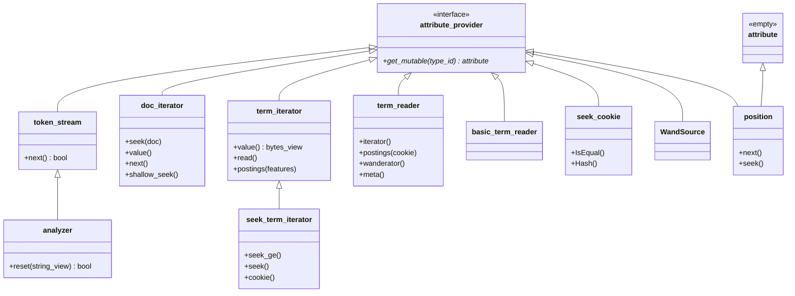

(`position` 既是属性又是 provider:它本身是 doc_iterator 的 `position` 属性,同时再暴露 `offset`、`payload` 子属性。)

**不同 "流" 暴露的属性**:

| 流 / 迭代器 | 暴露的属性(典型) | 谁读取 | 代码 |
|---|---|---|---|
| `token_stream`(分词器输出) | `term_attribute`(必须)、`increment`(必须)、`offset`、`payload` | `field_data::invert` | [token_streams.hpp](core/analysis/token_streams.hpp)、[field_data.cpp:986-1015](core/index/field_data.cpp#L986-L1015) |
| 内存倒排的 `doc_iterator`(flush 时) | `document`、`frequency`、`position`(带 `offset`/`payload`) | `postings_writer::write` | [field_data.cpp:226-343](core/index/field_data.cpp#L226-L343) |
| 磁盘倒排的 `doc_iterator` | `document`、`frequency`、`position`、`cost`、`score` | 过滤器、合取/析取、打分 | `formats_10.cpp` 的 `doc_iterator` / `wanderator` |
| 列存 `doc_iterator` | `document`、`cost`、`payload`(该文档的列值)、可选 `prev_doc` | norm 读取、排序、合并 | [columnstore2.cpp](core/formats/columnstore2.cpp) |
| `BufferedColumnIterator` | `document`、`cost`、`payload` | flush 期间的 wand/比较 | [buffered_column_iterator.hpp](core/index/buffered_column_iterator.hpp) |
| 合取/析取等组合迭代器 | `document`、`cost`、`score`(把子迭代器的分数合并) | 上层 | [conjunction.hpp](core/search/conjunction.hpp)、[disjunction.hpp](core/search/disjunction.hpp) |
| `term_iterator` | `term_meta`(docs_count、freq) | `read()` 之后取统计 | [formats.hpp:80-90](core/formats/formats.hpp#L80-L90) |
| `term_reader`(burst trie 实现) | `frequency`(整个字段的词频总和,仅当字段带 FREQ) | BM25/TFIDF 的 `FieldCollector` 取字段统计 | [formats_burst_trie.cpp:1537-1545](core/formats/formats_burst_trie.cpp#L1537-L1545) |
| `seek_cookie` | 实现自定义状态(不透明) | 缓存 term 位置,跳过 FST 遍历 | [seek_cookie.hpp](core/formats/seek_cookie.hpp) |

**为什么好**:

1. **接口窄**:`doc_iterator` 只有 `next/seek/value`,而"要不要位置/分数"是调用方按属性有无自行决定;
2. **按需构建**:`postings(features)` 请求什么 `IndexFeatures`,迭代器就只带上对应属性(没请求 `POS` 就不会有 `position`)——这就是 `IndexFeatures` 与属性机制的配合;
3. **可组合**:装饰器(如 `MaskDocIterator`、`Conjunction`)不改变接口,只是把自己的 `document` 属性暴露出去,并转发下层的 `score`/`cost`。分词管线是更直观的例子:`pipeline_token_stream::get_mutable(id)` 先查自己的 `attrs_`,**查不到就从管线末尾向前找最近的、提供该属性的子分析器**(`payload`、`offset` 除外,它们必须由管线自己控制),所以串起来的多个分析器对外仍是一个 "有 term/increment 的 token_stream"([pipeline_token_stream.hpp:37-52](core/analysis/pipeline_token_stream.hpp#L37-L52))。

**成本**:属性是否存在要在**运行时**查询(返回指针可能为空),类型安全靠约定而不是编译器;属性的生命周期完全绑在 provider 身上。

**属性也要注册**:`REGISTER_ATTRIBUTE(Norm2)` 把类型名放进全局表([attributes.hpp](core/utils/attributes.hpp)),因为 **feature 的类型名会被写进磁盘**(`.ti` 里的 `"iresearch::norm2"`),读取时要 `attributes::get(name)` 把名字还原成 `type_info`([formats_burst_trie.cpp:559](core/formats/formats_burst_trie.cpp#L559)、[731](core/formats/formats_burst_trie.cpp#L731))。

### 2.2 静态注册表 + 插件(format / analyzer / scorer / compression / attribute)

五种 "可插拔" 的东西共用同一个模板 `generic_register<Key, Entry, Register>`(单例,带互斥,支持从共享库加载):[register.hpp](core/utils/register.hpp)。

| 注册表 | 键 | 值 | 注册宏 | 查找 |
|---|---|---|---|---|
| format | `type_info` + 模块名 | `format::ptr (*)()`(`make`) | `REGISTER_FORMAT[_MODULE]` | `formats::get("1_5simd")` |
| analyzer | `type_info` + 参数格式(JSON / TEXT / VPACK) | 工厂函数 + 参数规范化函数 | `REGISTER_ANALYZER_JSON/TEXT/VPACK` | `analysis::analyzers::get(name, fmt, args)` |
| scorer | 同上 | 工厂 | `REGISTER_SCORER_JSON/VPACK` | `scorers::get(...)` |
| compression | 名字 | compressor/decompressor 工厂 | `compression_registrar` | `compression::get_compressor` |
| attribute | 名字 | `type_info` | `REGISTER_ATTRIBUTE` | `attributes::get(name)` |

关键约定:

- **注册发生在静态初始化期**:一个文件里 `static ::irs::format_registrar xxx(...)`。注释里反复强调 "`make(...)` MUST be defined in CPP to ensure proper code scope"([formats.hpp](core/formats/formats.hpp)、[analyzers.hpp](core/analysis/analyzers.hpp)),并为静态库提供 `init()`("for triggering registration in a static build",如 `BM25::init()`),因为链接器可能把没人引用的注册对象丢掉。
- **名字会被持久化**,所以可以按名字还原:format 名(`"1_4"`)决定怎么读 segment、feature 名决定 `.ti` 里怎么解析、analyzer 的名字+参数可以序列化成配置。

### 2.3 抽象工厂:`format` 一次给出读写两侧的整套类

[formats.hpp:395-420](core/formats/formats.hpp#L395-L420):

```cpp
class format {   // 一个"版本化的编解码器"
  get_index_meta_writer/reader();     get_segment_meta_writer/reader();
  get_document_mask_writer/reader();  get_field_writer(consolidation, rm)/get_field_reader(rm);
  get_columnstore_writer(consolidation, rm)/get_columnstore_reader();
};
```

- **版本演进用继承**:`format10 → 11 → 12 → 13 → 14 → 15`,每一级只覆盖有变化的那个工厂方法(如 `format14` 把列存换成 `columnstore2`、`format15` 打开 wand);再各自有 `*simd` 变体([formats_10.cpp:3808-4317](core/formats/formats_10.cpp#L3808-L4317))。
- **标量 / SIMD 用模板策略**:`postings_writer<FormatTraits>`,`format_traits<Wand, PosMin>` 与 SIMD 版本只在块大小、位打包函数、位置基准上不同。
- 这使得**一个 segment 的格式名就是它的 "解释器"**:`SegmentMeta::codec` 保存 `format::ptr`,读取时由它产出全套 reader。

### 2.4 策略(Strategy):用接口或 `std::function` 注入行为

| 注入点 | 类型 | 谁调用 | 说明 |
|---|---|---|---|
| 打分 | `Scorer`(接口)+ `ScorerBase<Impl,Stats>`(CRTP) | `prepare()` / `execute()` | BM25、TFIDF、BoostScore |
| 排序键比较 | `Comparer`(NVI:`Compare` 非虚、`CompareImpl` 纯虚) | `BufferedColumn::Flush` | 决定 segment 内文档顺序 |
| 合并策略 | `ConsolidationPolicy`(`std::function`) | `IndexWriter::Consolidate` | `ConsolidateTier/Bytes/Count/DocsLive/DocsFill` 返回不同的 lambda |
| 列配置 | `ColumnInfoProvider`(`std::function<ColumnInfo(name)>`) | `segment_writer`、`columnstore_writer` | 压缩/加密/是否跟踪前一文档,按列名决定 |
| feature 配置 | `FeatureInfoProvider`(返回 `ColumnInfo` + `FeatureWriterFactory`) | `field_data` 构造 | 按 feature 类型决定怎么写 norm |
| meta payload | `PayloadProvider` | commit | 把自定义数据写进 `IndexMeta` |
| 分词 | `analysis::analyzer` 子类 | `Field::get_tokens()` | 同一接口,不同实现 |

### 2.5 组合(Composite):读取器、布尔过滤器、分词管线

- **`IndexReader` / `SubReader`**:`SubReader` **继承自** `IndexReader` 且 `size() == 1`、`operator[](0)` 返回自己([index_reader.hpp:112-130](core/index/index_reader.hpp#L112-L130))。于是 "遍历 `IndexReader` 里的所有段" 对单段、多段读者写法一样;`DirectoryReader`(组合)→ `SegmentReader`(叶子)。
- **布尔过滤器**:`boolean_filter`(`And`、`Or`)装一组子 `filter`,`Not` 装一个;prepare 后对应 `BooleanQuery`(`AndQuery`、`OrQuery`、`MinMatchQuery`)。
- **`pipeline_token_stream`** 把若干 analyzer 串成一条(每个 `sub_analyzer_t` 消费上一个的输出)。

### 2.6 "编译再执行":`filter` → `prepared` → `doc_iterator`

[filter.hpp:46-91](core/search/filter.hpp#L46-L91):

- `filter`:用户态**只读描述**(字段名、term、选项、boost),可以比较、复制构造。
- `filter::prepare(PrepareContext)` → `prepared`:**跨所有段**一次完成统计收集、term 查找(把 term 在每个段里的位置缓存成 `seek_cookie`),产出不可变的 `prepared`。
- `prepared::execute(ExecutionContext)`:针对**一个段**构造 `doc_iterator`。

与 Lucene 的 `Query → Weight → Scorer` 是同一思路。把 "和段无关的重活" 与 "每段的轻活" 拆开,同一个 `prepared` 可以对每个新段/每个线程反复 `execute`。

### 2.7 空对象(Null Object)与哨兵,让调用方少写 `if`

| 位置 | 空对象 |
|---|---|
| 迭代器 | `doc_iterator::empty()`、`term_iterator::empty()`、`field_iterator::empty()`、`column_iterator::empty()`(`EmptyDocIterator` 等,[iterators.cpp](core/index/iterators.cpp)) |
| 过滤器 | `Empty`(不匹配任何文档)、`prepared::empty()` |
| 打分 | `score::kNoScore`、`ScoreFunction::Default(n)`、`Scorers::kUnordered` |
| 统计收集 | `collector_wrapper` 里的 `noop_field_collector`/`noop_term_collector`([collectors.hpp](core/search/collectors.hpp)) |
| 内存记账 | `IResourceManager::kNoop` |
| 读者 | `SubReader::empty()`、`EmptySubReader` |

### 2.8 访问者(Visitor)

- `filter_visitor`:多 term 过滤器遍历 term 字典时的回调(`prepare(segment, field, terms)` + `visit(boost)`),把 "怎么遍历 term" 与 "遍历到之后做什么" 分开,前缀/通配/范围/编辑距离共用([filter_visitor.hpp](core/search/filter_visitor.hpp))。
- `PreparedStateVisitor`:遍历一个 `prepared` 查询树里各类 state(`TermQuery`、`MultiTermQuery`、短语等)([prepared_state_visitor.hpp](core/search/prepared_state_visitor.hpp))。
- `directory::visit`、`columnstore_reader::visit`、`analyzers::visit`、`formats::visit`:枚举。

### 2.9 NVI / CRTP / mixin:少写样板、保证类型安全

| 手法 | 例子 | 目的 |
|---|---|---|
| CRTP 自动实现 `type()` | `TypedAnalyzer<Impl>`、`ScorerBase<Impl,Stats>`、`FilterWithType<Type>` | 每个实现类不用手写 `type()`;类型比较(`filter::operator==`)不依赖 RTTI |
| mixin 链堆叠能力 | `FilterWithBoost` → `FilterWithType` → `FilterWithOptions` → `FilterWithField` | 加一个字段/选项只多一层继承;`by_term` 只剩 `prepare` |
| "选项结构体" 与 "过滤器类" 分离 | `by_term_options{term}` + `by_term : FilterWithField<by_term_options>` | 选项可单独复制/比较/序列化,`options_type::filter_type` 回指 |
| NVI | `Comparer::Compare`(非虚,里面做断言)→ `CompareImpl`(纯虚) | 基类统一做前后置检查 |
| `ConstructToken` | `IndexWriter`、`segment_writer`、`SegmentReaderImpl::PrivateTag` | 构造函数公开(为了 `make_shared`)但只有内部能构造 |
| `IRS_NO_UNIQUE_ADDRESS` | `FilterWithOptions::options_`、`memory.hpp` 里带分配器的删除器 | 空选项/空分配器零开销 |

### 2.10 所有权与内存:`Managed`、`managed_ptr`、资源记账

- **`memory::Managed`**:带一个虚的 `Destroy()`。`OnHeap<T>` 的 `Destroy` 是 `delete this`;`Tracked<T>` 在构造时 `rm.Increase(sizeof)`,销毁时 `Decrease`;`managed_ptr<T>` 是用 `ManagedDeleter` 调 `Destroy()` 的 `unique_ptr`([memory.hpp:278-351](core/utils/memory.hpp#L278-L351))。效果:**同一个接口的对象可以在堆上、在池里、或带记账**,调用方拿到的类型都是 `managed_ptr<Base>`。`doc_iterator::ptr`、`prepared::ptr`、`column_reader` 等都是这种指针。
- **`IResourceManager`**:`Increase/Decrease` 两个虚函数;`ManagedTypedAllocator<T>` 把它包进 STL 分配器,于是 `ManagedVector<T>`、`ManagedBitset`、`StatesCache` 的 map 都能被记账([resource_manager.hpp](core/resource_manager.hpp))。`ResourceManagementOptions` 有 **5 个独立记账点**:`transactions`(写入缓冲)、`readers`、`consolidations`、`file_descriptors`、`cached_columns`。在 debug 构建里默认分配器会绑定 `kForbidden`,**强迫你显式传 manager**。
- **`ptr` 约定**:每个接口类里都有 `using ptr = ...`(`unique_ptr`、`managed_ptr` 或 `shared_ptr`),**选择即表达所有权**——`IndexReader::ptr` 是 `shared_ptr`(快照被多个线程共享),`doc_iterator::ptr` 是 `managed_ptr`(独占)。

### 2.11 不可变快照 + pimpl + 引用计数(读者侧)

- `DirectoryReader`、`SegmentReader` 都是 **pimpl 外壳**,内部是 `shared_ptr<const Impl>`([directory_reader.hpp](core/index/directory_reader.hpp)、[segment_reader.hpp](core/index/segment_reader.hpp))。拷贝便宜,快照一旦生成就不再变。
- `Reopen()` 会**复用没变化的段读者**(`DirectoryReaderImpl::Open(..., cached)`),新增段才真正打开文件。
- 文件生命周期靠 **`index_file_refs`**(引用计数的文件名表):读者持有 `FileRefs`,只要快照存活,对应文件就不会被 `directory_cleaner` 删除。

### 2.12 对象池 + 双缓冲(写者侧)

- `unbounded_object_pool<SegmentContext>`(`segment_writer_pool_`)复用 `segment_writer`——它的 `byte_pool_`/`int_pool_` 的块不释放,只把游标拨回起点([field_data.cpp:1165](core/index/field_data.cpp#L1165))。
- `FlushContext` 数组 **2 个**,轮流做 "当前正在接收写入" 和 "正在被 commit 处理"(`flush_context_pool_{2}`,[index_writer.hpp:937](core/index/index_writer.hpp#L937));`concurrent_stack` 作为 freelist。详见 [writer_threads_collaboration.md](study/writer_threads_collaboration.md)。

### 2.13 参数对象(Parameter Object)取代长参数列表

`PrepareContext{index, memory, scorers, ctx, boost}`、`ExecutionContext{segment, memory, scorers, ctx, wand}`、`flush_state{dir, docmap, columns, features, name, scorers, doc_count, index_features}`、`ReaderState{dir, meta, scorers}`、`SegmentWriterOptions{...}`、`CommitInfo{tick, progress, reopen_columnstore}`。这类结构体用**指定初始化**构造(`filter.prepare({.index = reader, .scorers = order})`,见 [index-search.cpp:259](utils/index-search.cpp#L259)),新增一个选项不会破坏调用方。

### 2.14 其它值得单列的设计点

| 设计 | 说明 | 位置 |
|---|---|---|
| 写一次/读多次的平坦目录 | `directory` 只有 `create/open/remove/rename/sync/visit/lock`,没有子目录、没有随机写 | [directory.hpp](core/store/directory.hpp) |
| 装饰器目录 | `TrackingDirectory`(记录这次写了哪些文件)、`RefTrackingDirectory`(加引用计数)、`CachingDirectory` | [directory_utils.hpp](core/utils/directory_utils.hpp)、[caching_directory.hpp](core/store/caching_directory.hpp) |
| 两阶段提交 | `index_meta_writer::prepare/commit/rollback`:先写 `pending_segments_N`,同步,再原子重命名为 `segments_N` | [formats.hpp:381-389](core/formats/formats.hpp#L381-L389) |
| tick / generation | 写入线程用单调 `tick` 给操作排序,与索引 `gen`(元数据版本)是**两套**计数 | [index_writer.hpp](core/index/index_writer.hpp) |
| 版本化文件头 | 每个文件 `format_utils::write_header(name, version)` + footer(魔数 + 校验和) | [format_utils.hpp](core/formats/format_utils.hpp) |
| 强类型枚举位掩码 | `ENABLE_BITMASK_ENUM(IndexFeatures/IOAdvice/ColumnHint/OpenMode)` | `utils/bit_utils.hpp` |
| `DownCast<T>` | 调试期检查类型、发布期直接 `static_cast` | `utils/type_utils.hpp` |
| 可选异常策略 | `directory`、`index_output` 等 IO 接口多数 `noexcept` + 返回 bool,错误用 `error/` 里的异常类型在上层抛 | [error.hpp](core/error/error.hpp) |

---

## 3. 模块逐个拆解:每个模块由哪些要素构成

> **覆盖范围**:脚本从 `core/` 的 231 个头文件/实现文件里抽取了 **871 个** `class / struct / enum` 声明(含嵌套类型和 `.cpp` 里的局部类)。本章用图和表讲清**每个模块的骨架和关键类**;**附录 A 给出逐文件的全量清单**,没有遗漏。每个要素标注种类:**接口**(纯虚基类)、**基类/混入**、**实现**、**配置**(选项、参数对象)、**数据**(元数据、状态)、**工具**。

### 3.1 `utils/`:语言工具箱 + 少量索引工具(102 个文件)

**不依赖领域知识的部分**(可单独理解):

| 组 | 要素(类/结构体/函数族) | 种类 | 职责 |
|---|---|---|---|
| **类型与属性** | `type_info`、`type<T>`、`attribute`、`attribute_provider`、`attribute_ptr<T>`、`attributes`/`attribute_registrar` | 基类/工具 | 见 2.1:类型标识、属性袋、属性注册 |
| **所有权与内存** | `memory::Managed`、`OnHeap`、`Tracked`、`ManagedDeleter`、`managed_ptr`;`aligned_*`;`allocator_deleter` 系列 | 基类/工具 | 自定义销毁的智能指针;带记账的对象 |
| | `ManagedAllocator`(`managed_allocator.hpp`)、`IResourceManager`、`ManagedTypedAllocator`、`ManagedVector`(在 `resource_manager.hpp`) | 接口/工具 | STL 分配器 + 内存记账 |
| | `noncopyable`、`singleton`、`ref_counter`、`small_vector`、`dynamic_bitset`(`bitset.hpp`) | 工具 | 基础容器和 mixin |
| **对象池与并发** | `bounded_object_pool`、`unbounded_object_pool`、`concurrent_stack`、`pool_control_ptr` | 工具 | 对象池(写者的 `segment_writer` 复用) |
| | `ThreadPool`、`busywait_mutex`、`WaitGroup`、`thread_utils` | 工具 | 线程池、等待组 |
| **字节池** | `block_pool`、`block_pool_inserter`、`block_pool_sliced_inserter/_greedy_inserter`、`block_pool_sliced_reader/_greedy_reader`、`block_pool_iterator` | 数据结构 | 内存倒排用的 "分块只追加池 + 分级 slice 链",见文档第 2 章 |
| | `raw_block_vector`(`container_utils.hpp`) | 数据结构 | `memory_file` 的底层 |
| **编码** | `bytes_io<T,N>`(`bytes_utils.hpp`):`vwrite/vread/write/read/zvwrite` | 工具 | 变长整数、定长大端 |
| | `bit_packing`、`bitpack`、`simd_utils`、`delta_compression`、`numeric_utils` | 工具 | 位打包、SIMD、数值 term 编码 |
| | `compression`(`compressor/decompressor`、`compression_registrar`、`none`)、`lz4compression` | 接口+实现 | 可注册的压缩器 |
| | `crc32c`、`encryption`/`ctr_encryption`(`encrypted_input/output`) | 工具 | 校验和、加密流(在 `store` 之上) |
| | `string.hpp`:`bstring`、`bytes_view`、`hashed_basic_string_view` | 数据 | 字节串、带缓存哈希的视图 |
| | `hash_set_utils`:`ValueRef`、`ValueRefHash`、`ValueRefEq` | 工具 | "句柄 + 缓存哈希" 的集合,`postings` 用 |
| **文本/算法** | `fstext/*`:`fst_builder`、`ImmutableFst`、`StringRefWeight`、`TableMatcher`、`SortedRangeExplicitMatcher` | 数据结构 | 基于 OpenFST 的前缀索引、自动机匹配 |
| | `automaton`、`automaton_utils`(`AutomatonTermIterator`、`Utf8TransitionsBuilder`) | 工具 | 自动机与 term 字典求交 |
| | `levenshtein_utils`(`parametric_description`)、`wildcard_utils`(`WildcardType`、`WildcardMatch`) | 工具 | 模糊/通配的自动机构造 |
| | `utf8_utils`、`utf8_character_tables`、`snowball_stemmer`、`ngram_match_utils`、`minhash_utils`(`MinHash`)、`fasttext_utils`(`ImmutableFastText`) | 工具 | 文本、词干、相似度 |
| **系统** | `file_utils`、`mmap_utils`(`mmap_handle`)、`so_utils`、`process_utils`、`network_utils`、`log`、`timer_utils`、`assert`、`version_utils`、`source_location` | 工具 | 文件、内存映射、动态库、日志、计时 |
| | `register.hpp`:`generic_register`、`tagged_generic_register` | 基类 | 见 2.2 |
| | `iterator.hpp`:`iterator<T,Base>`、`iterator_adaptor` | 基类 | 所有 "迭代器" 的共同基类(`value()`、`next()`) |
| | `misc.hpp`:`CachedFunc`、`Visitor<...>`;`std.hpp`:`back_emplace_iterator` 等 | 工具 | 杂项 |
| | `text_format.hpp`:`json`、`text`、`vpack` | 标签 | 参数格式标签,用于 analyzer/scorer 注册 |

**建立在 `directory`/`IndexWriter` 之上的工具**(放在 `utils/` 但依赖上层,见 1.2):

| 要素 | 职责 |
|---|---|
| `directory_utils.hpp`:`TrackingDirectory`、`RefTrackingDirectory` | 装饰器:记录一次写入产出了哪些文件;写入时加引用计数 |
| `index_utils.hpp`:`ConsolidateBytes/BytesAccum/Count/DocsLive/DocsFill/Tier` + `MakePolicy` | 合并策略工厂(返回 `ConsolidationPolicy`) |
| `index_utils.cpp`:`SegmentStats`、`ConsolidationCandidate` | 合并候选评分的内部数据 |
| `index_utils::FlushIndexSegment`、`ReadDocumentMask` | 段元数据写入、读取删除标记 |

### 3.2 `store/`:抽象文件系统与 IO 流(22 个文件)

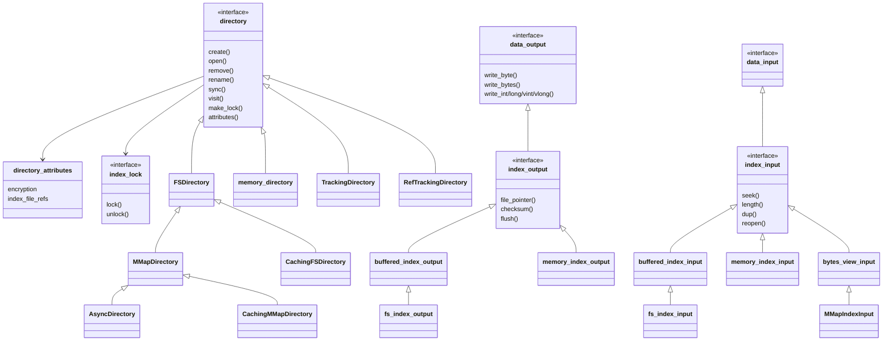

| 要素 | 种类 | 职责 |
|---|---|---|
| `directory`、`index_lock`、`IOAdvice` | 接口/配置 | "平坦的、写一次读多次的文件集合" + 锁 + 访问模式提示(顺序/随机/只读一次/直接读) |
| `FSDirectory`(`fs_index_input/output`、`file_handle`、`pooled_fs_index_input`、`fs_lock`) | 实现 | 普通文件;输入句柄可池化以限制文件描述符 |
| `MMapDirectory`(`MMapIndexInput`)、`CachingMMapDirectory` | 实现 | 内存映射读 |
| `AsyncDirectory`(`URing`、`AsyncFile`、`AsyncIndexOutput`、`SegregatedBuffer`) | 实现 | `io_uring` 异步写(Linux) |
| `CachingDirectoryBase<Impl>`、`CachingFSDirectory`、`CachingHelper` | 装饰/实现 | 缓存打开的文件句柄 |
| `memory_directory`(`memory_file`、`memory_index_input/output`、`memory_output`、`single_instance_lock`) | 实现 | 全内存目录;`memory_output`(文件 + 流)在 `columnstore2::column`、`field_writer` 里当 "块缓冲" 用 |
| `data_input`/`index_input`/`buffered_index_input`/`input_buf`;`data_output`/`index_output`/`buffered_index_output`/`output_buf` | 接口/基类 | 读写流抽象;`input_buf`/`output_buf` 适配成 `std::streambuf`(给 OpenFST 的序列化用) |
| `store_utils.hpp`:`read_write_helper`、`bytes_output`、`bytes_view_input`、`remapped_bytes_view_input`、`enum_hash` | 工具 | 读写助手、内存字节流、`shift_pack_32/64`、`write_string`、zigzag 等 |
| `store_avg_utils.hpp`(`encode::avg`) | 工具 | 偏移表的 "均值 + 残差" 编码 |
| `directory_attributes`:`encryption`、`encryption::stream`、`index_file_refs`、`directory_attributes` | 配置/数据 | 目录级属性:加密、文件引用计数 |
| `directory_cleaner` | 工具 | 清理没有被任何快照引用的文件 |

### 3.3 `analysis/`:分词器(35 个文件)

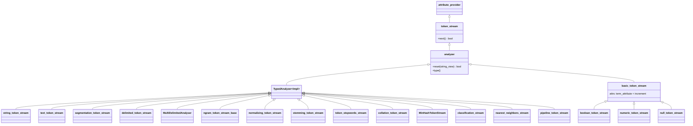

| 要素 | 种类 | 职责 / 依赖 |
|---|---|---|
| `token_stream`、`analyzer`、`TypedAnalyzer<Impl>`、`empty_analyzer` | 接口/基类 | `next()` 推进游标,数据靠属性;`reset(text)` 装入输入 |
| `token_attributes.hpp`:`term_attribute`、`increment`、`offset`、`payload`、`document`、`frequency`、`position`、`granularity_prefix`、`attribute_provider_change` | 数据(属性) | 每个 token 的 term 字节、位置增量、偏移、附加字节;`document/frequency/position` 其实是**倒排迭代器**用的属性 |
| `token_streams.hpp`:`basic_token_stream`、`boolean_token_stream`、`string_token_stream`、`numeric_token_stream`(含 `numeric_term`)、`null_token_stream` | 实现 | **不分词**的 "字段值 → term" 转换:布尔、整串、数值(多精度)、空值 |
| `text_token_stream`(依赖 ICU `BreakIterator`、`Normalizer2`、`Transliterator`、snowball) | 实现 | 完整的文本分析链:断词、归一、停用词、词干、n-gram |
| `segmentation_token_stream`(Boost.Text 的 word_break/case_mapping) | 实现 | Unicode 分词 + 大小写转换(`index-put` 的默认分析器) |
| `delimited_token_stream`、`MultiDelimitedAnalyser`(多种变体 + `TrieNode`,用 FST 的 `union/determinize`) | 实现 | 按分隔符切分 |
| `ngram_token_stream`(`ngram_token_stream_base`,`InputType`、`EmitOriginal` 选项) | 实现 | 字符/字节 n-gram |
| `normalizing_token_stream`(ICU)、`stemming_token_stream`(snowball)、`token_stopwords_stream` | 实现 | 单一职责的过滤器,通常放进 pipeline |
| `collation_token_stream`(ICU `Collator`) | 实现 | 排序键 term |
| `MinHashTokenStream`(`MinHash`)、`classification_stream`、`nearest_neighbors_stream`(fastText) | 实现 | 相似度/分类/近邻 |
| `pipeline_token_stream`(`sub_analyzer_t`) | 组合 | 把多个 analyzer 串起来,`get_mutable` 向后查找属性(见 2.1) |
| `analyzers.hpp/.cpp`:`analyzer_registrar`、`analyzer_register`、`analyzers::get/exists/normalize/visit/load_all`、`MakeAnalyzer`/`NormalizeAnalyzer`(velocypack) | 注册表 | 按名字 + 参数格式(JSON/TEXT/VPACK)创建 |

### 3.4 `formats/`:磁盘格式(20 个文件)

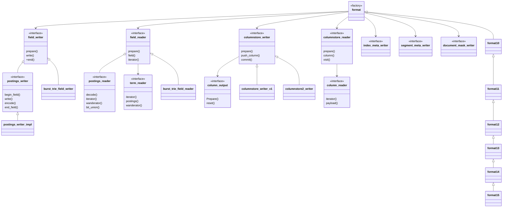

| 要素 | 种类 | 职责 |
|---|---|---|
图中 `burst_trie_field_writer`、`postings_writer_impl`、`columnstore_writer_v1`、`columnstore2_writer` 等是**为了区分同名而起的示意名**,源码里它们分别是 `burst_trie::field_writer`(及对应 `field_reader`)、`postings_writer<FormatTraits>`、`columnstore::writer`、`columnstore2::writer`。

图中 `burst_trie_field_writer`、`postings_writer_impl`、`columnstore_writer_v1`、`columnstore2_writer` 等是**为了区分同名而起的示意名**,源码里它们分别是 `burst_trie::field_writer`(及对应 `field_reader`)、`postings_writer<FormatTraits>`、`columnstore::writer`、`columnstore2::writer`。

| **接口层**(`formats.hpp`):`format`、`field_writer/field_reader`、`basic_term_reader`/`term_reader`、`postings_writer/postings_reader`、`columnstore_writer/reader`、`column_output`、`column_reader`、`index_meta_writer/reader`、`segment_meta_writer/reader`、`document_mask_writer/reader` | 接口 | 一个 segment 的**所有文件种类**各有一对读写接口 |
| **参数/状态**:`flush_state`、`ReaderState`、`SegmentWriterOptions`、`WanderatorOptions`、`WandInfo`、`FieldStats`、`term_meta`、`seek_cookie`、`SeekMode`、`ColumnHint` | 配置/数据 | 写时给 writer 的上下文(目录、docmap、列提供者、feature、scorers、文档数),读时的上下文 |
| **倒排:term 字典**(`formats_burst_trie.cpp`):`field_writer`(`block_t`、`entry`、`prefixed_output`、`fst_buffer`)、`field_reader`、`term_reader`、`term_iterator_base`、`block_iterator`、`single_term_iterator`、`automaton_term_iterator`、`term_reader_visitor`、`dumper` | 实现 | burst-trie 块 + FST 前缀索引;支持精确/范围/自动机三种 term 遍历 |
| **倒排:postings**(`formats_10.cpp`):`postings_writer_base`/`postings_writer<FormatTraits>`、`postings_reader<…>`、`doc_iterator`、`wanderator`、`single_doc_iterator`、`doc_buffer/pos_buffer/pay_buffer`、`format_traits`(标量)/`format_traits_sse4`(SIMD)、`term_meta`(10 版) | 实现 | `.doc/.pos/.pay` 的编解码,128 一块位打包,支持跳表和 wand |
| `skip_list.hpp`:`SkipWriter`、`SkipReaderBase`、`SkipReader`、`Level` | 工具 | 多级跳表 |
| `wand_writer.hpp`:`WandWriterImpl`、`WandScorer`、`FreqNormProducer`、`FreqNormSource`、`WandTag` | 实现 | wand(块最大分数)写入 |
| **列存 v1**(`columnstore.cpp`):`writer`、`column`、`meta_writer/meta_reader`、`block_cache`、`sparse_block/dense_block/dense_fixed_offset_block/sparse_mask_block/dense_mask_block`、对应的读列类 | 实现 | LZ4 压缩的块列存(format 1_0~1_3) |
| **列存 v2**(`columnstore2`):`writer`、`column`(`address_table`、`column_block`)、`column_header`、`ColumnType`、`ColumnProperty`;读侧 `reader`、`mask_column`、`fixed_length_column`、`dense_fixed_length_column`、`sparse_column` | 实现 | 稀疏位图 + 均值残差偏移表 + 定长/稀疏列(format 1_4+) |
| `sparse_bitmap.hpp`:`sparse_bitmap_writer`、`sparse_bitmap_iterator`、`SparseBitmapVersion`、`value_index` | 工具 | 65536 为一块的稀疏位图(dense/sparse/range 三种块) |
| **元数据**(`formats_10.cpp`):`IndexMetaWriter/Reader`、`SegmentMetaWriter/Reader`、`DocumentMaskWriter/Reader` | 实现 | `segments_N`、`.sm`、`.doc_mask` |
| **版本类**:`format10`~`format15`、`format12simd`~`format15simd` | 实现 | 通过继承逐级覆盖工厂方法 |
| `format_utils`:`write_header/footer`、`check_header`、`checksum`、`validate_footer` | 工具 | 统一的文件头尾与校验 |
| `empty_term_reader` | 空对象 | 字段不存在时的占位 |
| `formats.cpp`:`format_register`、`formats::get/exists/visit/init/load_all` | 注册表 | 按名字找 format |

### 3.5 `index/`:写入、读取、元数据(38 个文件)

按职责分成**写入侧**、**读取侧**、**元数据**三组:

| 组 | 要素 | 种类 | 职责 |
|---|---|---|---|
| **写入:入口** | `IndexWriter`、`IndexWriterOptions`/`SegmentOptions`、`OpenMode`、`CommitInfo`、`ConsolidationPolicy`/`ConsolidationResult`/`ConsolidationError`、`ProgressReportCallback`、`PayloadProvider` | 实现/配置 | 对外的唯一写入口;多线程安全 |
| **写入:事务与上下文** | `Transaction`、`Document`、`QueryContext`、`ActiveSegmentContext`、`PendingSegmentContext`、`SegmentContext`、`FlushContext`、`FlushedSegment`、`ImportContext`、`ConsolidationContext`、`SegmentLimits`、`PendingBase/PendingContext/PendingState` | 数据/实现 | 一个事务怎样借出段、怎样登记到 `FlushContext`、怎样两阶段提交 |
| **写入:段内缓冲** | `segment_writer`(`stored_column`、`sorted_column`、`DocsMask`、`Action`、`DocContext`) | 实现 | 一个段的写事务调度者 |
| | `fields_data`、`field_data`、`cached_column`、`postings`、`posting` | 实现/数据 | 内存倒排(`byte_block_pool` + `int_block_pool`)与缓存列 |
| | `BufferedColumn`、`BufferedValue`、`BufferedColumnIterator` | 实现 | flush 前可重排、可读的列暂存 |
| | `Comparer`、`UseDenseSort` | 接口 | 排序键比较 |
| **特征(feature)** | `IndexFeatures`、`FeatureWriter`、`FeatureWriterFactory`、`FeatureInfoProvider`、`feature_map_t/feature_set_t/features_t`;`norm.hpp`:`Norm`、`Norm2`、`Norm2Header`、`Norm2Writer<T>`、`NormReaderContext`、`NormWriter` | 接口/实现/配置 | 每文档一个值的字段级统计(norm) |
| | `ColumnInfo`、`ColumnInfoProvider` | 配置 | 按列名给压缩/加密/prev_doc 设置 |
| **合并** | `MergeWriter`(`ReaderCtx`)及 `.cpp` 里的 `CompoundTermIterator`、`CompoundFieldIterator`、`CompoundDocIterator`、`SortingCompoundDocIterator`、`RemappingDocIterator`、`CompoundColumnIterator`、`BufferedColumns`、`PrimarySortIteratorAdapter`、`MergeContext`、`ProgressTracker`;`heap_iterator.hpp`:`ExternalMergeIterator` | 实现 | 多路归并若干个 `SubReader`,产出一个新段 |
| **读取:读者** | `IndexReader`、`SubReader`、`ColumnProvider`、`DirectoryReader`(`DirectoryReaderImpl`)、`SegmentReader`(`SegmentReaderImpl`)、`CompositeReaderImpl<Readers>`、`EmptySubReader` | 接口/实现 | 见 2.5、2.11 |
| | `IndexReaderOptions`、`WandContext`、`ColumnWarmupCallback`、`ScorersView` | 配置 | 打开读者时的开关(加载哪些部分、wand 用的 scorer) |
| **读取:迭代器接口** | `doc_iterator`、`resettable_doc_iterator`、`term_iterator`、`seek_term_iterator`、`SeekResult`、`field_iterator`、`column_iterator` + `Empty*` 实现;`seek/seek_min/skip` 模板 | 接口 | 读取抽象的核心,formats 与 search 的粘合剂 |
| | `SegmentReaderImpl.cpp`:`AllIterator`、`MaskDocIterator`/`MaskedDocIterator` | 实现 | 给迭代器套上 "已删除文档" 的屏蔽 |
| **元数据** | `SegmentInfo`、`SegmentMeta`、`IndexSegment`、`IndexMeta`、`DirectoryMeta` | 数据 | 索引 → 段 → 文件 的层级描述 |
| | `field_meta`、`field_stats` | 数据 | 字段名/特征;每文档每字段的 token 统计 |
| | `file_names`:`file_name(...)` | 工具 | `<segment>.<ext>` 等命名 |

**写入侧在代码里最容易找不到的一点**:`Action`(`INDEX/STORE/STORE_SORTED`)与 `Field` 概念**不是类**,而是模板约定(`segment_writer::insert<Action>(field)`,见文档 1.1);`IndexWriter::Document::Insert<Action>` 只是转发。

### 3.6 `search/`:检索(81 个文件)

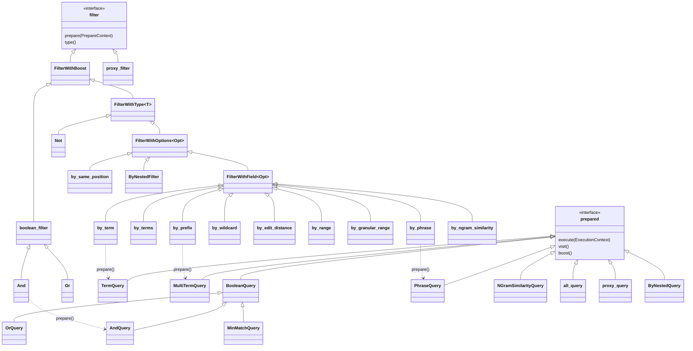

| 组 | 要素 | 种类 | 职责 |
|---|---|---|---|
| **过滤器基类** | `filter`、`filter::prepared`、`FilterWithBoost`、`FilterWithType<T>`、`FilterWithOptions<Opt>`、`FilterWithField<Opt>`、`Empty`、`PrepareContext`、`ExecutionContext` | 接口/基类/配置 | 见 2.6、2.9 |
| **用户态过滤器**(`xxx.hpp`;选项结构体 `xxx_options`) | `all`、`by_term`、`by_terms`(`search_term`)、`by_prefix`、`by_wildcard`、`by_edit_distance`(`by_edit_distance_options`)、`by_range`、`by_granular_range`、`by_phrase`(`by_phrase_options`)、`by_ngram_similarity`、`by_same_position`、`by_column_existence`、`ByNestedFilter`(`ByNestedOptions`、`Match`)、`proxy_filter`、`And`/`Or`/`Not`/`boolean_filter` | 实现/配置 | 一个字段/条件一个类 |
| **编译后查询**(`xxx_query.hpp` 或 `.cpp` 内) | `TermQuery`、`MultiTermQuery`、`BooleanQuery`(`AndQuery/OrQuery/MinMatchQuery`)、`PhraseQuery`(`FixedPhraseQuery/VariadicPhraseQuery`)、`NGramSimilarityQuery`、`all_query`、`same_position_query`、`column_existence_query`、`ByNestedQuery`、`proxy_query`、`EmptyQuery` | 实现 | `prepare()` 的产物,`execute()` 按段产出迭代器 |
| **每段状态** | `StatesCache<State>`、`TermState`、`MultiTermState`(`ScoredTermState`)、`FixedPhraseState`/`VariadicPhraseState`、`NGramState` | 数据 | `SubReader*` → 该段里 term 的位置(`seek_cookie`)和统计偏移 |
| **多 term 收集** | `limited_sample_collector`、`top_terms_collector`、`all_terms_collector`、`multiterm_visitor`、`filter_visitor`、`PreparedStateVisitor` | 工具/访问者 | 前缀/通配/范围/模糊展开出很多 term 时,只对 `scored_terms_limit`(默认 1024)个打分 |
| **迭代器代数** | `Conjunction`/`BlockConjunction`、`disjunction` 家族(`unary_disjunction`、`basic_disjunction`、`small_disjunction`、`disjunction`、`block_disjunction`)、`MinMatchDisjunction`、`exclusion`、`AllIterator`、`bitset_doc_iterator`、`PhraseIterator`、`NGramSimilarityDocIterator`、`same_position_iterator`、`ChildToParentJoin`(嵌套)、`lazy_bitset_iterator`、`ScoreAdapter`/`SubScores` | 实现 | 合取按 cost 升序、析取按子数选实现;子迭代器的分数通过 `score` 属性合并 |
| **属性** | `cost`、`score`(`UpperBounds`)、`prev_doc`、`filter_boost` | 数据(属性) | 迭代器暴露的元信息 |
| **打分** | `Scorer`、`ScorerBase<Impl,Stats>`、`Scorers`(`ScorerBucket`)、`ScoreFunction`/`score_ctx`、`ScoreMergeType`、`SumMerger/MaxMerger/MinMerger`、`Aggregator`、`ScoreBuffer`、`NoopAggregator`、`WandType` | 接口/实现 | 见 5.2 |
| | `FieldCollector`、`TermCollector`、`collectors.hpp`:`field_collectors`、`term_collectors`、`collector_wrapper`、`collectors_base` | 接口/工具 | 收集字段/term 统计,供 `Scorer::collect` 汇总 |
| | `BM25`(`BM25Stats`、`BM25FieldCollector`、`BM1Context/BM15Context/BM25Context`、`BM25NormAdapter`)、`TFIDF`(同构)、`BoostScore` | 实现 | 内置打分器 |
| | `WandWriter`、`WandSource`、`WanderatorOptions`(formats) | 接口 | 块最大分数的写入与读取 |
| | `scorers.hpp/.cpp`:`scorer_registrar`、`scorer_register`、`scorers::get` | 注册表 | 按名字+参数创建 |
| **辅助** | `AllDocsProvider`、`search_range<T>`、`BoundType` | 工具 | "全部文档" 的复用、范围边界 |

### 3.7 `error/` 与全局基础

| 要素 | 职责 |
|---|---|
| `error/error.hpp`:`ErrorCode`、`error_base`、`detailed_error_base`、`not_supported`、`io_error`、`lock_obtain_failed`、`file_not_found`、`index_not_found`、`index_error`、`not_impl_error`、`illegal_argument`、`illegal_state` | 异常类型层次 |
| `shared.hpp`、`types.hpp` | 宏(`IRS_ASSERT`、`IRS_FORCE_INLINE`、`IRS_LIKELY`…)和全局别名:`byte_type`、`field_id`、`doc_id_t`、`score_t` |
| `resource_manager.hpp` | 见 2.10 |

---

## 4. 索引构建:要素、类、配置

> 本章只回答三件事:**构建索引时涉及哪些实体、它们怎么组织、需要哪些配置**。线程怎么协作、字节怎么落盘分别在 [writer_threads_collaboration.md](study/writer_threads_collaboration.md) 和 [field_write_memory_flush_pipeline.md](study/field_write_memory_flush_pipeline.md)。

### 4.1 全景类图(写入侧)

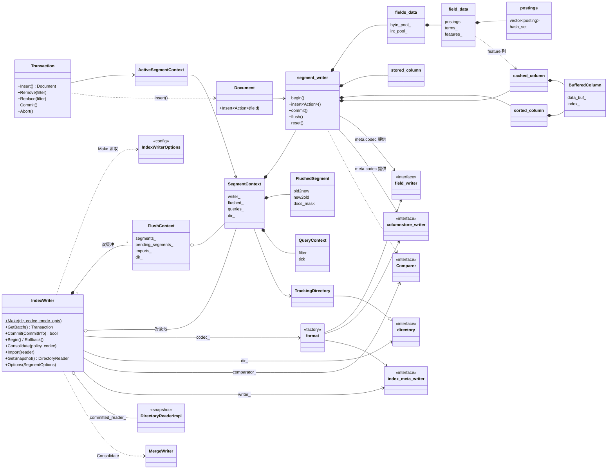

### 4.2 构建索引所涉及的实体

按 "输入 → 过程 → 输出" 分五类:

| 类别 | 实体 | 是谁 | 生命周期 / 数量 |
|---|---|---|---|
| **输入** | `Field`(**不是类**,是模板约定) | 提供 `name()`、`get_tokens()`、`features()`、`index_features()`、`write(data_output&)` | 调用方的对象,由 `Insert<Action>(field)` 引用,可跨文档复用 |
| | `Action`(`INDEX`、`STORE`、`STORE_SORTED` 及组合) | 告诉 `segment_writer` 这个字段走哪条路径 | 编译期模板参数 |
| | `analyzer` / `token_stream` | `Field::get_tokens()` 的返回值,把字段值切成 term | 调用方持有,按字段复用 |
| | `filter`(删除/替换条件) | `Transaction::Remove/Replace` 的参数 | 调用方保证存活到 commit,或交给 `QueryContext` 持有 |
| **事务层** | `IndexWriter` | 全局唯一写入口,线程安全 | 每个目录一个,持有 `write.lock` |
| | `Transaction` | 一个线程的写事务,**非线程安全**,每线程各一个 | `GetBatch()` 创建,析构时自动 `Commit()` |
| | `Document` | 一篇文档的 RAII 句柄:构造时 `segment_writer::begin`,析构时 `commit`(失败则 `rollback`) | 一次 `Transaction::Insert()` 一个 |
| | `ActiveSegmentContext` / `SegmentContext` / `PendingSegmentContext` | 事务正在使用的 "段写入上下文";从池里借出,commit 时还回 | 数量上限 `segment_count_max`,池大小 `segment_pool_size` |
| | `FlushContext` | 一次 commit 周期里收集到的所有段 | 全局 **2 个**,轮换 |
| | `QueryContext` | 一次 `Remove/Replace` 的过滤器 + tick | 随 `SegmentContext::queries_` |
| **段缓冲层** | `segment_writer` | 一个段的内存写事务 | 与 `SegmentContext` 同寿,flush 后 `reset()` 复用 |
| | `fields_data` → `field_data` → `postings`/`posting` | 内存倒排 | 每段一个 `fields_data`,每字段一个 `field_data` |
| | `byte_block_pool`、`int_block_pool` | 倒排流和指针的内存池 | 每个 `fields_data` 一对,块跨段复用 |
| | `stored_column` → `cached_column`/`column_output` | STORE 列 | 每列一个,按名字哈希 |
| | `sorted_column` | 排序列的暂存 | 每段一个 |
| | `BufferedColumn` | 有 comparator 时所有列的暂存区 | 见文档 2.10 |
| | `FeatureWriter`(`Norm2Writer`) | 每字段每 feature 一个 | 由 `FeatureInfoProvider` 的工厂创建 |
| **格式层** | `format` | 本次写入使用的编解码器 | `IndexWriter::codec_`,每个 `SegmentMeta::codec` |
| | `field_writer` + `postings_writer`、`columnstore_writer`、`segment_meta_writer`、`document_mask_writer`、`index_meta_writer` | flush/commit 时才真正写文件 | `segment_writer` 持有前两个(`reset(meta)` 时从 codec 取) |
| | `flush_state` | 一次 flush 传给 writer 的上下文 | 栈上构造 |
| **输出** | 段文件(`.tm .ti .doc .pos .pay .csd .csi .sm .doc_mask`)、`segments_N` | 见文档 3.4 | `TrackingDirectory` 记录了这次写了哪些 |
| | `IndexMeta` / `SegmentMeta` / `IndexSegment` / `DirectoryMeta` | 描述 "索引包含哪些段、各有哪些文件" | 内存里先构造,commit 时由 `index_meta_writer` 序列化 |
| | `DirectoryReaderImpl`(`committed_reader_`) | commit 之后立刻生成的新快照 | 原子替换,供检索使用 |

### 4.3 配置清单

**(a) 打开写者:`IndexWriter::Make(dir, codec, mode, opts)`**

| 配置 | 类型 / 默认 | 谁读取 | 影响 |
|---|---|---|---|
| `dir` | `directory&` | `IndexWriter::dir_`、`TrackingDirectory` | 文件落在哪:`FSDirectory`/`MMapDirectory`/`memory_directory`;目录的 `directory_attributes` 决定**加密**和**文件引用计数** |
| `codec` | `format::ptr`(如 `formats::get("1_4")`) | `SegmentMeta::codec`、`segment_writer::reset` | 列存版本(1_4+ 用 `columnstore2`)、是否有 `Norm2`/wand、倒排块编码(SIMD 与否)——**整个 segment 的磁盘格式由它决定** |
| `mode` | `OM_CREATE` / `OM_APPEND`(可组合) | `Make` | 新建(清空)还是追加;`OM_CREATE` 时仍会读旧元数据只为取版本号 |
| `opts.lock_repository` | `bool = true` | `Make` | 是否拿 `write.lock`,防止多个写者同时写一个目录(拿不到抛 `lock_obtain_failed`) |
| `opts.segment_pool_size` | `size_t = 128` | `segment_writer_pool_` | 缓存多少个可复用的 `SegmentContext`(0=不缓存) |
| `opts.segment_count_max` | `size_t = 0`(无限) | `GetSegmentContext` | 同时活跃的段上限,超了线程要等 |
| `opts.segment_memory_max` | `size_t = 0` | `FlushRequired`:与 `segment_writer::memory_active()` 比较 | 一个段内存超过多少字节就 flush |
| `opts.segment_docs_max` | `uint32 = 0` | `FlushRequired`:与 `buffered_docs()` 比较 | 一个段文档数(含已屏蔽)超过多少就 flush |
| `opts.comparator` | `const Comparer* = nullptr` | `IndexWriter::comparator_` → `segment_writer`/`fields_data` | **主排序键**:有它才允许 `STORE_SORTED`;所有缓冲列改为 `BufferedColumn`;倒排用随机访问布局(cookie) |
| `opts.column_info` | `ColumnInfoProvider`(默认:无压缩、无加密) | `segment_writer`、`columnstore_writer` | 按**列名**配置压缩/加密/`track_prev_doc` |
| `opts.features` | `FeatureInfoProvider`(默认:无 writer) | `field_data` 构造 | 按 feature 类型给 `ColumnInfo` + `FeatureWriterFactory`(如 `Norm2::MakeWriter`),**没有工厂就不会产生 norm 列** |
| `opts.meta_payload_provider` | `PayloadProvider` | `InitMeta` | 把自定义字节写进 `IndexMeta` |
| `opts.reader_options` | `IndexReaderOptions` | 初次打开的 `DirectoryReaderImpl`,以及 `wand_scorers_` | 其中 **`scorers`** 决定 wand(写入时额外写块最大分数)和哪些 feature 要走 `BufferedColumn`;**`resource_manager`** 的 5 个记账点必须全部非空(`IRS_ASSERT`) |

**(b) 每篇文档、每个字段**

| 配置 | 来源 | 影响 |
|---|---|---|
| `Action` | 调用 `Insert<Action>` 时选 | INDEX 倒排;STORE 列存;STORE_SORTED 排序列 |
| `field.index_features()` | 字段对象 | `FREQ/POS/OFFS/PAY`:倒排里存词频、位置、偏移、payload(同名字段再次出现时,其 `index_features` 必须是首次出现时的子集,否则该文档写入失败) |
| `field.features()` | 字段对象(类型 id 列表) | 需要哪些 feature 列(`Norm2` 等);`granularity_prefix` 之类只是标记 |
| `field.get_tokens()` 的 analyzer 与它的参数 | 调用方 | term 的内容与位置 |
| 列名 `field.name()` | 字段对象 | STORE 列按名字找列,`ColumnInfoProvider` 也按名字取配置 |

**(c) 运行期、提交、合并**

| 配置 | 位置 | 影响 |
|---|---|---|
| `IndexWriter::Options(SegmentOptions)` | 运行时可改 | 下一次 commit 起生效 |
| `CommitInfo{tick, progress, reopen_columnstore}` | `Commit/Begin` | `tick`:截断到哪个事务;`progress`:进度回调;`reopen_columnstore`:提交后重新打开列存 |
| `Consolidate(policy, codec, progress)` | 合并 | `ConsolidationPolicy`(`ConsolidateTier{min/max_segments, max_segments_bytes, floor_segment_bytes, min_score}` 等)决定选哪些段;`codec` 可换格式;`progress` 返回 false 则中止 |
| `ResourceManagementOptions` | `IndexReaderOptions::resource_manager` | 5 个记账点:`transactions`(写入缓冲)、`readers`、`consolidations`、`file_descriptors`、`cached_columns` |

### 4.4 配置如何流向各个类

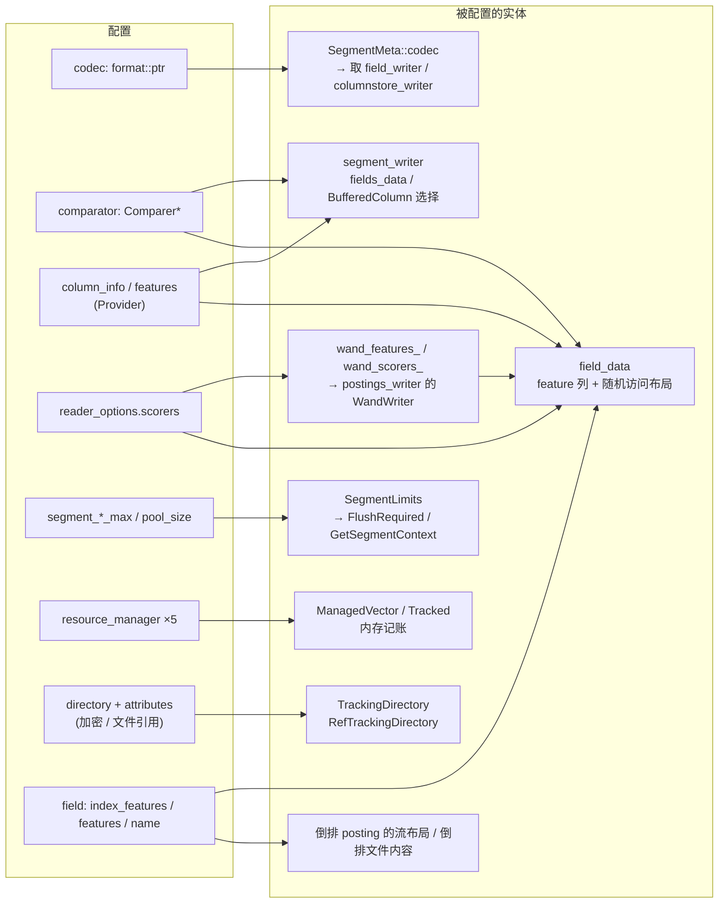

读法:**`comparator` 和 `reader_options.scorers` 是两个 "开关式" 配置**——前者让整段数据走 "暂存 → 重排" 路径,后者让倒排里额外写 wand 数据并让 norm 列走暂存。其余配置多是参数。

### 4.5 实体是怎么被一个个创建出来的(对象谱系)

| 谁创建 | 创建什么 | 位置 |
|---|---|---|
| 用户 | `IndexWriter::Make(...)` | 调用 |
| `Make` | 读 `segments_N` → `DirectoryReaderImpl`(`committed_reader_`)、`index_meta_writer`、`write.lock`、2 个 `FlushContext`(各带一个 `RefTrackingDirectory`)、`segment_writer_pool_` | [index_writer.cpp:1222-1305](core/index/index_writer.cpp#L1222-L1305) |
| 构造函数 | `wand_scorers_` ← `committed_reader_->Options().scorers`;`wand_features_` ← 每个 scorer 的 `get_features` | [index_writer.cpp:1167-1170](core/index/index_writer.cpp#L1167-L1170) |
| 用户线程 | `GetBatch()` → `Transaction`;`Transaction::Insert()` → `UpdateSegment` → `GetSegmentContext()` | [index_writer.cpp:1748-1803](core/index/index_writer.cpp#L1748-L1803) |
| `GetSegmentContext` | 从 `FlushContext` 的 freelist 复用,或 `segment_writer_pool_.emplace(...)` 建新的 `SegmentContext`(带 `meta_generator_`,首次用时才生成段名 `_N`) | 同上 |
| `SegmentContext` 构造函数 | `segment_writer::make(dir_, SegmentWriterOptions{column_info, feature_info, scorers_features, scorers, comparator, resource_manager})`(参数来自 `IndexWriter::GetSegmentWriterOptions`) | [index_writer.cpp:959-969](core/index/index_writer.cpp#L959-L969)、[1806-1816](core/index/index_writer.cpp#L1806-L1816) |
| `SegmentContext::Prepare()` | 调 `meta_generator_()` 生成 `SegmentMeta`(此时才确定段名 `_N`),再 `segment_writer::reset(meta)`:`meta.codec->get_field_writer(...)`、`get_columnstore_writer(...)`;`col_writer_->prepare(dir, meta)`(创建 `.csd` 并写 header) | [index_writer.cpp:1014-1019](core/index/index_writer.cpp#L1014-L1019)、[segment_writer.cpp:312-332](core/index/segment_writer.cpp#L312-L332) |
| `Transaction::Insert()` | `Document{segment, DocContext}` → `segment_writer::begin(ctx)` | [index_writer.cpp:697-705](core/index/index_writer.cpp#L697-L705) |
| `segment_writer::index` | `fields_data::emplace(name)` → `field_data`(构造里调 `FeatureInfoProvider`、建 `Norm2Writer` 和 `cached_column`) | [field_data.cpp:680-727](core/index/field_data.cpp#L680-L727) |
| `segment_writer::stream` | `stored_column`(要么 `push_column` 直写,要么 `cached_column`) | [segment_writer.cpp:52-74](core/index/segment_writer.cpp#L52-L74) |
| `SegmentContext::Flush` | `segment_writer::flush` 内:`FlushFields` → `field_writer::prepare/write/end`;`columnstore_writer::commit` | [index_writer.cpp:971-1005](core/index/index_writer.cpp#L971-L1005) |
| `Commit` → `PrepareFlush` | `FlushedSegmentContext`、`IndexMeta`、`SegmentReader`(读新段)、`index_meta_writer::prepare/commit` | [index_writer.cpp](core/index/index_writer.cpp) |

### 4.6 构建过程的一张时序图(只画类之间的调用)

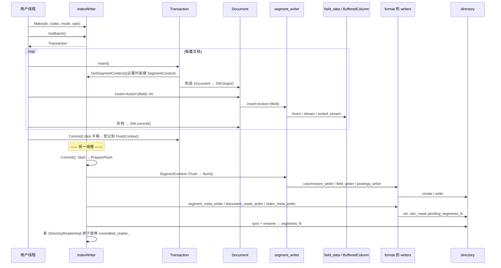

### 4.7 合并(consolidation)在类图里的位置

`IndexWriter::Consolidate(policy, codec, progress)`:

1. `ConsolidationPolicy`(策略)在 **`consolidation_lock_`** 下选候选 `Consolidation = vector<const SubReader*>`,排除 `consolidating_segments_`;
2. 创建 `MergeWriter(dir, SegmentWriterOptions)` + `ReaderCtx`(每个源 `SubReader` 带 `doc_id_map`);
3. `MergeWriter::Flush(segment_meta)` 用 `CompoundFieldIterator/CompoundTermIterator/CompoundDocIterator`(有排序时用 `SortingCompoundDocIterator` + `PrimarySortIteratorAdapter`)多路归并**读取侧的迭代器**,直接喂给同一套 `field_writer`/`columnstore_writer`——**不经过 `segment_writer` 的内存倒排**;
4. 结果以 `ImportContext` 挂进 `FlushContext::imports_`,下一次 commit 才生效。

要点:**写入与合并共用 `format` 提供的 writer**,区别只在 "数据来源是 `segment_writer` 的内存结构还是读者的迭代器"。细节见 [consolidation_merge_workflow.md](study/consolidation_merge_workflow.md)。

---

## 5. 检索:要素、类、配置

> 本章同样只回答 "有哪些实体、怎么组织、需要哪些配置"。执行轨迹(prepare / execute / 迭代 / NRT)在 [search_retrieval_pipeline.md](study/search_retrieval_pipeline.md)。

### 5.1 全景类图

**(A) 读者与读取接口**(把磁盘上的段变成可查询的对象)

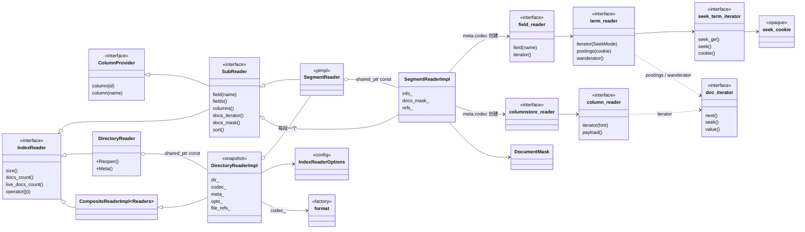

**(B) 查询、统计与打分**

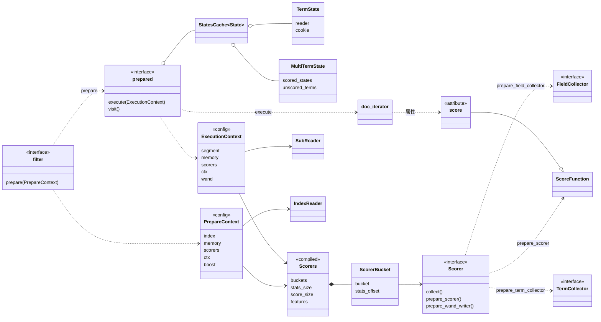

### 5.2 检索所涉及的实体

| 类别 | 实体 | 是谁 | 生命周期 / 数量 |
|---|---|---|---|
| **读者(快照)** | `DirectoryReader`(外壳)→ `DirectoryReaderImpl` | 一次 commit 对应的**不可变**索引快照;`size()` = 段数 | `IndexWriter::GetSnapshot()` 或 `DirectoryReader(dir, codec, opts)`;`shared_ptr`,多线程共享;`Reopen()` 复用未变的段 |
| | `SegmentReader` → `SegmentReaderImpl`(= `SubReader`) | 一个段;持有该段所有文件的引用计数 | 每段一个,随快照存亡 |
| | `ColumnProvider` | 按 id 或名字取列(`SegmentReaderImpl` 同时实现了它) | - |
| **读取接口** | `field_reader` | 一个段里所有字段的 "term 字典" 入口 | 由 `meta.codec->get_field_reader()` 创建 |
| | `term_reader`(每字段一个) | 一个字段的 term 字典:找 term、枚举 term、产出 postings | `field_reader::field(name)` |
| | `seek_term_iterator` / `seek_cookie` | term 迭代与 "term 位置" 的不透明句柄 | 查询期临时;`cookie` 被缓存进 `TermState` |
| | `postings_reader`(`formats_10.cpp` 内部) | 解码 `.doc/.pos/.pay`,产出带属性的 `doc_iterator` | 随 `field_reader` |
| | `columnstore_reader` → `column_reader` | 列存(`.csd/.csi`):norm、STORE 列、排序列 | 每段一个 |
| | `DocumentMask` | 被删文档集合 | 随 `SegmentReaderImpl` |
| **查询描述** | `filter` 家族 | 用户态,只描述 "查什么"(字段、term、选项、boost) | 调用方持有,可复用 |
| | `analyzer`(`token_stream`) | 把查询文本切成 term | 调用方持有 |
| **编译后** | `prepared` 家族 | **跨段**的编译结果(状态缓存 + 统计 + boost) | `prepare()` 产出,`managed_ptr<const prepared>`,可对每个段、每个线程反复 `execute` |
| | `StatesCache<State>` | `SubReader*` → 该段里的 term 状态 | 内含 `TermState`/`MultiTermState` 等 |
| **打分** | `Scorer`(`BM25`、`TFIDF`、`BoostScore`) | 打分算法的 "类" | `scorers::get(name, fmt, args)` 或直接构造 |
| | `Scorers`(`ScorerBucket`) | 若干 scorer 编译成的有序集合,算好总的 stats/score 字节数 | `Scorers::Prepare(...)` |
| | `FieldCollector` / `TermCollector` | 每个匹配字段、每个匹配 term 一个,收集统计 | `prepare()` 时创建,收集完 `finish` 写进 stats 缓冲 |
| | `ScoreFunction`(`score_ctx` + 函数指针) | 每个迭代器上的 "算分函数" | `Scorer::prepare_scorer` 创建,装进迭代器的 `score` 属性 |
| | `WandContext`(index、strict、root)、`WandWriter`/`WandSource` | 块最大分数的剪枝 | `ExecutionContext::wand` |
| **输出** | `doc_iterator`(带 `document`、`score`、`cost` 等属性) | 一个段上的匹配流 | `execute()` 产出,调用方逐段消费 |

### 5.3 配置清单

**(a) 打开读者**

| 配置 | 类型 / 默认 | 影响 |
|---|---|---|
| `dir` | `const directory&` | 读哪里;决定是否 mmap(`MMapDirectory`)等 |
| `codec` | `format::ptr`(`nullptr` = 按所有已知 codec 里**最新**的 `segments_N` 打开) | 解释文件的方式;每个段还有自己的 `meta.codec` |
| `IndexReaderOptions::index` | `bool = true` | 是否打开倒排(`field_reader::prepare`) |
| `::columnstore` | `bool = true` | 是否打开列存 |
| `::doc_mask` | `bool = true` | 是否读取删除标记 |
| `::scorers` | `ScorersView`(默认空) | **启用 wand 所必需**:写入时用同一批 scorer 写过块最大分数,打开时 `ReaderState::scorers` 告诉 `postings_reader` 怎么读 |
| `::warmup_columns` | `ColumnWarmupCallback` | 选出 "热" 列,预先读进内存(`columnstore_reader::options::warmup_column`) |
| `::resource_manager` | `ResourceManagementOptions`(5 个记账点,默认 noop) | `readers` 统计读者内存,`cached_columns`、`file_descriptors` 统计缓存列和句柄 |
| `Reopen()` | - | 复用没变的 `SegmentReaderImpl`,只打开新增/变化的段 |

**(b) 编译(`prepare`)**

| 配置 | 类型 | 影响 |
|---|---|---|
| `PrepareContext::index` | `const IndexReader&` | 在哪些段上收集统计、找 term |
| `::scorers` | `const Scorers&`(默认 `kUnordered`,即不打分) | 决定要不要收集统计、需要哪些 `IndexFeatures` |
| `::memory` | `IResourceManager&` | `prepared` 内部状态的记账 |
| `::boost` | `score_t = 1` | 沿着过滤器树逐层乘(`ctx.Boost(b)`) |
| `::ctx` | `const attribute_provider*` | 把外部上下文(如嵌套文档)带给过滤器 |
| **过滤器选项**(每个过滤器一个 `xxx_options`) | | |
| `by_term_options{term}`;`by_terms_options{terms(含各自 boost), min_match=1, merge_type=kSum}` | | 精确/多个 term |
| `by_prefix_options{term, scored_terms_limit=1024}`、`by_wildcard_options{term, scored_terms_limit=1024}`、`by_range_options{range, scored_terms_limit=1024}` | | 展开出的 term 可能很多,**只对前 `scored_terms_limit` 个打分**(`limited_sample_collector`) |
| `by_edit_distance_options{term, prefix, max_distance, with_transpositions, max_terms, provider}` | | 模糊匹配;`provider` 可替换参数化自动机的构造(昂贵) |
| `by_phrase_options`(按位置装 `by_term/prefix/wildcard/edit_distance/terms/range` 之一) | | 短语;要求字段有 `FREQ|POS` |
| `by_ngram_similarity_options{ngrams, threshold=1.0}` | | n-gram 相似度 |
| `by_same_position_options{terms(字段,term)}` | | 同一位置的多个字段 |
| `by_column_existence_options{acceptor}` | | 按列是否存在过滤 |
| `ByNestedOptions{parent, child, match, merge_type}` | | 嵌套文档(父子连接) |
| `boolean_filter`:`merge_type()`(默认 `kSum`)、`Or::min_match_count()`、`boost()` | | 布尔组合 |
| `FilterWithBoost::boost()` | `score_t` | 每个过滤器自带的 boost |
| `BM25(k=1.2, b=0.75, boost_as_score=false)`、`TFIDF(normalize=false, boost_as_score=false)` | | 打分器参数 |

**(c) 执行(`execute`)**

| 配置 | 类型 | 影响 |
|---|---|---|
| `ExecutionContext::segment` | `const SubReader&` | 在哪个段上执行 |
| `::scorers` | `const Scorers&` | 为迭代器编译 `score` 属性 |
| `::wand` | `WandContext{index, strict}`(默认 `kDisable`) | 是否启用块最大分数剪枝;`index` 是**写入时** `IndexWriter` 里该 wand 数据的序号([index_reader_options.hpp](core/index/index_reader_options.hpp) 注释:"Index of the wand data in the IndexWriter to use");查询侧用 `scorers` 里的**第一个** scorer 算分(`ExecutionContext::wand` 注释);`strict` 表示严格 top-K |
| 迭代期 | `score::Min(threshold)` | 调用方把 "当前第 K 名分数" 回灌给迭代器,迭代器据此跳块(动态剪枝,见 [index-search.cpp:726-780](utils/index-search.cpp#L726-L780)) |

**(d) 应用层**(命令行 `index-search` 暴露的选项,对应上面各项):`--threads`、`--topN`、`--scorer`/`--scorer-arg-format`/`--scorer-arg`、`--search-mode`(`all`/`wand`/`strictWand` → `kAll`/`kTop`/`kStrictTop` → `WandContext`)、`--scored-terms-limit`、`--format`。

### 5.4 配置如何流向各个类

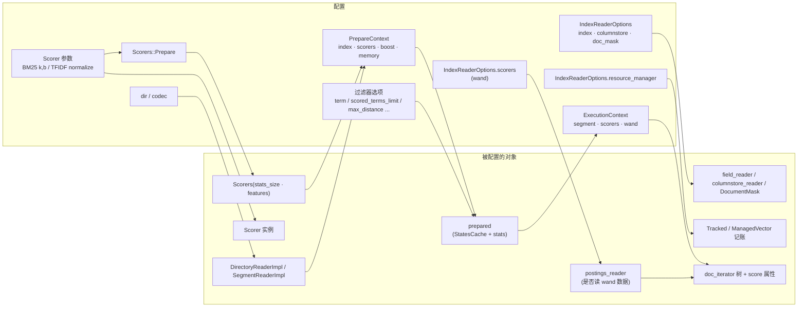

读法:**配置在三个时间点生效**:① 打开读者(`IndexReaderOptions`)决定 "能读什么";② `prepare`(`PrepareContext` + 过滤器选项)决定 "统计和 term 状态收集多少";③ `execute`(`ExecutionContext`)决定 "每段怎么迭代、要不要剪枝"。前一阶段的产物是后一阶段的输入,所以**配置不能越过阶段**(例如没在打开读者时给 `scorers`,执行时再开 wand 是无效的)。

### 5.5 对象谱系:检索一次查询时谁创建了谁

| 步骤 | 谁创建 | 创建什么 | 位置 |
|---|---|---|---|
| 1 | 用户 | `DirectoryReader(dir, codec, IndexReaderOptions)` → `DirectoryReaderImpl::Open`:读 `segments_N`(`codec->get_index_meta_reader`)得到 `DirectoryMeta`,每个段 `SegmentReader(dir, meta, opts)` | [directory_reader_impl.cpp](core/index/directory_reader_impl.cpp) |
| 2 | `SegmentReaderImpl::Open` | 读 `DocumentMask`(若 `opts.doc_mask`);`meta.codec->get_field_reader(rm.readers)`,`prepare(ReaderState{dir, meta, scorers})`(若 `opts.index`);`ColumnData::Open` 打开列存 | [segment_reader_impl.cpp:162-187](core/index/segment_reader_impl.cpp#L162-L187) |
| 3 | 用户 | `scorers::get("bm25", fmt, args)` 或 `BM25{...}`,`Scorers::Prepare(scorer)` | [index-search.cpp:525-598](utils/index-search.cpp#L525-L598) |
| 4 | 用户 | 过滤器树:`by_term`、`by_phrase`、`And`/`Or` ……,设置 `mutable_field()`、`mutable_options()` | [index-search.cpp:239-450](utils/index-search.cpp#L239-L450) |
| 5 | `filter::prepare` | `field_collectors`/`term_collectors`(每个 `Scorer` 一个 `FieldCollector`/`TermCollector`);遍历每个 `SubReader`:`segment.field(name)` → `term_reader::iterator(SeekMode)` → `seek(term)` → `cookie()` 存进 `StatesCache<TermState>`;`stats` 缓冲;最后 `make_tracked<TermQuery>` | [term_filter.cpp:92-128](core/search/term_filter.cpp#L92-L128) |
| 6 | `prepared::execute(ExecutionContext)` | `states_.find(segment)` → `term_reader::postings(cookie, features)`(或 `wanderator`)→ `doc_iterator`;`CompileScore` 把 `Scorer::prepare_scorer` 的结果装进 `score` 属性 | [term_query.cpp:35-72](core/search/term_query.cpp#L35-L72) |
| 7 | 布尔查询 | `BooleanQuery::execute` 对每个子 `prepared` 递归 `execute`,再用 `MakeConjunction/MakeDisjunction` 组合并 `exclusion` 处理 `Not` | [boolean_query.hpp](core/search/boolean_query.hpp) |
| 8 | 用户 | 逐段 `next()` 取 `document`、`score`,维护 top-K 堆并回灌 `score::Min` | [index-search.cpp:710-790](utils/index-search.cpp#L710-L790) |

### 5.6 检索侧的一个细节:同一个 `Scorer` 在三个阶段扮演三种角色

| 阶段 | `Scorer` 的方法 | 产物 | 说明 |
|---|---|---|---|
| prepare | `prepare_field_collector()`、`prepare_term_collector()` | `FieldCollector`、`TermCollector` | 每个匹配字段/ term 一个收集器 |
| prepare 结束 | `collect(stats_buf, field, term)` | `stats`(一块 `stats_size()` 字节的缓冲,`Scorers` 给每个 scorer 分配 `stats_offset`) | 把 idf、avgDL 等预先算好(BM25 的 `BM25Stats`,含 256 项 `norm_cache`) |
| execute | `prepare_scorer(segment, features, stats, doc_attrs, boost)` | `ScoreFunction` | 此时才读本段的 norm 列,绑定到 `doc_attrs`(迭代器属性)上 |
| 写入时 | `prepare_wand_writer(max_levels)` | `WandWriter` | 写 `.doc` 时顺带写每块的最大分数 |
| 读取时 | `prepare_wand_source()` | `WandSource` | 读出块最大分数,用于跳块 |

**设计上的好处**:统计收集(跨段,一次)与打分(每段每文档,热路径)分开,`ScoreFunction` 只是 "一个 `void*` 上下文 + 两个函数指针"(`score`、`min`),没有虚调用,热循环里开销最小。

---

## 6. 你阅读过程中反复查阅的类

> **依据**:本轮对话里你提问、选中代码、让我展开讲过的类,以及 `study/` 下已有笔记(`writer_threads_collaboration.md`、`concrete_walkthrough_2threads_3docs.md`、`consolidation_merge_workflow.md`、`search_retrieval_pipeline.md`、`READING_GUIDE.md`)里被反复引用的类。"频次" 是我按**涉及的不同问题数**粗分的三档(★★★ = 在 3 个以上不同问题/笔记里出现,★★ = 2 个,★ = 1 个),不是精确统计。

### 6.1 写入路径(这是你读得最深的部分)

| 类 | 文件 | 频次 | 你为什么总回头看它 | 在设计里的角色 | 本文位置 |
|---|---|---|---|---|---|
| `segment_writer` | [segment_writer.hpp/.cpp](core/index/segment_writer.hpp) | ★★★ | `insert<Action>`、`index/store/store_sorted`、`flush()` 的五步顺序、`col_writer_`/`field_writer_` 何时创建 | **一个段的写事务调度者**,把字段分发到倒排或列 | 3.5、4.1 |
| `IndexWriter` + `SegmentContext`/`FlushContext`/`ActiveSegmentContext`/`QueryContext` | [index_writer.hpp/.cpp](core/index/index_writer.hpp) | ★★★ | `SegmentContext::Flush()` 是不是真正落盘;线程协作;tick | **事务与并发层**:借出/归还段、双缓冲、两阶段提交 | 4.1、4.5 |
| `fields_data`、`field_data`、`posting`/`postings`、`cached_column` | [field_data.hpp/.cpp](core/index/field_data.hpp)、[postings.hpp](core/index/postings.hpp) | ★★★ | `new_term/add_term`、`doc_code`、cookie、`int_pool_` 槽位顺序 | **内存倒排**:term → 流指针;延迟写 | 3.5、4.2 |
| `block_pool` 家族(`byte_block_pool`、`int_block_pool`、`block_pool_sliced_inserter/reader`、`..._greedy_...`) | [block_pool.hpp](core/utils/block_pool.hpp) | ★★★ | slice 分级、扩容时搬 3 个字节、greedy slice 与 cookie | **分块只追加池 + 链式变长流** | 3.1 |
| `BufferedColumn`、`BufferedColumnIterator`、`BufferedValue`、`Comparer`、`UseDenseSort`、`DocMap` | [buffered_column.hpp/.cpp](core/index/buffered_column.hpp)、[comparer.hpp](core/index/comparer.hpp) | ★★★ | `Prepare` 的封口逻辑、`iota`、`std::prev`、dense/sparse、docmap 如何同时改写所有列 | **有排序时的列暂存区 + docmap 生成** | 3.5 |
| `columnstore2::column/writer`、`sparse_bitmap_writer`、`address_table`、`column_header` | [columnstore2.hpp/.cpp](core/formats/columnstore2.hpp)、[sparse_bitmap.hpp](core/formats/sparse_bitmap.hpp) | ★★★ | 偏移表的均值+残差、`flush_block`、位图块、`.csi` 记录 | **磁盘列存(v2)** | 3.4 |
| `field_writer`(burst trie)、`postings_writer<FormatTraits>`、`term_meta`、`SkipWriter`、`block_t`、`fst_buffer` | [formats_burst_trie.cpp](core/formats/formats_burst_trie.cpp)、[formats_10.cpp](core/formats/formats_10.cpp)、[skip_list.hpp](core/formats/skip_list.hpp) | ★★★ | `.tm/.ti/.doc/.pos` 的字节布局 | **磁盘倒排** | 3.4 |
| `Norm2`、`Norm2Writer<T>`、`Norm2Header`、`FeatureWriter`、`FeatureInfoProvider` | [norm.hpp](core/index/norm.hpp)、[index_features.hpp](core/index/index_features.hpp) | ★★ | norm 列是什么、宽度怎么定、怎么回到 `.ti` | **feature 机制**:字段级 "每文档一个值" | 3.5 |
| `token_stream`、`analyzer`、`numeric_token_stream`、`string_token_stream`、`term_attribute`、`increment`、`offset`、`payload` | [token_streams.hpp](core/analysis/token_streams.hpp)、[token_attributes.hpp](core/analysis/token_attributes.hpp) | ★★ | 数值如何拆成多个 term;"stream 里的 attr" | **属性袋的典型用法** | 2.1、3.3 |
| `Field`(`index-put.cpp` 里的示例类)、`StringComparer` | [index-put.cpp:166-350](utils/index-put.cpp#L166-L350) | ★★ | 字段需要提供哪些成员;排序列为什么是降序 | **字段 "概念" 的示例实现** | 4.2 |
| `data_output`、`bytes_io`(`vwrite`)、`shift_pack_32/64`、`write_string` | [data_output.hpp](core/store/data_output.hpp)、[bytes_utils.hpp](core/utils/bytes_utils.hpp)、[store_utils.hpp](core/store/store_utils.hpp) | ★★ | 变长整数、"输出迭代器" 式的 `*out = byte` | **序列化原语** | 2.9、3.2 |
| `TrackingDirectory`、`SegmentMeta`、`IndexSegment`、`segment_meta_writer`、`format`(`format14`)、`flush_state` | [directory_utils.hpp](core/utils/directory_utils.hpp)、[index_meta.hpp](core/index/index_meta.hpp)、[formats.hpp](core/formats/formats.hpp) | ★★ | `meta.files` 怎么来、`.sm` 写什么 | **元数据与格式抽象** | 2.3、3.2 |

### 6.2 检索与合并路径(来自已有笔记)

| 类 | 文件 | 在你的笔记里出现的位置 | 角色 |
|---|---|---|---|
| `DirectoryReader`/`DirectoryReaderImpl`、`SegmentReader`/`SegmentReaderImpl`、`SubReader`、`IndexReader` | [index_reader.hpp](core/index/index_reader.hpp) | `search_retrieval_pipeline.md` §2、§6 | 不可变快照与段读者 |
| `field_reader`、`term_reader`、`seek_term_iterator`、`seek_cookie`、`postings_reader` | [formats.hpp](core/formats/formats.hpp) | §2.3、§3 | 倒排读取接口 |
| `filter`、`prepared`、`TermQuery`、`BooleanQuery`、`StatesCache`、`TermState` | [filter.hpp](core/search/filter.hpp)、[term_query.hpp](core/search/term_query.hpp) | §4 | 查询编译与执行 |
| `Conjunction`、`disjunction`、`exclusion`、`MinMatchDisjunction` | [conjunction.hpp](core/search/conjunction.hpp) | §4.4、§5.5 | 迭代器代数 |
| `Scorers`、`BM25`、`FieldCollector`/`TermCollector`、`ScoreFunction`、`WandContext` | [scorer.hpp](core/search/scorer.hpp)、[bm25.hpp](core/search/bm25.hpp) | §4.3、§5.5(d) | 打分与剪枝 |
| `MergeWriter`、`CompoundTermIterator`、`RemappingDocIterator`、`ConsolidationPolicy` | [merge_writer.hpp](core/index/merge_writer.hpp) | `consolidation_merge_workflow.md` | 段合并 |
| `proxy_filter`、`column_existence_filter`、`by_range`/`by_granular_range` | [proxy_filter.hpp](core/search/proxy_filter.hpp) | §5 | 过滤功能 |

### 6.3 基础设施(READING_GUIDE 第 0 层,已标 ✅ 的)

`type_info`/`type<T>`、`attribute`/`attribute_provider`/`attribute_ptr`、`memory::Managed`/`managed_ptr`、`hashed_*`/`ValueRef*`、`block_pool`、`vwrite/vread/shift_pack`——这些正是本文第 2 章归纳的 "套路",所以读后面的类时遇到它们不需要再回头看实现,只需要记住**它们的契约**(见 2.1~2.10)。

### 6.4 值得下一步补读的类(你还没有展开,但本文的类图里是关键节点)

| 类 / 文件 | 为什么值得读 | 建议配合的测试 |
|---|---|---|
| `Conjunction`/`BlockConjunction`、`disjunction` 家族([conjunction.hpp](core/search/conjunction.hpp)、[disjunction.hpp](core/search/disjunction.hpp)) | 检索热路径,体现 "按 cost 排序、按子数选实现、score 属性合并" | 没有单独的测试文件;看 `tests/search/boolean_filter_tests.cpp`、`wand_test.cpp` |
| `wanderator`、`WandWriterImpl`、`FreqNormProducer`([formats_10.cpp](core/formats/formats_10.cpp)、[wand_writer.hpp](core/formats/wand_writer.hpp)) | 把 "写入时算块最大分数" 与 "查询时 `score::Min` 剪枝" 连起来 | `tests/search/wand_test.cpp` |
| `MultiTermQuery`、`limited_sample_collector`、`top_terms_collector`([multiterm_query.hpp](core/search/multiterm_query.hpp)) | 前缀/通配/范围/模糊共用的展开与采样 | `tests/search/prefix_filter_test.cpp`、`range_filter_test.cpp`、`top_terms_collector_test.cpp` |
| `automaton_utils`、`fstext/*`、`levenshtein_utils` | 通配、模糊如何借助自动机与 FST 求交 | `tests/utils/automaton_test.cpp` |
| `SegmentReaderImpl::ColumnData`、`columnstore2::reader` 的各列类、`sparse_bitmap_iterator` | 读取侧的列存,和你已读的写入侧对称 | `columnstore2_test.cpp` |
| `DirectoryReaderImpl::Open`(`Reopen` 的复用逻辑)、`index_file_refs` | NRT 与文件生命周期 | `tests/search/index_reader_test.cpp`、`tests/index/index_tests.cpp` |
| `ByNestedFilter`、`ChildToParentJoin` | 嵌套文档,体现属性/迭代器的组合能力 | `tests/search/nested_filter_test.cpp` |

---

## 7. 从这份代码总结:做检索工程代码库的经验

每条按 "**观察 → 为什么这样做 → 代价 → 自己做时怎么用**" 写,观察都有代码依据。

### 7.1 把 "磁盘格式" 做成可版本化的抽象工厂

- **观察**:`format` 一次产出所有读写器;`format10`→`format15` 靠继承逐级覆盖;每个段的 `SegmentMeta::codec` 记录自己的格式;格式名可以持久化并从注册表还原(2.3)。
- **为什么**:索引格式一定会演进(这里 positions 从一基改零基、列存从 v1 换 v2、加 wand、加 SIMD)。段不可变,所以可以**新旧格式的段并存**,合并时再统一。
- **代价**:`formats` 与 `index` 互相依赖(1.2);继承链越来越长,读代码要看 "这个方法在哪一级被覆盖"。
- **用法**:第一天就把 "文件 → 读写器接口" 的映射定下来,**读写成对**设计;格式名与版本号写进文件头;测试里对每个格式版本跑同一套用例(`tests/formats/formats_10..15_tests.cpp`)。

### 7.2 段不可变 + 元数据追加 + 两阶段提交

- **观察**:段写完不再改;删除用 `DocumentMask`(单独文件);合并生成新段;`index_meta_writer::prepare/commit/rollback` 先写 `pending_segments_N` 再重命名(2.14);读者是 `shared_ptr<const Impl>` 快照。
- **为什么**:读者无需加锁;崩溃恢复简单(没有 `segments_N` 指向的文件都是垃圾,`RemoveAllUnreferenced`);NRT 就是 "commit 完成后换一个快照指针"。
- **代价**:空间放大(旧段在合并前和删除标记并存);合并是后台持续负担(需要策略,`ConsolidateTier` 等)。
- **用法**:先决定 "最小不可变单元"(段)和 "谁有权改元数据"(只有 commit 线程);所有其它设计都围绕这两点。

### 7.3 "编译再执行" 的查询模型,把和段无关的重活提前

- **观察**:`filter::prepare` 跨所有段一次完成统计收集与 term 查找,结果缓存成 `StatesCache`(含 `seek_cookie`);`prepared::execute` 每段廉价地构造迭代器(2.6、5.5)。
- **为什么**:BM25 的 idf、avgDL 需要**全局**统计才能对每个段给出可比的分数;term 在每个段里的位置只查一次。
- **代价**:`prepare` 要访问所有段;`prepared` 与 `SubReader` 地址绑定(`StatesCache` 以 `const SubReader*` 为键),**快照换了就要重新 prepare**。
- **用法**:把 "查询描述 / 编译 / 执行" 分成三个对象,别让用户态对象持有任何和某个快照绑定的东西。

### 7.4 迭代器 + 属性袋,代替胖接口和 RTTI

- **观察**:2.1。接口只有 `next/seek/value`,能力靠 `get<T>(provider)`,类型标识靠函数指针,属性列表固定且短。
- **为什么**:检索里 "一个文档流可能带词频/位置/分数/代价/偏移……" 的组合极多;属性袋让**新增能力不改接口**,组合迭代器能原样转发子属性。
- **代价**:是否有某属性是运行期事实,写错只在运行时暴露;文档靠约定(各接口注释里写明 "必须提供 xxx 属性")。
- **用法**:属性要**小、POD、地址稳定**;调用方一次性取指针后缓存;给每种流写一张 "暴露的属性表"(本文 2.1 那张)。

### 7.5 用 `cost` 这类元信息让优化与具体类型解耦

- **观察**:`MakeConjunction` 按 `cost::extract(itr)` **升序**排子迭代器,最小者做 "lead"([conjunction.hpp:438-470](core/search/conjunction.hpp#L438-L470));`MakeDisjunction` 按子迭代器**个数**选实现:0 个 → 空迭代器;1 个 → 直接返回它(或 `unary`);2 个 → `basic`;不超过 `kSmallDisjunctionUpperBound` → `small`;启用 wand 且子迭代器都带分数 → wand 版;否则通用 `disjunction`。带 `min_match` 的弱析取会退化:`min_match == 1` → 纯析取,`min_match == size` → 纯合取([disjunction.hpp:1412-1500](core/search/disjunction.hpp#L1412-L1500))。
- **为什么**:合取的复杂度由最短的流决定;析取的最佳数据结构取决于分支数。
- **用法**:每个迭代器暴露一个代价估计(估计值即可),组合算子据此选算法——**优化规则写在组合器里,不用知道子迭代器是哪种过滤器**。

### 7.6 打分拆成 "收集统计 / 绑定到文档 / 剪枝数据" 三个阶段

- **观察**:5.6。`FieldCollector`/`TermCollector`(跨段汇总)→ `stats` 字节缓冲 → `prepare_scorer`(每段、读 norm 列)→ `ScoreFunction`(两个函数指针 + 上下文);另有 `WandWriter/WandSource`。
- **为什么**:统计只算一次,热循环只有 "`score(ctx, res)`" 一个间接调用。
- **用法**:不要让 scorer 持有索引状态;统计放在一块**不透明的、对齐的缓冲**里由框架分配(`stats_size()` 返回字节数与对齐),scorer 只负责解释。

### 7.7 动态剪枝要在**写入**和**读取**两端同时设计

- **观察**:写入时 `IndexWriterOptions::reader_options.scorers` → `wand_scorers_/wand_features_` → `postings_writer` 的 `WandWriter` 把每块的最大分数写进跳表,**同时**让 norm 列走 `BufferedColumn`(因为写倒排时要读回 norm);读取时 `IndexReaderOptions::scorers` + `WandContext` → `wanderator`;查询循环用 `score::Min` 回灌阈值([index-search.cpp:726-780](utils/index-search.cpp#L726-L780))。
- **启示**:wand 不是 "查询优化器的开关",而是**索引格式的一部分**;配置必须在写读两端一致(这里就是同一个 `scorers` 列表)。

### 7.8 内存:用池 + 偏移量 + 延迟序列化,把 "构建倒排" 的开销压低

- **观察**:`block_pool`(只追加、偏移量代替指针、块复用)+ 分级 slice 链 + `int_pool_` 存流指针 + `posting` 里留 "最近一个文档";`segment_writer` 被对象池复用,`reset()` 只拨游标。
- **为什么**:一个 term 的 posting 增长不可预测;slice 链让增长摊销为 O(1) 且不碎片化;偏移量让池可以增长而不使地址失效;flush 时一次性顺序解码重编码,编码细节集中在 format 里。
- **代价**:内存里的结构与磁盘格式是**两套**(文档第 2、3 章);随机访问布局(cookie)与顺序布局并存,增加了 `field_data` 的复杂度。
- **用法**:**内存形态为 "写得快、增长平滑" 设计,磁盘形态为 "读得快、体积小" 设计**,中间用一个明确的 flush 转换层隔开。

### 7.9 "需不需要重排" 决定数据结构

- **观察**:有 comparator 时一切暂存(`BufferedColumn`),因为新 doc id 要等整列排序完才能确定;没有则直写(`columnstore2::column`)。docmap **同时改写倒排、所有列、删除标记**(`old2new`/`new2old` 被保留)。
- **启示**:如果支持**主排序/索引排序**,它会渗透到每一个模块(写入缓冲、列存、倒排读取的 doc id、删除、合并)。要么一开始就把 `docmap` 设计成一等公民,要么干脆不支持。

### 7.10 并发:per-thread 事务 + 双缓冲 + tick

- **观察**:`Transaction` 非线程安全、每线程一个;`FlushContext` 两个轮换;`tick` 给 Remove/Replace 与 Insert 排序;commit 线程全局唯一(2.12)。
- **为什么**:写热路径(`segment_writer`)完全无锁,只有借出/归还段和 commit 切换时才同步。
- **用法**:先问 "写入热路径里能不能一把锁都没有",再想 commit 和后台合并怎么与它隔离。

### 7.11 资源记账从第一天起就进接口

- **观察**:`IResourceManager` + `ManagedTypedAllocator` + `Tracked`;5 个独立记账点;debug 下默认分配器绑 `kForbidden` 强迫显式传入(2.10)。写入器与合并器用不同的 manager(`GetSegmentWriterOptions(consolidation)`)。
- **启示**:检索服务里内存是最常见的稳定性问题,事后补记账几乎不可能。**把 "谁在用内存" 作为类型的一部分**。

### 7.12 注册表 + 持久化的名字:插件化的同时保持兼容

- **观察**:2.2。format / analyzer / scorer / compression / attribute 都按名字注册;feature 名、format 名写进文件。
- **代价**:静态注册在静态库里会被链接器丢掉(所以有 `init()`);名字一旦持久化就**不能改**(源码里多处 "DO NOT CHANGE NAME" 注释,如 `Norm::type_name`、`document::type_name`)。
- **用法**:持久化的标识要有**专门的稳定名字**(这里用 `type_name()` 而不是 `typeid` 的实现相关名字);给每个注册表配一个 "列出所有已注册项" 的 `visit`,方便诊断。

### 7.13 参数对象与选项结构体,保证 API 能演进

- **观察**:2.13。`PrepareContext/ExecutionContext/flush_state/ReaderState/IndexWriterOptions/IndexReaderOptions` 全是带默认值的结构体,用指定初始化构造;每个过滤器的选项是独立结构体,`operator==` 在其上定义。
- **用法**:公共 API 里**不要出现超过 3 个参数的函数**;新增选项给默认值,不改变既有调用。

### 7.14 空对象让热路径少分支

- **观察**:2.7。`empty()` 迭代器、`kNoScore`、noop collector、`kNoop` 资源管理器。
- **用法**:凡是 "可选依赖",都准备一个 "什么也不做" 的实现,调用方永远拿到非空对象。

### 7.15 工程与测试组织

- **观察**:`tests/` 与 `core/` 目录同构(READING_GUIDE 通用建议 3);`utils/index-put.cpp`/`index-search.cpp` 是可运行的端到端剧本;`microbench/` 有针对热点结构(`lower_bound`、`hash_map`、`memory_file`、`column_writer`)的微基准;`scripts/` 有与其它引擎对比的基准脚本。
- **用法**:每个关键数据结构配一个微基准,**端到端的命令行程序**既是示例也是回归入口。

### 7.16 这份代码**暴露出来的设计张力**(自己做时可以提前避开)

| 现象 | 位置 | 经验 |
|---|---|---|
| `utils` 依赖上层(`directory_utils`、`index_utils`)、`formats` ↔ `index` 循环依赖 | 1.2 | 提前规划 "接口 + 数据类型" 放在哪一层;把 "依赖 directory 的工具" 另放目录 |
| 随机访问倒排布局(cookie)与顺序布局并存于同一个 `field_data` | field_data.cpp | 功能开关(是否有排序)会倍增状态空间,尽量在最高层选一次,不要在低层到处判断 |
| 注释里有大量 `FIXME`/`TODO` 说明取舍(如 "FIXME why don't use `std::vector<size_t>`"、`columnstore2` 忽略压缩配置、`postings` 里 "Maybe just `flat_hash_set<unique_ptr<posting>>`") | field_data.hpp、columnstore2.cpp、postings.hpp | **把性能取舍写成注释**,后人才知道哪些是有意的 |
| 属性存在性靠运行期判断 | 2.1 | 给每种流的 "必须提供的属性" 写在接口注释里,测试里断言 |
| 许多类型靠模板 + 宏(`REGISTER_*`、`DEFINE_FACTORY_INLINE`、`ENABLE_BITMASK_ENUM`) | utils | 编译时间与可读性代价;模板放头文件、实现放 `.cpp`,并保持宏的数量少而统一 |

### 7.17 一份 "做检索库" 的最小架构清单(由上面反推)

| 层 | 要有的东西 | 对应这里的 |
|---|---|---|
| 存储 | 平坦的 write-once 目录抽象 + 输入/输出流 + 文件引用计数 | `store/`、`index_file_refs` |
| 基础 | 类型标识、属性袋、内存记账、对象池 | `utils/` |
| 分析 | `token_stream` + 属性 + 注册表 | `analysis/` |
| 格式 | 每种文件一对读写接口 + 版本化工厂 + 文件头尾 | `formats/` |
| 写入 | 事务/上下文、段内缓冲(倒排、列)、flush、合并、元数据两阶段提交 | `index/` 写入侧 |
| 读取 | 不可变快照、段读者、统一的迭代器接口 | `index/` 读取侧 |
| 查询 | 过滤器(描述)→ prepared(编译)→ 迭代器代数 | `search/` |
| 打分 | 统计收集 + 打分函数 + 剪枝数据 | `search/scorer`、`wand` |
| 应用 | 端到端命令行 + 基准 + 测试 | `utils/`(根)、`tests/`、`microbench/` |

---

## 附录 A:全量类型清单(脚本从 `core/` 抽取,共 871 个声明 / 231 个文件)

读法:每行是一个文件,列出其中声明的 `class / struct / enum`;`<…>` 内是基类(截断);名字后的 `*` 表示嵌套类型或 `.cpp` 内的局部类型(缩进 > 0)。抽取脚本共找到 871 个声明,**同一文件内重名的嵌套类型(如多处 `iterator`、`Ctx`)合并显示**,所以下表共 849 个条目。**这是 "不遗漏" 的依据**:本文正文讨论的类都能在这里找到,没有在正文展开的在这里只有名字。抽取靠正则,模板偏特化和极少数写法特殊的声明可能被漏掉或基类显示不全,**以源码为准**。

### A.1 `(根)`(1 个文件,3 个类型)

| 文件 | 类型(`<基类>`;`*` = 嵌套/局部) |
|---|---|
| [resource_manager.hpp](core/resource_manager.hpp) | `IResourceManager` `ResourceManagementOptions` `ManagedTypedAllocator` |

### A.2 `utils`(71 个文件,193 个类型)

| 文件 | 类型(`<基类>`;`*` = 嵌套/局部) |
|---|---|
| [utils/async_utils.hpp](core/utils/async_utils.hpp) | `busywait_mutex` `ThreadPool` `Task*` |
| [utils/attribute_helper.hpp](core/utils/attribute_helper.hpp) | `attribute_ptr` |
| [utils/attribute_provider.hpp](core/utils/attribute_provider.hpp) | `attribute` `attribute_provider<memory::Managed>` |
| [utils/attributes.cpp](core/utils/attributes.cpp) | `attribute_register` |
| [utils/attributes.hpp](core/utils/attributes.hpp) | `attributes` `attribute_registrar` |
| [utils/automaton.hpp](core/utils/automaton.hpp) | `BooleanWeight` `RangeLabelLE` `RangeLabelBE` `RangeLabel<RangeLabelType>` `Transition<RangeLabel>` `RangeLabelComparer*` |
| [utils/automaton_utils.hpp](core/utils/automaton_utils.hpp) | `AutomatonTermIterator<seek_term_iterator>` `Utf8TransitionsBuilder` `Arc*<RangeLabel,util::noncopyable>` `State*<util::noncopyable>` `StateHash*` `StateEqual*` `StateEmplace*` |
| [utils/bit_packing.hpp](core/utils/bit_packing.hpp) | `iterator` |
| [utils/bit_utils.hpp](core/utils/bit_utils.hpp) | `enum_bitwise_traits` |
| [utils/bitset.hpp](core/utils/bitset.hpp) | `dynamic_bitset` |
| [utils/block_pool.hpp](core/utils/block_pool.hpp) | `block_pool_const_iterator` `block_pool_iterator<block_pool_const_iterator<ContType>` `block_pool_reader` `level` `block_pool_sliced_reader_base` `block_pool_sliced_reader` `block_pool_sliced_greedy_reader` `block_pool_inserter` `block_pool_sliced_inserter` `block_pool_sliced_greedy_inserter` `proxy_block_t` `block_pool` |
| [utils/compression.cpp](core/utils/compression.cpp) | `value` `compression_register` `identity_compressor<compressor>` |
| [utils/compression.hpp](core/utils/compression.hpp) | `options` `enum Hint*<uint8_t>` `compressor<memory::Managed>` `decompressor<memory::Managed>` `compression_registrar` `none` |
| [utils/container_utils.hpp](core/utils/container_utils.hpp) | `BucketInfo` `BucketMeta` `raw_block_vector_base<util::noncopyable>` `buffer_t*` `raw_block_vector<raw_block_vector_base>` |
| [utils/crc.hpp](core/utils/crc.hpp) | `crc32c` |
| [utils/ctr_encryption.cpp](core/utils/ctr_encryption.cpp) | `ctr_cipher_stream<encryption::stream>` |
| [utils/ctr_encryption.hpp](core/utils/ctr_encryption.hpp) | `cipher` `ctr_encryption<encryption>` |
| [utils/delta_compression.hpp](core/utils/delta_compression.hpp) | `delta_compressor<compressor,util::noncopyable>` `delta_decompressor<decompressor,util::noncopyable>` `delta` |
| [utils/directory_utils.hpp](core/utils/directory_utils.hpp) | `TrackingDirectory<directory>` `RefTrackingDirectory<directory>` |
| [utils/empty.hpp](core/utils/empty.hpp) | `Empty` |
| [utils/encryption.hpp](core/utils/encryption.hpp) | `encrypted_output<irs::index_output,util::noncopyabl>` `encrypted_input<buffered_index_input,util::noncopy>` |
| [utils/fasttext_utils.hpp](core/utils/fasttext_utils.hpp) | `ImmutableFastText<FastText>` |
| [utils/file_utils.cpp](core/utils/file_utils.cpp) | `deleter_t*` |
| [utils/file_utils.hpp](core/utils/file_utils.hpp) | `lock_file_deleter` `enum OpenMode<uint16_t>` `file_deleter` `path_parts_t` |
| [utils/fstext/fst_builder.hpp](core/utils/fstext/fst_builder.hpp) | `fst_stats` `fst_builder<util::noncopyable>` `arc*<util::noncopyable>` `state*<util::noncopyable>` `state_equal*` `state_hash*` `state_emplace*` |
| [utils/fstext/fst_draw.hpp](core/utils/fstext/fst_draw.hpp) | `LabelToString` `FstDrawer` |
| [utils/fstext/fst_matcher.hpp](core/utils/fstext/fst_matcher.hpp) | `explicit_matcher` |
| [utils/fstext/fst_sorted_range_matcher.hpp](core/utils/fstext/fst_sorted_range_matcher.hpp) | `SortedRangeExplicitMatcher<MatcherBase<typename F::Arc>>` |
| [utils/fstext/fst_states_map.hpp](core/utils/fstext/fst_states_map.hpp) | `fst_states_map<util::noncopyable>` |
| [utils/fstext/fst_string_ref_weight.hpp](core/utils/fstext/fst_string_ref_weight.hpp) | `StringRefWeightTraits` `StringRefWeight<StringRefWeightTraits<Label>>` |
| [utils/fstext/fst_string_weight.hpp](core/utils/fstext/fst_string_weight.hpp) | `StringLeftWeightTraits` `StringLeftWeight<StringLeftWeightTraits<Label>>` |
| [utils/fstext/fst_table_matcher.hpp](core/utils/fstext/fst_table_matcher.hpp) | `TableMatcher<MatcherBase<typename F::Arc>>` |
| [utils/fstext/fst_utils.hpp](core/utils/fstext/fst_utils.hpp) | `EmptyLabel` `EmptyWeight` `ILabelArc` `std<:hash<typename ::fst::fstext::Empt>` |
| [utils/fstext/immutable_fst.hpp](core/utils/fstext/immutable_fst.hpp) | `ImmutableFstImpl<internal::FstImpl<A>>` `enum Version*<uint8_t>` `State*` `ImmutableFst<ImplToExpandedFst<ImmutableFstImpl>` |
| [utils/hash_set_utils.hpp](core/utils/hash_set_utils.hpp) | `ValueRef` `ValueRefHash` `ValueRefEq` |
| [utils/hash_utils.hpp](core/utils/hash_utils.hpp) | `hashed_basic_string_view<basic_string_view<Elem>>` `std<:hash<::irs::hashed_basic_string_v>` |
| [utils/index_utils.cpp](core/utils/index_utils.cpp) | `SegmentStats` `ConsolidationCandidate` |
| [utils/index_utils.hpp](core/utils/index_utils.hpp) | `ConsolidateBytes` `ConsolidateBytesAccum` `ConsolidateCount` `ConsolidateDocsLive` `ConsolidateDocsFill` `ConsolidateTier` |
| [utils/iterator.hpp](core/utils/iterator.hpp) | `iterator<Base>` `iterator_adaptor<Base>` |
| [utils/levenshtein_default_pdp.cpp](core/utils/levenshtein_default_pdp.cpp) | `builder*` |
| [utils/levenshtein_utils.cpp](core/utils/levenshtein_utils.cpp) | `position` `parametric_state` `parametric_states` `parametric_state_hash*` `character` `state*` |
| [utils/levenshtein_utils.hpp](core/utils/levenshtein_utils.hpp) | `parametric_description` |
| [utils/log.cpp](core/utils/log.cpp) | `CallbackCell` |
| [utils/log.hpp](core/utils/log.hpp) | `enum Level<uint8_t>` |
| [utils/lz4compression.hpp](core/utils/lz4compression.hpp) | `LZ4_stream_deleter` `LZ4_streamDecode_deleter` `lz4` `lz4compressor*<compression::compressor>` `lz4decompressor*<compression::decompressor>` |
| [utils/managed_allocator.hpp](core/utils/managed_allocator.hpp) | `ManagedAllocator<Allocator>` |
| [utils/math_utils.hpp](core/utils/math_utils.hpp) | `math_traits` |
| [utils/memory.hpp](core/utils/memory.hpp) | `aligned_storage` `align_t*` `aligned_union` `type*` `aligned_type` `allocator_deallocator` `allocator_deleter` `allocator_array_deallocator` `allocator_array_deleter` `Managed` `OnHeap<Base>` `Tracked<Base>` `ManagedDeleter` `managed_ptr<std::unique_ptr<T,ManagedDeleter>>` `allocate_only_tag` `maker` |
| [utils/minhash_utils.hpp](core/utils/minhash_utils.hpp) | `MinHash` |
| [utils/misc.hpp](core/utils/misc.hpp) | `CachedFunc` `Visitor<Visitors...>` |
| [utils/mmap_utils.hpp](core/utils/mmap_utils.hpp) | `mmap_handle<util::noncopyable>` |
| [utils/noncopyable.hpp](core/utils/noncopyable.hpp) | `noncopyable` |
| [utils/numeric_utils.cpp](core/utils/numeric_utils.cpp) | `enum buf_id_t` |
| [utils/object_pool.hpp](core/utils/object_pool.hpp) | `concurrent_stack<util::noncopyable>` `node_type*` `pool_control_ptr<std::unique_ptr<T,D>>` `bounded_object_pool` `slot*<util::noncopyable>` `releaser*` `unbounded_object_pool_base<util::noncopyable>` `unbounded_object_pool<unbounded_object_pool_base<T>>` |
| [utils/ref_counter.hpp](core/utils/ref_counter.hpp) | `ref_counter<util::noncopyable>` `equal_to*<Equal>` `hash*<Hash>` |
| [utils/register.hpp](core/utils/register.hpp) | `generic_register<singleton<RegisterType>>` `tagged_generic_register` |
| [utils/simd_utils.hpp](core/utils/simd_utils.hpp) | `simd_helper` |
| [utils/singleton.hpp](core/utils/singleton.hpp) | `singleton<util::noncopyable>` |
| [utils/snowball_stemmer.hpp](core/utils/snowball_stemmer.hpp) | `stemmer_deleter` |
| [utils/source_location.hpp](core/utils/source_location.hpp) | `SourceLocation` |
| [utils/std.hpp](core/utils/std.hpp) | `adjust_const` `back_emplace_iterator` `output_stream_iterator` `input_stream_iterator` `initializer` `static_lazy_array` |
| [utils/string.hpp](core/utils/string.hpp) | `char_traits_byte` `Hasher` `std<:hash<::irs::bstring>>` |
| [utils/text_format.hpp](core/utils/text_format.hpp) | `json` `text` `vpack` |
| [utils/thread_utils.cpp](core/utils/thread_utils.cpp) | `local_deleter` |
| [utils/timer_utils.cpp](core/utils/timer_utils.cpp) | `timer_states<irs::singleton<timer_states>>` |
| [utils/timer_utils.hpp](core/utils/timer_utils.hpp) | `timer_stat_t` `scoped_timer<util::noncopyable>` |
| [utils/type_id.hpp](core/utils/type_id.hpp) | `type` |
| [utils/type_info.hpp](core/utils/type_info.hpp) | `type_info` `std<:hash<::irs::type_info>>` |
| [utils/type_utils.hpp](core/utils/type_utils.hpp) | `is_shared_ptr<std::false_type>` `is_unique_ptr<std::false_type>` `is_vector<std::false_type>` |
| [utils/wait_group.hpp](core/utils/wait_group.hpp) | `WaitGroup` |
| [utils/wildcard_utils.hpp](core/utils/wildcard_utils.hpp) | `enum WildcardType` `enum WildcardMatch<uint8_t>` |

### A.3 `error`(1 个文件,12 个类型)

| 文件 | 类型(`<基类>`;`*` = 嵌套/局部) |
|---|---|
| [error/error.hpp](core/error/error.hpp) | `enum ErrorCode<uint32_t>` `error_base<std::exception>` `detailed_error_base<error_base>` `not_supported<error_base>` `io_error<detailed_error_base>` `lock_obtain_failed<error_base>` `file_not_found<error_base>` `index_not_found<error_base>` `index_error<detailed_error_base>` `not_impl_error<error_base>` `illegal_argument<detailed_error_base>` `illegal_state<detailed_error_base>` |

### A.4 `store`(15 个文件,51 个类型)

| 文件 | 类型(`<基类>`;`*` = 嵌套/局部) |
|---|---|
| [store/async_directory.cpp](core/store/async_directory.cpp) | `BufferDeleter` `SegregatedBuffer` `URing` `AsyncFile` `AsyncIndexOutput<index_output>` |
| [store/async_directory.hpp](core/store/async_directory.hpp) | `AsyncFileDeleter` `AsyncFileBuilder` `AsyncDirectory<MMapDirectory>` |
| [store/caching_directory.hpp](core/store/caching_directory.hpp) | `CachingHelper` `CachingDirectoryBase<Impl>` |
| [store/data_input.hpp](core/store/data_input.hpp) | `enum BufferHint` `data_input` `index_input<data_input>` `input_buf<std::streambuf,util::noncopyable>` `buffered_index_input<index_input>` |
| [store/data_output.hpp](core/store/data_output.hpp) | `data_output` `index_output<data_output>` `output_buf<std::streambuf,util::noncopyable>` `buffered_index_output<index_output,util::noncopyable>` |
| [store/directory.hpp](core/store/directory.hpp) | `index_lock<util::noncopyable>` `enum IOAdvice<uint32_t>` `directory<util::noncopyable>` |
| [store/directory_attributes.hpp](core/store/directory_attributes.hpp) | `encryption` `stream*` `index_file_refs` `directory_attributes` |
| [store/directory_cleaner.hpp](core/store/directory_cleaner.hpp) | `directory_cleaner` |
| [store/fs_directory.cpp](core/store/fs_directory.cpp) | `fs_lock<index_lock>` `fs_index_output<buffered_index_output>` `fs_index_input<buffered_index_input>` `file_handle*` `pooled_fs_index_input<fs_index_input>` `builder*` |
| [store/fs_directory.hpp](core/store/fs_directory.hpp) | `FSDirectory<directory>` `CachingFSDirectory<CachingDirectoryBase<FSDirectory,u>` |
| [store/memory_directory.cpp](core/store/memory_directory.cpp) | `single_instance_lock<index_lock>` `checksum_memory_index_output<memory_index_output>` |
| [store/memory_directory.hpp](core/store/memory_directory.hpp) | `memory_file<container_utils::raw_block_vector<>` `meta*` `memory_index_input<index_input>` `memory_index_output<index_output>` `memory_directory<directory>` `memory_output` |
| [store/mmap_directory.cpp](core/store/mmap_directory.cpp) | `MMapIndexInput<bytes_view_input>` |
| [store/mmap_directory.hpp](core/store/mmap_directory.hpp) | `MMapDirectory<FSDirectory>` `CachingMMapDirectory` |
| [store/store_utils.hpp](core/store/store_utils.hpp) | `read_write_helper` `enum_hash` `bytes_output<data_output>` `bytes_view_input<index_input>` `remapped_bytes_view_input<bytes_view_input>` |

### A.5 `analysis`(25 个文件,77 个类型)

| 文件 | 类型(`<基类>`;`*` = 嵌套/局部) |
|---|---|
| [analysis/analyzer.hpp](core/analysis/analyzer.hpp) | `analyzer<token_stream>` `TypedAnalyzer<analyzer>` `empty_analyzer<TypedAnalyzer<empty_analyzer>>` |
| [analysis/analyzers.cpp](core/analysis/analyzers.cpp) | `key` `value` `std<:hash<::key>>` `analyzer_register` |
| [analysis/analyzers.hpp](core/analysis/analyzers.hpp) | `analyzer_registrar` |
| [analysis/classification_stream.hpp](core/analysis/classification_stream.hpp) | `classification_stream<TypedAnalyzer<classification_strea>` `Options*` |
| [analysis/collation_token_stream.cpp](core/analysis/collation_token_stream.cpp) | `collation_token_stream<:state_t>` |
| [analysis/collation_token_stream.hpp](core/analysis/collation_token_stream.hpp) | `collation_token_stream` `options_t*` `state_deleter_t*` |
| [analysis/delimited_token_stream.hpp](core/analysis/delimited_token_stream.hpp) | `delimited_token_stream` |
| [analysis/minhash_token_stream.hpp](core/analysis/minhash_token_stream.hpp) | `MinHashTokenStream<TypedAnalyzer<MinHashTokenStream>,>` `Options*` |
| [analysis/multi_delimited_token_stream.cpp](core/analysis/multi_delimited_token_stream.cpp) | `MultiDelimitedTokenStreamBase<MultiDelimitedAnalyser>` `MultiDelimitedTokenStreamSingleCharsBase` `MultiDelimitedTokenStreamSingleChars` `MultiDelimitedTokenStreamGenericSingleChars` `TrieNode` `MultiDelimitedTokenStreamGeneric` `MultiDelimitedTokenStreamSingle` |
| [analysis/multi_delimited_token_stream.hpp](core/analysis/multi_delimited_token_stream.hpp) | `MultiDelimitedAnalyser<TypedAnalyzer<MultiDelimitedAnalys>` `Options*` |
| [analysis/nearest_neighbors_stream.hpp](core/analysis/nearest_neighbors_stream.hpp) | `nearest_neighbors_stream` `options*` |
| [analysis/ngram_token_stream.hpp](core/analysis/ngram_token_stream.hpp) | `ngram_token_stream_base<TypedAnalyzer<ngram_token_stream_b>` `enum InputType*<uint8_t>` `Options*` `enum EmitOriginal*` `ngram_token_stream<ngram_token_stream_base>` |
| [analysis/pipeline_token_stream.hpp](core/analysis/pipeline_token_stream.hpp) | `pipeline_token_stream<TypedAnalyzer<pipeline_token_strea>` `sub_analyzer_t*` |
| [analysis/segmentation_token_stream.cpp](core/analysis/segmentation_token_stream.cpp) | `segmentation_token_stream<:state_t>` |
| [analysis/segmentation_token_stream.hpp](core/analysis/segmentation_token_stream.hpp) | `segmentation_token_stream` `options_t*` `enum case_convert_t*` `enum word_break_t*` `state_deleter_t*` |
| [analysis/text_token_normalizing_stream.cpp](core/analysis/text_token_normalizing_stream.cpp) | `normalizing_token_stream<:state_t>` |
| [analysis/text_token_normalizing_stream.hpp](core/analysis/text_token_normalizing_stream.hpp) | `normalizing_token_stream` `enum case_convert_t*` `options_t*` `state_deleter_t*` |
| [analysis/text_token_stemming_stream.hpp](core/analysis/text_token_stemming_stream.hpp) | `stemming_token_stream<TypedAnalyzer<stemming_token_strea>` `options_t*` |
| [analysis/text_token_stream.cpp](core/analysis/text_token_stream.cpp) | `icu_objects` `text_token_stream<:state_t : icu_objects>` `ngram_state_t*` `cached_options_t<analysis::text_token_stream::optio>` `StringHash` |
| [analysis/text_token_stream.hpp](core/analysis/text_token_stream.hpp) | `text_token_stream<TypedAnalyzer<text_token_stream>,u>` `enum case_convert_t*` `options_t*` `state_deleter_t*` |
| [analysis/token_attributes.cpp](core/analysis/token_attributes.cpp) | `EmptyPosition<position>` |
| [analysis/token_attributes.hpp](core/analysis/token_attributes.hpp) | `offset<attribute>` `increment<attribute>` `term_attribute<attribute>` `payload<attribute>` `document<attribute>` `frequency<attribute>` `granularity_prefix` `position<attribute,attribute_provider>` `attribute_provider_change<attribute>` |
| [analysis/token_stopwords_stream.hpp](core/analysis/token_stopwords_stream.hpp) | `token_stopwords_stream` |
| [analysis/token_stream.hpp](core/analysis/token_stream.hpp) | `token_stream<attribute_provider>` |
| [analysis/token_streams.hpp](core/analysis/token_streams.hpp) | `basic_token_stream<analysis::analyzer>` `boolean_token_stream<basic_token_stream,util::noncopyab>` `string_token_stream<analysis::TypedAnalyzer<string_tok>` `numeric_token_stream<basic_token_stream,util::noncopyab>` `numeric_term*` `enum NumericType*` `null_token_stream<basic_token_stream,util::noncopyab>` |

### A.6 `formats`(17 个文件,194 个类型)

| 文件 | 类型(`<基类>`;`*` = 嵌套/局部) |
|---|---|
| [formats/columnstore.cpp](core/formats/columnstore.cpp) | `column_meta` `format_traits` `enum ColumnProperty<uint32_t>` `meta_writer` `meta_reader` `index_block` `writer<irs::columnstore_writer>` `column*<irs::column_output>` `block_cache<irs::util::noncopyable>` `block_cache_traits` `sparse_block<util::noncopyable>` `ref*` `iterator*` `dense_block<util::noncopyable>` `dense_fixed_offset_block<util::noncopyable>` `sparse_mask_block<util::noncopyable>` `dense_mask_block` `read_context` `context_provider<util::noncopyable>` `column<irs::column_reader,util::noncopyab>` `column_iterator<irs::doc_iterator>` `sparse_column<column>` `block_ref*<util::noncopyable>` `dense_fixed_offset_column<column>` `column_iterator*<irs::doc_iterator>` `reader<columnstore_reader,context_provide>` |
| [formats/columnstore.hpp](core/formats/columnstore.hpp) | `enum ColumnMetaVersion<int32_t>` `enum Version<int32_t>` |
| [formats/columnstore2.cpp](core/formats/columnstore2.cpp) | `range_column_iterator<resettable_doc_iterator,PayloadRea>` `bitmap_column_iterator<resettable_doc_iterator,PayloadRea>` `column_base<column_reader,util::noncopyable>` `noop_value_reader` `value_direct_reader` `value_reader` `encrypted_value_reader` `mask_column<column_base>` `dense_fixed_length_column<column_base>` `payload_reader*<ValueReader>` `factory*` `fixed_length_column<column_base>` `sparse_column<column_base>` `column_block*<column::column_block>` |
| [formats/columnstore2.hpp](core/formats/columnstore2.hpp) | `enum Version<int32_t>` `column<irs::column_output>` `context*` `column_block*` `address_table*` `writer<columnstore_writer>` `enum ColumnType<uint16_t>` `enum ColumnProperty<uint16_t>` `column_header` `reader<columnstore_reader>` |
| [formats/empty_term_reader.hpp](core/formats/empty_term_reader.hpp) | `empty_term_reader<irs::term_reader>` |
| [formats/formats.cpp](core/formats/formats.cpp) | `equal_to` `hash` `format_register` |
| [formats/formats.hpp](core/formats/formats.hpp) | `WanderatorOptions` `SegmentWriterOptions` `term_meta<attribute>` `postings_writer` `FieldStats*` `basic_term_reader<attribute_provider>` `field_writer` `WandInfo` `postings_reader` `enum SeekMode<uint32_t>` `term_reader<attribute_provider>` `field_reader` `column_output<data_output>` `columnstore_writer` `column_t*` `enum ColumnHint<uint32_t>` `column_reader<memory::Managed>` `columnstore_reader` `options*` `document_mask_writer<memory::Managed>` `document_mask_reader<memory::Managed>` `segment_meta_writer<memory::Managed>` `segment_meta_reader<memory::Managed>` `index_meta_writer` `index_meta_reader<memory::Managed>` `format` `flush_state` `ReaderState` `format_registrar` |
| [formats/formats_10.cpp](core/formats/formats_10.cpp) | `format_traits` `skip_buffer` `doc_buffer<skip_buffer>` `pos_buffer<skip_buffer>` `pay_buffer<skip_buffer>` `enum TermsFormat<int32_t>` `enum PostingsFormat<int32_t>` `postings_writer_base<irs::postings_writer>` `Features*` `Attributes*<attribute_provider>` `postings_writer<postings_writer_base>` `SkipState` `DocState` `cookie*` `position<irs::position,position_impl<Iterat>` `empty` `data_buffer` `freq_buffer<data_buffer<IteratorTraits>>` `doc_iterator_base<irs::doc_iterator>` `single_doc_iterator` `Extent` `doc_iterator<doc_iterator_base<IteratorTraits,F>` `ReadSkip*<WandExtent>` `wanderator<doc_iterator_base<IteratorTraits,F>` `SkipScoreContext*<attribute_provider>` `IndexMetaWriter<index_meta_writer>` `IndexMetaReader<index_meta_reader>` `SegmentMetaWriter<segment_meta_writer>` `SegmentMetaReader<segment_meta_reader>` `DocumentMaskWriter<document_mask_writer>` `DocumentMaskReader<document_mask_reader>` `postings_reader_base<irs::postings_reader>` `postings_reader<postings_reader_base>` `iterator_traits*<FormatTraits>` `format10<irs::version10::format>` `format11<format10>` `format12<format11>` `format13<format12>` `format14<format13>` `format15<format14>` `format_traits_sse4` `format12simd<format12>` `format13simd<format13>` `format14simd<format13simd>` `format15simd<format14simd>` |
| [formats/formats_10.hpp](core/formats/formats_10.hpp) | `format<irs::format>` |
| [formats/formats_10_attributes.hpp](core/formats/formats_10_attributes.hpp) | `term_meta<irs::term_meta>` |
| [formats/formats_burst_trie.cpp](core/formats/formats_burst_trie.cpp) | `volatile_ref<util::noncopyable>` `Node` `IntrusiveList` `block_t<util::noncopyable>` `prefixed_output*<data_output,Node<prefixed_output>,>` `MonotonicBuffer` `enum EntryType<uint8_t>` `entry<util::noncopyable>` `block_meta` `cookie<seek_cookie>` `fst_buffer<vector_byte_fst>` `fst_stats*<irs::fst_stats>` `field_writer<irs::field_writer>` `fst_buffer*<:fst_stats stats>` `term_reader_base<irs::term_reader,util::noncopyable>` `block_iterator<util::noncopyable>` `data_block*<util::noncopyable>` `term_iterator_base<seek_term_iterator>` `term_iterator<term_iterator_base>` `arc*` `single_term_iterator<seek_term_iterator>` `automaton_arc_matcher` `fst_arc_matcher` `automaton_term_iterator<term_iterator_base>` `block_iterator*<::block_iterator>` `field_reader<irs::field_reader>` `term_reader*<term_reader_base>` `less*` `term_reader_visitor` `dumper<util::noncopyable>` |
| [formats/formats_burst_trie.hpp](core/formats/formats_burst_trie.hpp) | `enum Version<int32_t>` |
| [formats/seek_cookie.hpp](core/formats/seek_cookie.hpp) | `seek_cookie<attribute_provider>` |
| [formats/skip_list.hpp](core/formats/skip_list.hpp) | `SkipWriter<util::noncopyable>` `SkipReaderBase<util::noncopyable>` `Level*` `SkipReader<SkipReaderBase>` |
| [formats/sparse_bitmap.cpp](core/formats/sparse_bitmap.cpp) | `enum BlockType<uint32_t>` `enum AccessType<uint32_t>` |
| [formats/sparse_bitmap.hpp](core/formats/sparse_bitmap.hpp) | `enum SparseBitmapVersion` `SparseBitmapWriterOptions` `sparse_bitmap_writer` `block*` `value_index<document>` `sparse_bitmap_iterator<resettable_doc_iterator>` `options*` `container_iterator_context*` |
| [formats/wand_writer.hpp](core/formats/wand_writer.hpp) | `WandWriterImpl<WandWriter>` `WandScorer` `enum WandTag<uint32_t>` `FreqNormProducer` `Entry*` `FreqNormSource<WandSource>` |

### A.7 `index`(30 个文件,127 个类型)

| 文件 | 类型(`<基类>`;`*` = 嵌套/局部) |
|---|---|
| [index/buffered_column.hpp](core/index/buffered_column.hpp) | `BufferedValue` `BufferedColumn<column_output,util::noncopyable>` |
| [index/buffered_column_iterator.hpp](core/index/buffered_column_iterator.hpp) | `BufferedColumnIterator<doc_iterator>` |
| [index/column_info.hpp](core/index/column_info.hpp) | `ColumnInfo` |
| [index/comparer.hpp](core/index/comparer.hpp) | `Comparer` |
| [index/composite_reader_impl.hpp](core/index/composite_reader_impl.hpp) | `CompositeReaderImpl<IndexReader>` |
| [index/directory_reader.hpp](core/index/directory_reader.hpp) | `DirectoryReader<IndexReader>` |
| [index/directory_reader_impl.cpp](core/index/directory_reader_impl.cpp) | `DirectoryReaderImpl<:Init>` |
| [index/directory_reader_impl.hpp](core/index/directory_reader_impl.hpp) | `DirectoryReaderImpl` |
| [index/field_data.cpp](core/index/field_data.cpp) | `pos_iterator<irs::position>` `doc_iterator<irs::doc_iterator>` `sorting_doc_iterator<irs::doc_iterator>` `doc_entry*` `term_iterator<irs::term_iterator>` `term_reader<irs::basic_term_reader,util::nonco>` |
| [index/field_data.hpp](core/index/field_data.hpp) | `cached_column<column_reader>` `field_data<util::noncopyable>` `feature_info*` `fields_data<util::noncopyable>` `FieldEq*<ValueRefEq<field_data*>>` |
| [index/field_meta.hpp](core/index/field_meta.hpp) | `field_stats` `field_meta` |
| [index/heap_iterator.hpp](core/index/heap_iterator.hpp) | `ExternalMergeIterator` |
| [index/index_features.hpp](core/index/index_features.hpp) | `enum IndexFeatures<uint8_t>` `FeatureWriter<memory::Managed>` |
| [index/index_meta.hpp](core/index/index_meta.hpp) | `SegmentInfo` `SegmentMeta<SegmentInfo>` `IndexSegment` `IndexMeta` `DirectoryMeta` |
| [index/index_reader.cpp](core/index/index_reader.cpp) | `EmptySubReader<SubReader>` |
| [index/index_reader.hpp](core/index/index_reader.hpp) | `IndexReader` `Iterator*` `ColumnProvider` `SubReader<IndexReader,ColumnProvider>` |
| [index/index_reader_options.hpp](core/index/index_reader_options.hpp) | `WandContext` `IndexReaderOptions` |
| [index/index_writer.cpp](core/index/index_writer.cpp) | `FlushedSegmentContext` `CandidateMapping` `Old*` `MapCandidatesResult` `PartialSync` |
| [index/index_writer.hpp](core/index/index_writer.hpp) | `enum OpenMode` `enum ConsolidationError<uint32_t>` `ConsolidationResult` `SegmentOptions` `IndexWriterOptions<SegmentOptions>` `CommitInfo` `IndexWriter<util::noncopyable>` `ConstructToken*` `ActiveSegmentContext*` `QueryContext*` `Document*<util::noncopyable>` `Transaction*<util::noncopyable>` `ConsolidationContext*<util::noncopyable>` `ImportContext*` `FlushedSegment*<IndexSegment>` `SegmentContext*` `SegmentLimits*` `PendingSegmentContext*<Freelist::node_type>` `FlushContext*` `PendingBase*` `PendingContext*<PendingBase>` `PendingState*<PendingBase>` |
| [index/iterators.cpp](core/index/iterators.cpp) | `EmptyDocIterator<doc_iterator>` `EmptyTermIterator<term_iterator>` `EmptySeekTermIterator<seek_term_iterator>` `EmptyFieldIterator<field_iterator>` `EmptyColumnReader<column_reader>` `EmptyColumnIterator<column_iterator>` |
| [index/iterators.hpp](core/index/iterators.hpp) | `doc_iterator<iterator<doc_id_t,attribute_provid>` `resettable_doc_iterator<doc_iterator>` `field_iterator<iterator<const term_reader&>>` `column_iterator<iterator<const column_reader&>>` `term_iterator<iterator<bytes_view,attribute_prov>` `enum SeekResult` `seek_term_iterator<term_iterator>` |
| [index/merge_writer.cpp](core/index/merge_writer.cpp) | `NoopDirectory<directory>` `ProgressTracker` `RemappingDocIterator<doc_iterator>` `CompoundDocIterator<doc_iterator>` `SortingCompoundDocIterator<doc_iterator>` `Context*` `DocIteratorContainer` `CompoundColumnIterator` `Iterator*<util::noncopyable>` `CompoundTermIterator<term_iterator>` `TermIterator*` `CompoundFieldIterator<basic_term_reader>` `FieldIterator*<util::noncopyable>` `Columnstore` `PrimarySortIteratorAdapter` `MergeContext` `BufferedValues<column_reader,data_output>` `BufferedColumns<irs::ColumnProvider>` |
| [index/merge_writer.hpp](core/index/merge_writer.hpp) | `MergeWriter<util::noncopyable>` `ReaderCtx*` |
| [index/norm.cpp](core/index/norm.cpp) | `NormWriter<FeatureWriter>` |
| [index/norm.hpp](core/index/norm.hpp) | `NormReaderContext` `Norm<attribute>` `enum Norm2Version<uint8_t>` `enum Norm2Encoding<uint8_t>` `Norm2Header` `Norm2Writer<FeatureWriter>` `Norm2ReaderContext<NormReaderContext>` `Norm2<attribute>` |
| [index/postings.hpp](core/index/postings.hpp) | `posting` `postings<util::noncopyable>` `TermEq*<ValueRefEq<size_t>>` |
| [index/segment_reader.hpp](core/index/segment_reader.hpp) | `SegmentReader<SubReader>` |
| [index/segment_reader_impl.cpp](core/index/segment_reader_impl.cpp) | `AllIterator<doc_iterator>` `MaskDocIterator<doc_iterator>` `MaskedDocIterator<doc_iterator>` `less*` |
| [index/segment_reader_impl.hpp](core/index/segment_reader_impl.hpp) | `SegmentReaderImpl<SubReader>` `PrivateTag*` `ColumnData*` |
| [index/segment_writer.hpp](core/index/segment_writer.hpp) | `enum Action` `DocsMask` `segment_writer<ColumnProvider,util::noncopyable>` `ConstructToken*` `DocContext*` `stored_column*<util::noncopyable>` `hash*` `eq*` `sorted_column*<util::noncopyable>` |

### A.8 `search`(71 个文件,214 个类型)

| 文件 | 类型(`<基类>`;`*` = 嵌套/局部) |
|---|---|
| [search/all_docs_provider.hpp](core/search/all_docs_provider.hpp) | `AllDocsProvider` |
| [search/all_filter.cpp](core/search/all_filter.cpp) | `all_query<filter::prepared>` |
| [search/all_filter.hpp](core/search/all_filter.hpp) | `all<FilterWithBoost>` |
| [search/all_iterator.hpp](core/search/all_iterator.hpp) | `AllIterator<doc_iterator>` |
| [search/all_terms_collector.hpp](core/search/all_terms_collector.hpp) | `all_terms_collector<util::noncopyable>` `collector_state*` |
| [search/bitset_doc_iterator.hpp](core/search/bitset_doc_iterator.hpp) | `bitset_doc_iterator<doc_iterator,util::noncopyable>` |
| [search/bm25.cpp](core/search/bm25.cpp) | `BM25FieldCollector<FieldCollector>` `BM1Context<irs::score_ctx>` `BM15Context<BM1Context>` `BM25Context<BM15Context>` `BM25NormAdapter` |
| [search/bm25.hpp](core/search/bm25.hpp) | `BM25Stats` `BM25<irs::ScorerBase<BM25,BM25Stats>>` |
| [search/boolean_filter.hpp](core/search/boolean_filter.hpp) | `boolean_filter<FilterWithBoost,AllDocsProvider>` `And<boolean_filter>` `Or<boolean_filter>` `Not<FilterWithType<Not>,AllDocsProvide>` |
| [search/boolean_query.hpp](core/search/boolean_query.hpp) | `BooleanQuery<filter::prepared>` `AndQuery<BooleanQuery>` `OrQuery<BooleanQuery>` `MinMatchQuery<BooleanQuery>` |
| [search/boost_scorer.cpp](core/search/boost_scorer.cpp) | `volatile_boost_score_ctx<score_ctx>` |
| [search/boost_scorer.hpp](core/search/boost_scorer.hpp) | `BoostScore<ScorerBase<BoostScore,void>>` |
| [search/collectors.cpp](core/search/collectors.cpp) | `noop_field_collector<FieldCollector>` `noop_term_collector<TermCollector>` |
| [search/collectors.hpp](core/search/collectors.hpp) | `collector_wrapper` `collectors_base` `field_collector_wrapper` `field_collectors<collectors_base<field_collector_wr>` `term_collector_wrapper` `term_collectors<collectors_base<term_collector_wra>` |
| [search/column_existence_filter.cpp](core/search/column_existence_filter.cpp) | `column_existence_query<filter::prepared>` `column_prefix_existence_query<column_existence_query>` |
| [search/column_existence_filter.hpp](core/search/column_existence_filter.hpp) | `by_column_existence_options` `by_column_existence` |
| [search/conjunction.hpp](core/search/conjunction.hpp) | `ScoreAdapter` `SubScores` `ConjunctionBase<doc_iterator,Merger,score_ctx>` `Conjunction<ConjunctionBase<DocIterator,Merger>` `BlockConjunction<ConjunctionBase<DocIterator,Merger>` |
| [search/cost.hpp](core/search/cost.hpp) | `cost<attribute>` |
| [search/disjunction.hpp](core/search/disjunction.hpp) | `min_match_buffer` `score_buffer` `empty_score_buffer` `SubScoresCtx<SubScores>` `compound_doc_iterator<doc_iterator>` `unary_disjunction<compound_doc_iterator<Adapter>>` `basic_disjunction<compound_doc_iterator<Adapter>,Mer>` `resolve_overload_tag*` `small_disjunction<compound_doc_iterator<Adapter>,Mer>` `disjunction<compound_doc_iterator<Adapter>,Mer>` `enum MatchType` `block_disjunction_traits` `block_disjunction<doc_iterator,Merger,score_ctx>` |
| [search/exclusion.hpp](core/search/exclusion.hpp) | `exclusion<doc_iterator>` |
| [search/filter.cpp](core/search/filter.cpp) | `EmptyQuery<filter::prepared>` |
| [search/filter.hpp](core/search/filter.hpp) | `PrepareContext` `ExecutionContext` `filter` `prepared*<memory::Managed>` `FilterWithBoost<filter>` `FilterWithType<FilterWithBoost>` `FilterWithOptions<FilterWithType<typename Options::f>` `FilterWithField<FilterWithOptions<Options>>` `Empty<FilterWithType<Empty>>` |
| [search/filter_visitor.hpp](core/search/filter_visitor.hpp) | `filter_visitor` |
| [search/granular_range_filter.hpp](core/search/granular_range_filter.hpp) | `by_granular_range_options` `by_granular_range<FilterWithField<by_granular_range_>` |
| [search/levenshtein_filter.cpp](core/search/levenshtein_filter.cpp) | `aggregated_stats_visitor<util::noncopyable>` `top_terms_collector` `automaton_context*<util::noncopyable>` |
| [search/levenshtein_filter.hpp](core/search/levenshtein_filter.hpp) | `by_edit_distance_all_options` `by_edit_distance_options<by_edit_distance_all_options>` `by_edit_distance` |
| [search/limited_sample_collector.hpp](core/search/limited_sample_collector.hpp) | `limited_sample_collector<util::noncopyable>` `stats_state*` `collector_state*` `scored_term_state*` `term_frequency` `multiterm_visitor` |
| [search/min_match_disjunction.hpp](core/search/min_match_disjunction.hpp) | `CostAdapter<ScoreAdapter<DocIterator>>` `MinMatchDisjunction<doc_iterator,Merger,score_ctx>` |
| [search/multiterm_query.cpp](core/search/multiterm_query.cpp) | `lazy_bitset_iterator<bitset_doc_iterator>` |
| [search/multiterm_query.hpp](core/search/multiterm_query.hpp) | `MultiTermQuery<filter::prepared>` |
| [search/nested_filter.cpp](core/search/nested_filter.cpp) | `ScorerWrapper<doc_iterator>` `ChildToParentJoin<doc_iterator,Matcher>` `NoneMatcher<NoopAggregator>` `AnyMatcher<Merger,score_ctx>` `PredMatcher<Merger,ScoreBuffer<Merger>,score_c>` `RangeMatcher<Merger,ScoreBuffer<Merger>,score_c>` `MinMatcher<Merger,ScoreBuffer<Merger>,score_c>` `ByNestedQuery<filter::prepared>` |
| [search/nested_filter.hpp](core/search/nested_filter.hpp) | `Match` `ByNestedOptions` `ByNestedFilter<FilterWithOptions<ByNestedOptions>>` |
| [search/ngram_similarity_filter.hpp](core/search/ngram_similarity_filter.hpp) | `by_ngram_similarity_options` `by_ngram_similarity` |
| [search/ngram_similarity_query.cpp](core/search/ngram_similarity_query.cpp) | `Position` `PositionWithOffset<Position>` `SearchState` `NGramApprox<MinMatchDisjunction<NoopAggregator>` `Dummy` `NGramPosition<position>` `SerialPositionsChecker<Base>` `NGramSimilarityDocIterator<doc_iterator,score_ctx>` |
| [search/ngram_similarity_query.hpp](core/search/ngram_similarity_query.hpp) | `NGramSimilarityQuery<filter::prepared>` |
| [search/phrase_filter.cpp](core/search/phrase_filter.cpp) | `TopTermsCollector<filter_visitor>` `GetVisitor` `PrepareVisitor<util::noncopyable>` `phrase_term_visitor<filter_visitor,util::noncopyable>` |
| [search/phrase_filter.hpp](core/search/phrase_filter.hpp) | `by_phrase_options` `by_phrase<FilterWithField<by_phrase_options>>` |
| [search/phrase_iterator.hpp](core/search/phrase_iterator.hpp) | `PhrasePosition<position,Frequency>` `HasPosition<std::false_type>` `FixedPhraseFrequency` `VariadicPhraseAdapter<ScoreAdapter<>>` `VariadicPhraseOffsetAdapter<VariadicPhraseAdapter>` `VariadicPhraseFrequency` `SubMatchContext*` `VariadicPhraseFrequencyOverlapped` `PhraseIterator<doc_iterator>` |
| [search/phrase_query.hpp](core/search/phrase_query.hpp) | `PhraseQuery<filter::prepared>` `FixedPhraseQuery<PhraseQuery<FixedPhraseState>>` `VariadicPhraseQuery<PhraseQuery<VariadicPhraseState>>` |
| [search/prefix_filter.hpp](core/search/prefix_filter.hpp) | `by_prefix_filter_options` `by_prefix_options<by_prefix_filter_options>` `by_prefix<FilterWithField<by_prefix_options>>` |
| [search/prepared_state_visitor.hpp](core/search/prepared_state_visitor.hpp) | `PreparedStateVisitor` |
| [search/prev_doc.hpp](core/search/prev_doc.hpp) | `prev_doc<attribute>` |
| [search/proxy_filter.cpp](core/search/proxy_filter.cpp) | `lazy_filter_bitset<util::noncopyable>` `lazy_filter_bitset_iterator<doc_iterator,util::noncopyable>` `proxy_query_cache` `proxy_query<filter::prepared>` |
| [search/proxy_filter.hpp](core/search/proxy_filter.hpp) | `proxy_filter<filter>` |
| [search/range_filter.hpp](core/search/range_filter.hpp) | `by_range_filter_options` `by_range_options<by_range_filter_options>` `by_range<FilterWithField<by_range_options>>` |
| [search/same_position_filter.cpp](core/search/same_position_filter.cpp) | `same_position_iterator<Conjunction>` `same_position_query<filter::prepared>` |
| [search/same_position_filter.hpp](core/search/same_position_filter.hpp) | `by_same_position_options` `by_same_position<FilterWithOptions<by_same_position>` |
| [search/score.cpp](core/search/score.cpp) | `Ctx*<score_ctx>` |
| [search/score.hpp](core/search/score.hpp) | `score<attribute,ScoreFunction>` `UpperBounds*` |
| [search/score_function.cpp](core/search/score_function.cpp) | `ConstantCtx` |
| [search/score_function.hpp](core/search/score_function.hpp) | `score_ctx` `ScoreFunction<util::noncopyable>` |
| [search/scorer.hpp](core/search/scorer.hpp) | `filter_boost<attribute>` `FieldCollector` `TermCollector` `WandSource<attribute_provider>` `WandWriter` `Scorer` `enum WandType*<uint8_t>` `enum ScoreMergeType` `ScorerBucket` `Scorers<util::noncopyable>` `NoopAggregator` `ScoreBuffer` `Aggregator<ScoreBuffer<Size>>` `HasScoreHelper<std::true_type>` `SumMerger` `MaxMerger` `MinMerger` `ScorerBase<Scorer>` |
| [search/scorer_impl.hpp](core/search/scorer_impl.hpp) | `ByteRefIterator` `TermCollectorImpl<TermCollector>` `MakeScoreFunctionImpl` `enum NormType` |
| [search/scorers.cpp](core/search/scorers.cpp) | `entry_key_t` `std<:hash<entry_key_t>>` `scorer_register` |
| [search/scorers.hpp](core/search/scorers.hpp) | `scorer_registrar` |
| [search/search_range.hpp](core/search/search_range.hpp) | `enum BoundType` `search_range` |
| [search/states/multiterm_state.hpp](core/search/states/multiterm_state.hpp) | `MultiTermState` `ScoredTermState*` |
| [search/states/ngram_state.hpp](core/search/states/ngram_state.hpp) | `NGramState` |
| [search/states/phrase_state.hpp](core/search/states/phrase_state.hpp) | `FixedPhraseState` `TermState*` `VariadicPhraseState` |
| [search/states/term_state.hpp](core/search/states/term_state.hpp) | `TermState` |
| [search/states_cache.hpp](core/search/states_cache.hpp) | `StatesCache<util::noncopyable>` |
| [search/term_filter.cpp](core/search/term_filter.cpp) | `term_visitor<util::noncopyable>` |
| [search/term_filter.hpp](core/search/term_filter.hpp) | `by_term_options` `by_term<FilterWithField<by_term_options>>` |
| [search/term_query.hpp](core/search/term_query.hpp) | `TermQuery<filter::prepared>` |
| [search/terms_filter.cpp](core/search/terms_filter.cpp) | `terms_visitor` |
| [search/terms_filter.hpp](core/search/terms_filter.hpp) | `by_terms_options` `search_term*` `by_terms<FilterWithField<by_terms_options>,>` |
| [search/tfidf.cpp](core/search/tfidf.cpp) | `TFIDFFieldCollector<FieldCollector>` `TFIDFContext<score_ctx>` `TFIDFNormAdapter` |
| [search/tfidf.hpp](core/search/tfidf.hpp) | `TFIDFStats` `TFIDF<irs::ScorerBase<TFIDF,TFIDFStats>>` |
| [search/top_terms_collector.hpp](core/search/top_terms_collector.hpp) | `top_term` `top_term_comparer` `top_term_state<top_term<T>>` `segment_state*` `top_terms_collector<util::noncopyable>` `collector_state*` |
| [search/wildcard_filter.cpp](core/search/wildcard_filter.cpp) | `AutomatonContext*<util::noncopyable>` |
| [search/wildcard_filter.hpp](core/search/wildcard_filter.hpp) | `by_wildcard_filter_options` `by_wildcard_options<by_wildcard_filter_options>` `by_wildcard<FilterWithField<by_wildcard_option>` |

---

## 附录 B:三张目录表

### B.1 全库 `attribute` 清单(共 16 种)

| 属性 | 所在文件 | 含义 | 出现在哪些 provider 上 |
|---|---|---|---|
| `term_attribute` | analysis/token_attributes.hpp | 当前 token 的 term 字节 | `token_stream` |
| `increment` | 同上 | 位置增量 | `token_stream` |
| `offset` | 同上 | 字符偏移 `{start,end}` | `token_stream`、`position` |
| `payload` | 同上 | 每位置/每文档附带的字节 | `token_stream`、`position`、列迭代器 |
| `document` | 同上 | 当前文档号 | 所有 `doc_iterator` |
| `frequency` | 同上 | 词频 | 倒排 `doc_iterator`、`term_reader`(字段总词频) |
| `position` | 同上 | 位置迭代器(既是属性又是 provider,带 `offset`/`payload`) | 倒排 `doc_iterator` |
| `attribute_provider_change` | 同上 | 订阅 "provider 变了" 的回调 | `postings_writer` 接收的迭代器 |
| `granularity_prefix` | 同上(仅标记,不是 attribute 子类) | 数值 term 的精度前缀标记 | 字段 `features()` |
| `value_index` | formats/sparse_bitmap.hpp(`: document`) | 位图迭代器里 "第几个有值文档" | `sparse_bitmap_iterator` |
| `term_meta` | formats/formats.hpp | term 的 `docs_count`、`freq` | `term_iterator` |
| `Norm`、`Norm2` | index/norm.hpp | 文档长度 / norm 值 | scorer 读取 |
| `cost` | search/cost.hpp | 迭代器代价估计 | 几乎所有 `doc_iterator` |
| `score` | search/score.hpp | 打分函数 + 上下界(`UpperBounds`) | 带分数的 `doc_iterator` |
| `prev_doc` | search/prev_doc.hpp | 上一个文档号 | 部分列迭代器 |
| `filter_boost` | search/scorer.hpp | 逐文档的 boost 附加值 | 过滤器产出的迭代器 |

### B.2 注册表里已有的条目

| 注册表 | 条目(`type_name`) |
|---|---|
| **format** | `1_0`、`1_1`、`1_2`、`1_3`、`1_4`、`1_5`、`1_2simd`、`1_3simd`、`1_4simd`、`1_5simd` |
| **analyzer** | `text`、`segmentation`、`delimiter`、`multi_delimiter`、`ngram`、`norm`(归一化)、`stem`、`stopwords`、`collation`、`minhash`、`classification`、`nearest_neighbors`、`pipeline`;(不经注册表直接用的:`identity`=`string_token_stream`、`boolean_token_stream`、`numeric_token_stream`、`null_token_stream`、`empty_analyzer`) |
| **scorer** | `bm25`、`tfidf`、`boostscore` |
| **compression** | `iresearch::compression::none`、`...::lz4`、`...::delta` |
| **attribute** | 上表中用 `REGISTER_ATTRIBUTE` 登记的(`frequency`、`offset`、`payload`、`position`、`Norm`、`Norm2` 等) |

### B.3 `format` 各版本差异(只列已读到的)

| 版本 | 列存 | postings 位置基准 | term 字典 | 其它 |
|---|---|---|---|---|
| 1_0 | 旧列存 v1(`.cs/.cm`)| 一基(`pos_limits::min()`) | burst trie(早期版本) | 不支持主排序;legacy `Norm` |
| 1_1 | v1 | 一基 | 加密支持 | 段元数据 version=1(支持主排序标记) |
| 1_2 | v1(`columnstore::Version::MAX`) | 一基 | - | 有 SIMD 变体 |
| 1_3 | v1 | **零基** | - | - |
| 1_4 | **列存 v2**(`.csd/.csi`) | 零基 | 不可变 FST(`IMMUTABLE_FST`) | `Norm2` 可用 |
| 1_5 | v2 | 零基 | `WAND` 版本 | **wand**(块最大分数) |
| `*simd` | 同对应版本 | 同 | 同 | `format_traits_sse4` / SIMD 位打包 |

(来源:[formats_10.cpp:3808-4317](core/formats/formats_10.cpp#L3808-L4317),细节在文档 `field_write_memory_flush_pipeline.md` 的 3.x。表中 "1_2/1_3 的列存" 等细节我只核实了类的覆盖关系,未逐项对照磁盘字节。)
