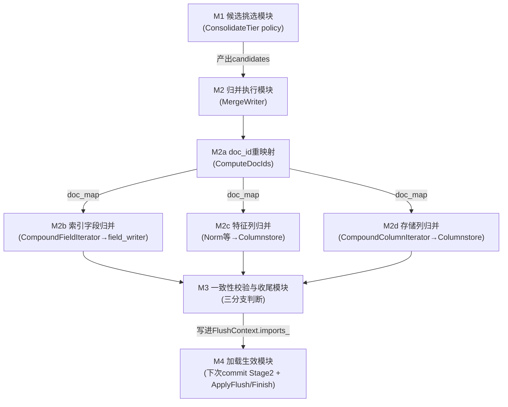
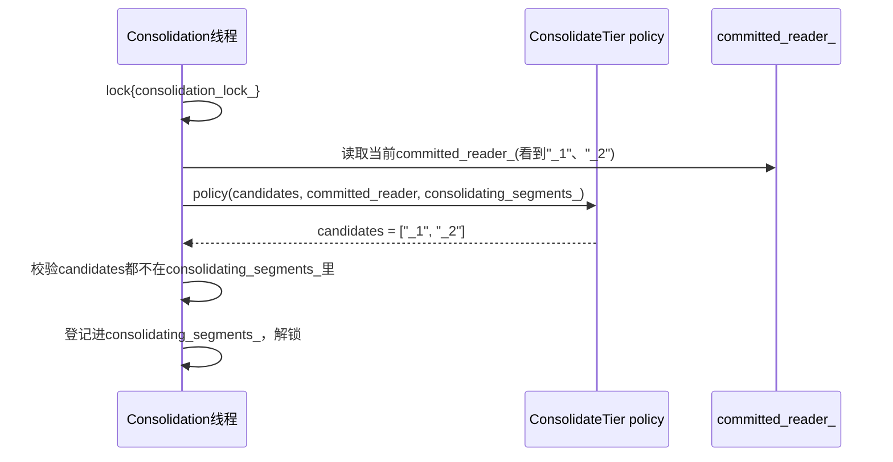
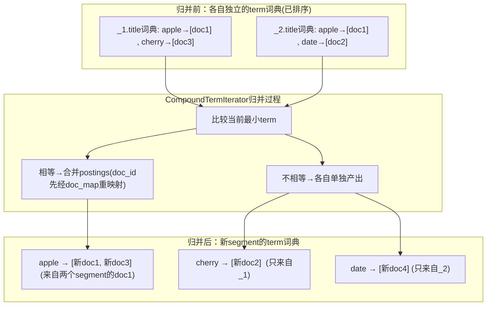
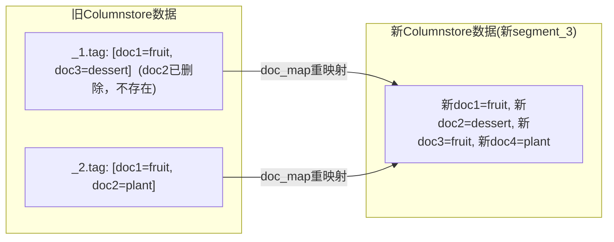
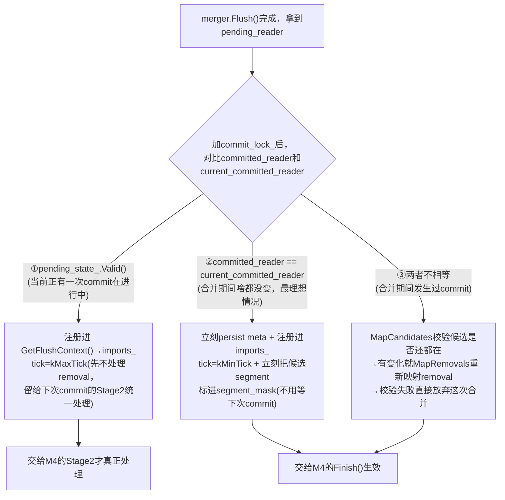

# Consolidation 段合并(Merge)详细设计笔记

个人学习笔记，整理自对 `core/index/merge_writer.cpp`、`core/index/index_writer.cpp`(`Consolidate()`/`MapCandidates`/`MapRemovals`)的逐行阅读。这是[writer_threads_collaboration.md](writer_threads_collaboration.md)第5节"重要纠正"的详细展开版。

按"功能点 → 模块关系 → 逐模块详细设计"组织，但对**本质上跟时序强相关**的模块(候选挑选、收尾分支判断)保留时间线图，不强行拆成纯静态描述——这部分内容的核心矛盾正是"时间差"，丢了时序就丢了重点。

---

## 1. 功能点说明

Consolidation 要解决的问题：segment 数据不可变，长期运行下来索引里会堆积大量小 segment(每次flush一个)，且被删除的文档只是"打了mask"、并没有真正从磁盘上消失。Consolidation 的职责是：

| 功能点 | 说明 |
|---|---|
| F1. 减少segment数量 | 把若干个小segment合并成一个大segment，降低查询时需要打开/扫描的文件数 |
| F2. 回收被删除文档的空间 | 合并时真正丢弃被mask的文档，不再把"死文档"的数据继续搬运到新文件里 |
| F3. 不阻塞正常读写 | 合并过程耗时(CPU+磁盘I/O)，不能长时间占用全局锁，必须能跟Index/Commit线程并行 |
| F4. 保证合并期间发生的变更不丢失 | 合并耗时期间，候选segment可能被别的commit继续删除文档，这些新变化不能被合并结果"吞掉" |

---

## 2. 模块及模块间关系



**模块职责与边界**：
- **M1**：决定"这次该合并哪些segment"，对应`consolidation_lock_`保护的那一小段代码——运行极快，只做挑选和登记，不做任何实际I/O。
- **M2**：真正执行合并，内部又分4个子模块，分别处理"doc_id怎么变"和三种不同性质的数据(索引字段/特征列/存储列)怎么搬运——这部分是纯CPU+磁盘I/O，不持任何全局锁，运行耗时但可以跟其他线程完全并行。
- **M3**：M2跑完之后，判断"合并这段时间里世界有没有变"，决定怎么把结果安全地交出去——这是整个consolidation里逻辑最绕的模块，核心矛盾是"M2结果是基于旧快照算出来的，但现实可能已经变了"。
- **M4**：复用普通commit已有的机制(`PrepareFlush`的Stage2、`ApplyFlush`、`Finish`)，让M3交出来的结果真正变得可查询——这个模块本身没有consolidation专属逻辑，纯粹是"借用"。

---

## 3. 贯穿全文的例子

```
旧segment "_1"：docs_count=3，doc_id=2已被标记删除(live_docs_count=2)
  title(索引,文本)： doc1="apple pie"   doc2(已删除)="banana split"   doc3="cherry cake"
  body(索引,文本,带Norm特征)： ...(内容略，只关心它也要走特征合并)
  tag(仅存储,不索引)： doc1="fruit"      doc2(已删除)="fruit"           doc3="dessert"

旧segment "_2"：docs_count=2，无删除(live_docs_count=2)
  title： doc1="apple sauce"   doc2="date palm"
  body(带Norm)： ...
  tag： doc1="fruit"            doc2="plant"
```
**特意设计"apple"这个词同时出现在"_1".doc1和"_2".doc1里**，用来演示"同一个term跨多个segment"时postings是怎么合并的；**特意保留"_1".doc2的删除**，用来演示"删除的文档在合并时会被彻底丢弃、doc_id重新收缩编号"。这个例子会贯穿下面所有模块的详细设计。

---

## 4. 模块详细设计

### 4.1 M1：候选挑选模块

**职责**：从当前`committed_reader_`里选出一批值得合并的segment，并登记"占用中"标记，防止被别的consolidation线程重复选中。


**关键点**：这一步**全程持锁**，但因为只做"读列表+登记标记"，执行极快——真正耗时的归并计算(M2)是在锁释放**之后**才开始的，所以不会阻塞别的consolidation线程去挑选另一批互不重叠的候选。`consolidating_segments_`这个排除名单，正是用来保证两个并发的consolidation线程不会选中同一批segment(你之前深挖过的"多个consolidation线程"并发场景)。

### 4.2 M2：归并执行模块

**职责**：把M1选出的候选segment真正合并成一个新segment文件，不持任何全局锁。内部按"数据性质"拆成4个子模块，顺序执行。

#### 4.2.1 M2a：doc_id重映射(`ComputeDocIds`)——删除的文档被彻底丢弃

**用例子说明**：
```mermaid
graph LR
    subgraph seg1["旧segment _1 (docs_count=3)"]
      A1["doc1(live)"]
      A2["doc2(已删除)"]
      A3["doc3(live)"]
    end
    subgraph seg2["旧segment _2 (docs_count=2)"]
      B1["doc1(live)"]
      B2["doc2(live)"]
    end
    subgraph new3["新segment _3 (docs_count=4)"]
      N1["新doc1"]
      N2["新doc2"]
      N3["新doc3"]
      N4["新doc4"]
    end
    A1 -->|doc_id_map[1]=1| N1
    A2 -.->|doc_id_map[2]=eof，丢弃| X["(永久消失)"]
    A3 -->|doc_id_map[3]=2| N2
    B1 -->|doc_id_map[1]=3| N3
    B2 -->|doc_id_map[2]=4| N4
```
```cpp
for (auto docs_itr = reader.docs_iterator(); docs_itr->next(); ++next_id) {
  doc_id_map[docs_itr->value()] = next_id;   // docs_iterator()只吐出活着的文档，死的根本不出现在这里
}
```
**设计要点**：`doc_id_map`初始全部填`doc_limits::eof()`(哨兵值)，只有`docs_iterator()`真正吐出来的(活着的)doc才会被赋上新doc_id——`"_1".doc2`因为已删除，`docs_iterator()`根本不会经过它，`doc_id_map[2]`永远是`eof()`，这篇文档的数据在新segment里**彻底不存在**，对应功能点F2(空间回收)。这一步产出的`doc_map`函数，是后面3个子模块共同依赖的输入。

#### 4.2.2 M2b：索引字段归并(`CompoundFieldIterator`→`field_writer`)——k-way归并，同term跨segment的postings拼在一起

**用例子说明**(以"title"字段为例)：

```cpp
// CompoundTermIterator::next() 核心逻辑
for (每个还在工作的term_iterator) {
  value = it->value();
  if (value < current_term_) { term_iterator_mask_.clear(); }   // 发现更小的term，重新开始收集
  if (value == current_term_) { term_iterator_mask_.emplace_back(i); }  // 跟当前最小term一样大，一起收进来
}
```
("_1"的"title"排好序是`apple, cherry`——doc2的"banana"因为被删，`docs_iterator()`不会吐出它；"_2"是`apple, date`)

**归并过程(逐步取最小term)**：
```
第1轮：两个segment当前term分别是"_1":apple, "_2":apple → 相等！两者都收进term_iterator_mask_
      → 合并产出term"apple"，postings来自两个segment
第2轮："_1"推进到"cherry"，"_2"推进到"date" → "cherry" < "date" → 只收"_1"
      → 产出term"cherry"，postings只来自"_1"
第3轮："_1"耗尽，"_2"还在"date" → 只收"_2"
      → 产出term"date"，postings只来自"_2"
```


**设计要点**：`apple`的postings列表`[新doc1, 新doc3]`里，doc_id已经是经过M2a的`doc_map`重映射后的全局新doc_id，不是原segment内部的doc1——这是`CompoundDocIterator`(配合`RemappingDocIterator`)的职责：遍历某个term在某来源segment里的原始postings时，实时把每个doc_id过一遍`doc_map`再吐出去。**词典层面去重合并，postings层面取并集**，这是索引字段区别于下面两个子模块的核心特点。

#### 4.2.3 M2c：特征列归并(Norm等)——不走field_writer，走Columnstore

**用例子说明**(以"body"字段的Norm特征为例)：
```cpp
// WriteFields内部,对每个field的每个feature(比如Norm)：
feature_writer = factory({hdrs.data(), hdrs.size()});   // hdrs是各旧segment这个特征列的payload头，先汇总
res = cs.insert(feature_itr, info, finalizer, write_values);  // 直接写进新Columnstore，不经过field_writer
```
**设计要点**：Norm本质是列存数据(doc_id→归一化因子)，不是倒排词典，所以合并时走的是Columnstore的插入接口，而不是`field_writer`的term写入接口——即使"body"是个索引字段，它的Norm特征依然走"列"这条路线，跟M2b的term合并是完全不同的代码路径，这是需要特别记住的一点：**同一个字段，不同种类的附属数据，合并代码路径可能完全不同**。

#### 4.2.4 M2d：存储列归并(`CompoundColumnIterator`→`WriteColumns`)——按文档逐篇搬运，不涉及"词"的概念

**用例子说明**(以"tag"字段为例)：
```cpp
WriteColumns(cs, remapping_itrs, *column_info_, columns_itr, progress);
// 内部：CompoundColumnIterator遍历所有旧segment的所有列
// 对每一列，逐个旧doc_id取出原始字节值，用doc_map重映射成新doc_id，写进新Columnstore
```

**设计要点**："tag"字段没有"term"这个概念，只是"doc_id→原始字节值"的映射，合并时就是单纯地把"_1"(跳过已删除的doc2)和"_2"的`tag`值，按新doc_id顺序搬进新的Columnstore——`out.Prepare(new_doc); out.write_bytes(value)`，跟你之前深挖过的`BufferedColumn::Prepare`是同一套底层机制，只是数据来源从"实时写入"变成了"从旧文件读出来再搬运"。这是三种数据里**最简单**的一种，连去重的概念都不需要。

#### 4.2.5 三个子模块对比小结

| 子模块 | 有没有"词"的概念 | 同key(term/doc)跨segment时怎么处理 | 落地接口 |
|---|---|---|---|
| M2b 索引字段 | 有(term) | 合并postings(取并集) | `field_writer` |
| M2c 特征列 | 没有(纯列) | 不存在"同key合并"问题，每个doc只有一个值 | `Columnstore` |
| M2d 存储列 | 没有(纯列) | 同上 | `Columnstore` |

### 4.3 M3：一致性校验与收尾模块

**职责**：M2跑完后，判断"合并期间，世界有没有变"，据此决定怎么安全地把结果交出去。这是整个consolidation里**与时序关系最紧密**的模块，核心矛盾对应功能点F4。

**先打开一次reader验证**：
```cpp
auto pending_reader = SegmentReaderImpl::Open(dir_, consolidation_segment.meta, committed_reader->Options());
```
这一步只是打开文件、校验完整性，拿到的`pending_reader`此刻还只是个局部变量。

**三条收尾分支**：


**本例走最常见的②分支**(假设合并这几十毫秒里没有别的commit发生)：
```cpp
index_utils::FlushIndexSegment(dir, consolidation_segment);   // 持久化"_3"的meta
ctx->imports_.emplace_back(..., writer_limits::kMinTick, ...);  // 注册进当前FlushContext
segment_mask.emplace("_1");   // 立刻标记"_1"作废
segment_mask.emplace("_2");   // 立刻标记"_2"作废
```
**设计要点**：为什么会有③这条分支——因为M2(归并计算)是基于"合并开始那一刻"的快照跑的，但它运行期间，别的commit可能已经删除了候选segment里的某些文档，甚至把某个候选segment整个处理掉了。`MapCandidates`负责核实候选是否还都健在，`MapRemovals`负责把合并期间新产生的删除重新映射到新segment的doc_id空间上——这是为了保证"合并期间发生的变更不会被合并结果覆盖掉丢失"(功能点F4)。

### 4.4 M4：加载生效模块

**职责**：让M3交出的结果真正变成可查询的状态——这个模块**没有consolidation专属逻辑**，完全复用普通commit已有的机制。

**第一步：下一次commit的Stage2，正式收编**
```cpp
for (import : ctx->imports_) {
  pending_consolidation = static_cast<bool>(import.consolidation_ctx.merger);  // true，这是合并结果
  MapCandidates(mappings, candidates=["_1","_2"], readers);   // 再次校验"_1"、"_2"是否还在readers里
  // 校验通过 → segment_mask再确认一次 → "_3"正式并入 readers / pending_meta.segments
}
```
(如果M3走的是②分支，这里大部分校验工作已经提前做完，Stage2基本是"确认一下、正式收编"；如果走的是①分支，removal的映射工作会在这里才真正发生)

**第二步：跟普通commit完全一样的`ApplyFlush`+`Finish`**
```cpp
pending_state_.commit = make_shared<DirectoryReaderImpl>(..., readers=[..., reader_"_3"]);
...
std::atomic_store(committed_reader_, pending_state_.commit);
// ★ 这一刻，"_3"才真正对查询可见；"_1"、"_2"因为在segment_mask里，不会出现在新的readers列表里 ★
```
旧的`"_1"`、`"_2"`的物理文件，此刻不会立刻删除——要等没有任何reader再引用它们，才会被文件引用计数机制真正清理掉磁盘文件。

---

## 5. 一句话总结全流程

**M2(归并执行)是纯CPU+磁盘I/O操作，不持任何全局锁，可以跟其他Index/Commit线程完全并行**；真正需要加锁协调的只有M1(挑候选，`consolidation_lock_`)和M3(收尾判断，`commit_lock_`，专门应对"合并期间世界可能已经变了"这个核心矛盾)；最终让新segment真正可查询的M4，走的是跟普通文档commit完全同一套机制，没有任何consolidation专属的加载通道。
