# 查询语法树与分数树的构造过程

个人学习笔记,是 [search_retrieval_pipeline.md](search_retrieval_pipeline.md) §4/§5 的深入篇。那篇讲"检索全流程",这篇只盯一件事:**一个查询从"用户写的树"变成"迭代器树 + 分数树"的全过程**,每一步的原理、每一步产生/转换什么数据结构、配一个贯穿的例子。

> **验证说明**:全部结论来自读源码(`core/search/*`),**没有运行 iresearch**。例子中的迭代器选择、命中顺序、分数是按源码逻辑和 BM25 公式手推的,分数为近似值。没有读到底的部分在 §8.3 单独列出。
>
> **示例数据**沿用 [search_retrieval_pipeline.md §0.4](search_retrieval_pipeline.md) 的两个 segment(`_0` 5 篇、`_1` 2 篇),打分器 BM25(k=1.2, b=0.75)。

---

## 0. 导读

### 0.1 先纠正一个说法:这里没有"查询语法"

`core` 里**没有查询字符串解析器**(没有把 `apple AND pie` 解析成树的代码)。所谓"语法树"就是**调用方用 C++ 代码手工拼出来的 `filter` 对象树**。`utils/index-search.cpp` 里的 `prepareFilter()` 是唯一的"文本 → 树"示例,而且只是按任务类别 `switch`,不是通用解析器([index-search.cpp:240-449](utils/index-search.cpp#L240-L449))。所以本文的"语法树构造"= **用户如何拼 `filter` 树 + 引擎如何把它规约、编译**。

### 0.2 一个查询有四棵"树"(同一棵逻辑结构的四种形态)

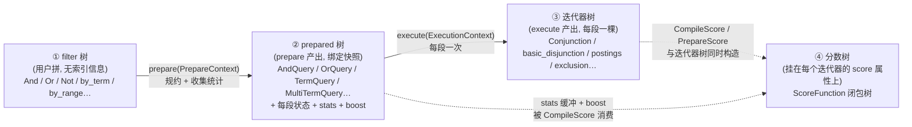

| 形态 | 类型 | 创建者 | 生命周期 | 携带的"打分相关"信息 |
|---|---|---|---|---|
| ① filter 树 | `irs::filter` 子类 | 调用方 | 可复用、与索引无关 | `boost`、`merge_type`、`min_match_count` |
| ② prepared 树 | `filter::prepared` 子类 | `filter::prepare` | 绑定一个 `DirectoryReader` 快照 | `stats_`(IDF 等常量)、`boost_`、每段 `StatesCache` |
| ③ 迭代器树 | `doc_iterator` 子类 | `prepared::execute` | 一次性,每个段一棵 | 每个节点的 `score` 属性 |
| ④ 分数树 | `ScoreFunction`(函数指针 + 上下文) | `CompileScore` 等 | 与迭代器同生共死 | 叶子:BM25 公式;内部节点:合并子分数 |

> **核心设计**:**分数树不是一棵独立的数据结构**,它是"每个迭代器节点的 `score` 属性里存的一个 `ScoreFunction`",树形来自迭代器树本身的父子关系。读分数 = 对根迭代器的 `score` 调用一次 `Score(buf)`,函数内部递归调用子节点的 `ScoreFunction`。

### 0.3 贯穿全文的例子查询 Q

```
Q = And {
      Or(boost=2.0) { body:apple , body:pie },    // 语义:含 apple 或 pie,得分翻倍
      price ∈ [15, 40],                           // 过滤子句(数值范围)
      Not { body:red }                            // 排除含 red 的
    }
```

对应 C++(示意,未编译):

```cpp
irs::And root;                                        // merge_type 默认 kSum, boost 默认 1

auto& or_ = root.add<irs::Or>();                      // min_match_count 默认 1
or_.boost(2.f);
{ auto& t = or_.add<irs::by_term>();  *t.mutable_field() = "body";
  t.mutable_options()->term = irs::ViewCast<irs::byte_type>(std::string_view{"apple"}); }
{ auto& t = or_.add<irs::by_term>();  *t.mutable_field() = "body";
  t.mutable_options()->term = irs::ViewCast<irs::byte_type>(std::string_view{"pie"}); }

auto& rng = root.add<irs::by_granular_range>();       // 数值范围,边界展开方式见主文档 §5.3
*rng.mutable_field() = "price";
/* set_granular_term(range.min/max, numeric_token_stream 展开的 15 / 40); 两端闭区间 */

auto& not_ = root.add<irs::Not>();
{ auto& t = not_.filter<irs::by_term>();  *t.mutable_field() = "body";
  t.mutable_options()->term = irs::ViewCast<irs::byte_type>(std::string_view{"red"}); }

auto order    = irs::Scorers::Prepare(bm25);          // §3
auto prepared = root.prepare({.index = reader, .scorers = order});   // ② 树
// 每个 segment: prepared->execute({.segment = seg, .scorers = order}) → ③④ 树
```

**手算的期望结果**(逻辑上,后面 §5.4 逐项验证):

| | 满足 `Or` | 满足 `price∈[15,40]` | 不含 `red` | 命中 |
|---|---|---|---|---|
| `_0` | `{1,2,3,4,5}`(apple∪pie) | `{2,3,4}` | 排除 `{1,3}` | **`{2,4}`** |
| `_1` | `{1}`(b1) | `{1}`(price=30) | 排除 `{2}` | **`{1}`** |

---

## 1. 语法树(filter 树)

### 1.1 节点类型与类层次

[filter.hpp:61-146](core/search/filter.hpp#L61-L146) 定义了所有用户侧过滤器的骨架:

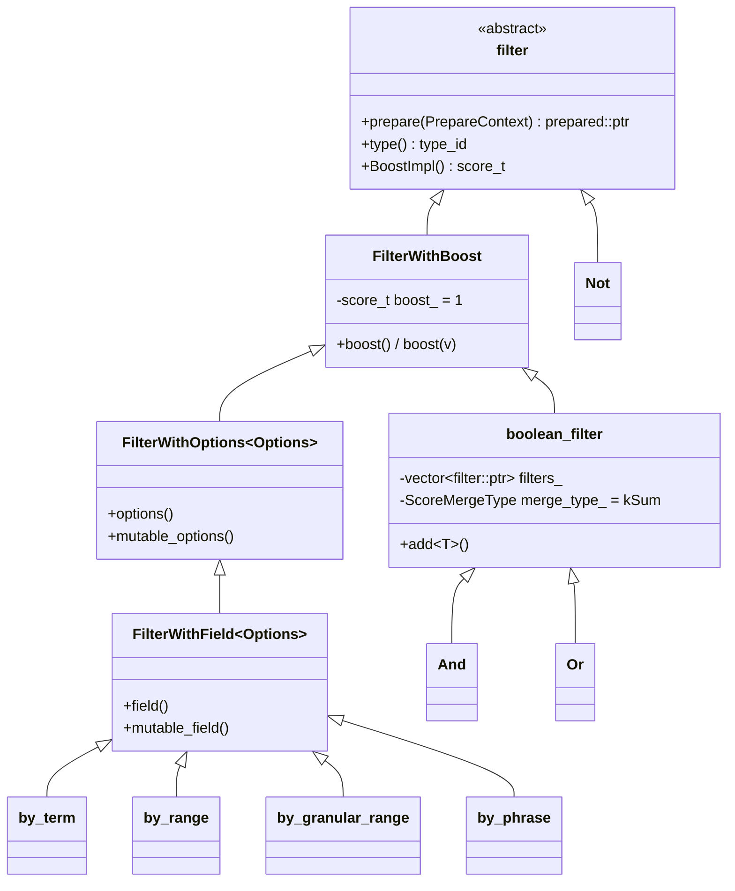

要点:
- **每个节点自带 `boost`**(`FilterWithBoost`),默认 `kNoBoost = 1.0`。
- **叶子(`by_*`)= 字段名 + options**(term、范围、前缀…),没有任何索引相关的数据。
- **`boolean_filter` 是容器**:`vector<filter::ptr>` + `merge_type`(默认 `kSum`)。`Or` 额外有 `min_match_count`(默认 1)。`Not` 是单子节点。
- `filter::operator==` 递归比较树结构([filter.hpp:77-79](core/search/filter.hpp#L77-L79)、[boolean_filter.cpp:45-53](core/search/boolean_filter.cpp#L45-L53)),**`prepare` 里的优化要靠它判断"两个子节点是不是同一个 `all`"**。

### 1.2 树上能调的三个"打分旋钮"

| 旋钮 | 在哪 | 作用 | 影响哪棵树 |
|---|---|---|---|
| `boost(x)` | 任意节点 | **沿 prepare 树向下相乘**,最终固化进叶子 `TermQuery::boost_`,再被 BM25 乘进分子(`num = boost·(k+1)·idf`)| ④ |
| `merge_type(kSum/kMax/kMin)` | `And`/`Or` | 决定子分数怎么合成父分数 | ④(选 `Merger` 模板)|
| `min_match_count(n)` | `Or` | "至少命中 n 个子句"(n=1 即 Or,n=子句数即 And) | ②③ 选不同的 Query/迭代器类 |

### 1.3 `index-search` 里"文本 → 树"的对应

| 任务类别 | 拼出的树 | 代码 |
|---|---|---|
| `HighTerm/MedTerm/LowTerm` | `by_term(body)` | [index-search.cpp:248-263](utils/index-search.cpp#L248-L263) |
| `HighPhrase…` | `by_phrase(body)`,每个词一个 `by_term_options` | [264-286](utils/index-search.cpp#L264-L286) |
| `AndHigh*` | `And{ by_term… }` | [316-339](utils/index-search.cpp#L316-L339) |
| `OrHigh*` | `Or{ by_term… }` | [340-363](utils/index-search.cpp#L340-L363) |
| `MinMatch2High2Med` | `Or{ by_term… }.min_match_count(n)` | [422-445](utils/index-search.cpp#L422-L445) |
| `Prefix3` / `Wildcard` / `Fuzzy*` | `by_prefix` / `by_wildcard` / `by_edit_distance` | [364-421](utils/index-search.cpp#L364-L421) |

---

## 2. prepare:语法树 → 编译树(prepared 树)

### 2.1 `PrepareContext`:沿树向下传递的"环境"

```cpp
struct PrepareContext {            // filter.hpp:36-47
  const IndexReader& index;        // 整个快照(所有段) —— 为了做全局统计
  IResourceManager&  memory;
  const Scorers&     scorers;      // 要用哪些打分器(空 = 不打分)
  const attribute_provider* ctx;
  score_t            boost;        // 累积 boost
  PrepareContext Boost(score_t b) const { auto c = *this; c.boost *= b; return c; }
};
```

**`boost` 是"乘法下传"**:每经过一个带 boost 的节点就 `ctx.Boost(node.boost())`,所以叶子拿到的是**从根到叶所有节点 boost 的乘积**。

### 2.2 `boolean_filter::prepare` 的规约流水线

入口 [boolean_filter.cpp:57-90](core/search/boolean_filter.cpp#L57-L90),分四步:

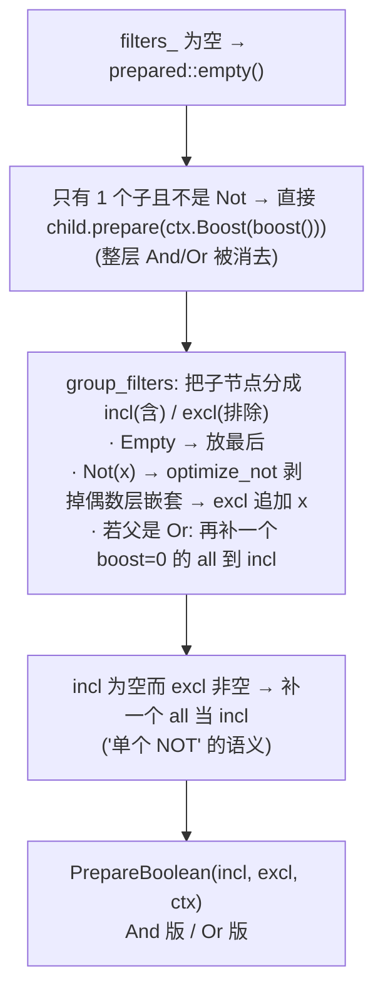

- `optimize_not`([boolean_filter.cpp:32-43](core/search/boolean_filter.cpp#L32-L43)):`Not(Not(x))` 被剥成 `x`(`neg` 记录奇偶)。
- `group_filters`([92-138](core/search/boolean_filter.cpp#L92-L138)):遇到 `Not(all)`(即"非全部")→ 整个 `incl` 清空 → 结果为空。

#### `And::PrepareBoolean`([140-210](core/search/boolean_filter.cpp#L140-L210))

| 情形 | 处理 |
|---|---|
| `incl` 为空,或最后一个是 `Empty` | `prepared::empty()`(整个合取必空)|
| 只剩 1 个 incl 且无 excl | **消去 And 层**,直接 `incl[0]->prepare(boost 已乘 And.boost)` |
| incl 里有若干 `all` | 合并成一个累计 boost 的 `all`;若只剩 1 个非 `all` 子句,把 `all` 的 boost **折算进这个子句的 boost**(公式见源码注释)|
| 其它 | `AndQuery`,`q->prepare(sub_ctx, merge_type(), incl, excl)` |

#### `Or::PrepareBoolean`([221-312](core/search/boolean_filter.cpp#L221-L312))

| 情形 | 处理 |
|---|---|
| `min_match_count == 0` | `all`(0 个条件即全满足)|
| incl 为空 | 空 |
| 只剩 1 个 incl 且无 excl | 消去 Or 层 |
| 无 scorer 且 incl 里有 `all` 且 `min_match ≤ all 个数` | 只留一个 `all`(其它子句无需执行) |
| 规约后 `adjusted_min_match` | `== incl.size()` → **`AndQuery`**;`== 1` → **`OrQuery`**;其间 → **`MinMatchQuery(n)`**;`> incl.size()` → 空 |

> 所以**用户写的 `Or.min_match_count(n)` 不一定得到 `MinMatchQuery`**:`n` 等于子句数时退化成 `AndQuery`(合取比弱析取快)。

#### `Not::prepare`([314-335](core/search/boolean_filter.cpp#L314-L335))

独立出现的 `Not(x)` = `AndQuery{ incl=[all], excl=[x] }`(用 `ScoreMergeType::kSum`)。

### 2.3 `BooleanQuery::prepare`:递归 prepare 子节点,**排除端不带 scorer**

[boolean_query.cpp:181-200](core/search/boolean_query.cpp#L181-L200):

```cpp
for (auto* f : incl) queries.emplace_back(f->prepare(ctx));            // 带 scorers、带累积 boost
for (auto* f : excl) queries.emplace_back(f->prepare({                  // 排除端:
    .index = ctx.index, .memory = ctx.memory, .ctx = ctx.ctx }));       //   scorers = kUnordered, boost = 1
prepare(ctx, merge_type, std::move(queries), incl.size());              // excl_ = incl.size()
```

排除端 **既不收集统计也没有打分器**——这是"排除子树里不存在分数树"的根源(§5.3)。

### 2.4 叶子 prepare 做什么

以 `by_term` 为例([term_filter.cpp:92-129](core/search/term_filter.cpp#L92-L129)),详见主文档 §4.3。从"构造树"的角度,叶子 prepare 产出三样东西:

| 产物 | 内容 | 将被谁消费 |
|---|---|---|
| `states_` (`StatesCache`) | `SubReader* → {term_reader*, cookie}` | `execute` 找词典位置 |
| `stats_` (`bstring`) | 由打分器 `collect` 出来的**查询级常量**(BM25 的 idf、`norm_const`、`norm_length`、`norm_cache[256]`)| `CompileScore` 构造叶子分数函数 |
| `boost_` | 从根累积下来的 boost | 同上 |

> 每个 prepared **叶子各有一份独立的 `stats_`**。同一个 term 出现在两个子句里,统计会各收集一次。

### 2.5 例子:Q 的 prepare 过程

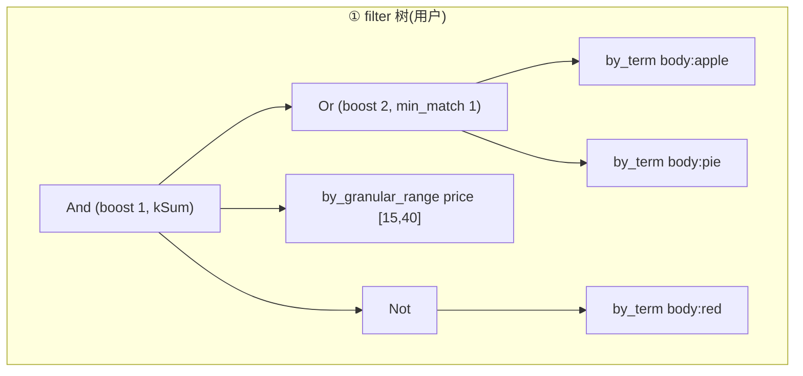

1. `And::prepare` → `boolean_filter::prepare`:3 个子节点,不走"单子消去"。
2. `group_filters`:`Or` → incl;`range` → incl;`Not(red)` → `optimize_not` 得 `(red, neg=true)` → **excl**(父是 And,不补 `all`)。得 `incl=[Or, range]`,`excl=[red]`。
3. `And::PrepareBoolean`:incl 里无 `all`;`sub_ctx.boost *= And.boost(=1)`;生成 `AndQuery q`。
4. `q->prepare(sub_ctx, kSum, incl, excl)`:
   - `Or->prepare(ctx)`(boost=1)→ `Or::prepare` → `boolean_filter::prepare` → `group_filters` 得 `incl=[apple,pie]` → `Or::PrepareBoolean`:`sub_ctx = ctx.Boost(2)`;`adjusted_min_match = 1` → `OrQuery`;子节点以 **boost=2** prepare:
     - `by_term(apple)::prepare`:收集 `N=7, df=4, avgdl=2.0` → `TermQuery{boost_=2, stats_(idf=0.575…)}`
     - `by_term(pie)::prepare`:`df=4` → `TermQuery{boost_=2, stats_}`
   - `range->prepare(ctx)` → `MultiTermQuery{boost_=1}`:每个段枚举落在 `[15,40]` 的 term(`_0`:15/25/40;`_1`:30),`scorers` 非空 → 这些 term 进入 `scored_states`(上限 `scored_terms_limit=1024`),并各自收集统计。
   - `red->prepare({.index,.memory})`(**无 scorers**)→ `TermQuery{boost_=1, stats_ 为空}`。

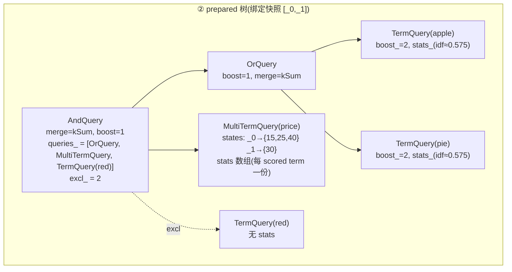

---

## 3. 统计与 stats 缓冲:分数树的"静态一半"

打分分两半:**静态一半**(prepare 时算好的常量,全局统计)和**动态一半**(execute/迭代时每篇文档的 tf、len)。这一章讲静态一半怎么来。

### 3.1 `Scorers::Prepare`:把用户的打分器编译成"桶"

[scorer.hpp:243-310](core/search/scorer.hpp#L243-L310)、[scorer.cpp:66-77](core/search/scorer.cpp#L66-L77):

```cpp
Scorers order = Scorers::Prepare(bm25);      // 或 Prepare({&bm25, &tfidf})
```

每个 scorer 成为一个 **`ScorerBucket{ bucket*, stats_offset }`**:

| 字段 | 含义 |
|---|---|
| `buckets_` | `SmallVector<ScorerBucket,2>`,每个打分器一项 |
| `stats_size_` | 所有桶的 stats 字节总和(各桶按各自对齐拼接) |
| `score_size_` | `sizeof(score_t) × 桶数` —— **一篇文档的分数输出缓冲大小** |
| `features_` | 所有桶 `index_features()` 的并集(BM25 要 `FREQ`)—— **决定 postings 迭代器要不要读词频** |

例:BM25 + TFIDF 两个桶 → `stats` 缓冲布局 `[ BM25Stats | (对齐) | TFIDFStats ]`,`bucket[0].stats_offset=0`,`bucket[1].stats_offset=align_up(sizeof(BM25Stats),align)`;每篇文档输出 `score_t[2]`。

### 3.2 两级统计收集器

`Scorer` 提供 `prepare_field_collector()` / `prepare_term_collector()`,引擎按桶数批量创建([collectors.cpp:46-62, 89-103](core/search/collectors.cpp#L46-L103)):

| 收集器 | 粒度 | 调用时机 | BM25 里收集什么 |
|---|---|---|---|
| `field_collectors` | 每个匹配字段,**每段一次**(不管该段有没有匹配 term)| 叶子 prepare 的段循环里 `collect(segment, field)` | `docs_with_field += field.docs_count()`、`total_term_freq += freq`——**读堆内 `term_reader` 成员,不碰磁盘**([bm25.cpp:52-57](core/search/bm25.cpp#L52-L57))|
| `term_collectors` | 每个匹配 term,每段一次 | 读出 `term_meta` 后 `collect(segment, field, term_idx, attrs)` | `docs_with_term += docs_count`([bm25.cpp:64+](core/search/bm25.cpp#L64))|

`term_collectors` 内部布局 `[t0.b0, t0.b1, … t0.bN, t1.b0, …]`(**term 主序、桶副序**)。收集结束后:

```cpp
term_stats.finish(stats_buf, term_idx, field_stats, index);
   // → 对每个桶: bucket.scorer->collect(stats_buf + stats_offset, field_collector[b], term_collector[t,b])
```

BM25 的 `collect`([bm25.cpp:366-414](core/search/bm25.cpp#L366-L414))把全局统计变成常量:

```
idf         += ln(1 + (docs_with_field − docs_with_term + 0.5) / (docs_with_term + 0.5))
norm_const   = k·(1−b)
norm_length  = k·b / avgdl          (avgdl = total_term_freq / docs_with_field)
norm_cache[i]= 1 / (norm_const + norm_length · i),  i = 1..255   // 小长度查表
```

### 3.3 例子:Q 里三个叶子的 stats

全局统计(两段合计):`docs_with_field(body)=7`,总词频 14,`avgdl=2.0`;`df(apple)=df(pie)=4`。

| 叶子 | stats_(BM25Stats) |
|---|---|
| `TermQuery(apple)` | `idf = ln(1+3.5/4.5) ≈ 0.575`,`norm_const = 1.2×0.25 = 0.3`,`norm_length = 1.2×0.75/2.0 = 0.45` |
| `TermQuery(pie)` | 同上(df 恰好相同,但**是另一份缓冲**)|
| `MultiTermQuery(price)` | 每个 scored term 一份:`price` 的 `docs_with_field=7`,各自 `df`;`price` 无 FREQ,**最终用不上**(见 §5.2)|
| `TermQuery(red)`(排除端)| **无**(没传 scorers)|

> **短语的 idf 是各词 idf 之和**:`FixedPrepareCollect` 对短语的每个词依次调用 `term_stats.finish(stats_buf, term_idx, …)`([phrase_filter.cpp:285-294](core/search/phrase_filter.cpp#L285-L294)),而 BM25 的 `idf` 用的是 `+=`,于是同一块 `stats_buf` 累加出短语总 idf。

> **`all` / `column_existence` 这类没有 term 的过滤器**调用 `PrepareCollectors(buckets, stats_buf)`,即 `collect(stats_buf, nullptr, nullptr)`([score.cpp:164-170](core/search/score.cpp#L164-L170)),BM25 里 `docs_with_term=0` 当作缺省处理。

---

## 4. execute:编译树 → 迭代器树

### 4.1 `execute` 的上下文与总体规则

```cpp
struct ExecutionContext {            // filter.hpp:49-56
  const SubReader& segment;          // 本次只处理一个段
  IResourceManager& memory;
  const Scorers& scorers;            // 与 prepare 时同一份
  const attribute_provider* ctx;
  WandContext wand;                  // {index, strict, root}  —— WAND 开关
};
```

**每个 prepared 节点的 `execute` 都是"在本段构造一个 `doc_iterator` 子树"**,规则:

| prepared 节点 | 本段 `execute` 产出 |
|---|---|
| `TermQuery` | `states_.find(segment)` → 无状态则 `empty()`;有则 `postings(cookie, features)`(或 `wanderator`),再 `CompileScore`([term_query.cpp:35-74](core/search/term_query.cpp#L35-L74))|
| `MultiTermQuery` | 每个 scored term 一个 postings(各自 `CompileScore`);全部 unscored term 合成一个 `lazy_bitset_iterator`;外面套并集([multiterm_query.cpp:114-181](core/search/multiterm_query.cpp#L114-L181))|
| `AndQuery/OrQuery/MinMatchQuery` | 先对子节点 `execute`,再选迭代器类型(§4.2)|
| `BooleanQuery`(带 excl) | `exclusion(incl_iter, excl_iter)`(§4.3)|
| `all_query` | `AllIterator(docs_count)`,有 scorer 时也 `CompileScore` |
| `by_phrase` 系 | 合取子 postings(**请求 `FREQ\|POS`,会读 `.pos`**)+ `PhraseIterator`,自己 `CompileScore`(§5.3.5);对比:`TermQuery` 的请求 features 只有 `NONE`/`FREQ`,**不读 `.pos`**,具体例子见 [search_retrieval_pipeline.md §4.7](search_retrieval_pipeline.md) |

### 4.2 布尔节点:迭代器类型的选择

[boolean_query.cpp:32-123](core/search/boolean_query.cpp#L32-L123)。统一先过 **`MakeScoreAdapters`**:

```cpp
for each child query: docs = child->execute(ctx);
   if (doc_limits::eof(docs->value()))   // 子迭代器一开始就是空
        Conjunction → 整个返回空;  Disjunction → 丢掉这个子迭代器
   itrs.emplace_back(docs);              // ScoreAdapter{ it, &document, &score }
// 子节点个数>1 或合取 → ctx.wand.root = false
```

**`ScoreAdapter`**([conjunction.hpp:34-70](core/search/conjunction.hpp#L34-L70))给每个子迭代器缓存 `document*` 和 `score*` 两个指针,父节点读 `value()` 和调子分数时**不用虚调用**,也不用每次 `irs::get<score>`。

之后按节点类型和子迭代器个数选实现:

| 节点 | 条件 | 迭代器 | 代码 |
|---|---|---|---|
| `AndQuery` | 子数 0 | `empty()` | [boolean_query.cpp:105-107](core/search/boolean_query.cpp#L105-L107) |
| | 子数 1 | **直接返回该子迭代器**(无合取层)| |
| | ≥2 | 按 `cost` 升序排序;`WAND` 开启且 lead.cost>1 且所有子分数上界有限 → `BlockConjunction`;否则 **`Conjunction`** | [conjunction.hpp:436-495](core/search/conjunction.hpp#L436-L495) |
| `OrQuery` | 0 | `empty()` | [boolean_query.cpp:66-94](core/search/boolean_query.cpp#L66-L94) |
| | 1 | **直接返回该子迭代器** | [disjunction.hpp:1422-1431](core/search/disjunction.hpp#L1422-L1431) |
| | 2 | `basic_disjunction`(两路)| [1433-1440](core/search/disjunction.hpp#L1433-L1440) |
| | ≥3 | `block_disjunction`(按块位图合并);WAND 开启且子分数上界有限 → 其 WAND 变体 | [1451-1467](core/search/disjunction.hpp#L1451-L1467) |
| `MinMatchQuery(n)` | `n==子数` | 退化成合取 | [boolean_query.cpp:212-247](core/search/boolean_query.cpp#L212-L247) |
| | 其它 | `min_match_iterator`(弱析取,`MakeWeakDisjunction`)| [disjunction.hpp:1471-1513](core/search/disjunction.hpp#L1471-L1513) |

**无 scorer 时的编译期消除**:`ResoveMergeType(type, num_buckets, visitor)`([scorer.hpp:425-452](core/search/scorer.hpp#L425-L452))——`num_buckets==0` 直接传 `NoopAggregator`,迭代器模板里的 `if constexpr (HasScore_v<Merger>)` 整块打分代码被**编译期裁掉**:不打分的查询,迭代器树里**根本不存在分数树**。桶数 1~4 用定长 `Aggregator<Merger,N>`(栈上 `std::array`),>4 用运行期缓冲。

### 4.3 排除端:`exclusion`

[boolean_query.cpp:127-154](core/search/boolean_query.cpp#L127-L154):

```cpp
auto incl = execute(ctx, begin(), excl_begin);                    // 包含部分(Conjunction/Disjunction)
if (excl_begin == end) return incl;
auto excl = make_disjunction({.segment=..., .scorers=kUnordered}, kNoop, excl_begin, end);
if (doc_limits::eof(excl->value())) return incl;                  // 本段排除集为空 → 退化
return make_managed<exclusion>(std::move(incl), std::move(excl));
```

`exclusion::get_mutable` **直接转发给 `incl_`**([exclusion.hpp:59-61](core/search/exclusion.hpp#L59-L61)):它**没有自己的 `score` 属性**,从外面看 `score` 就是 `incl` 的。

### 4.4 例子:Q 在 `_0` 与 `_1` 的迭代器树

**`_0`**:

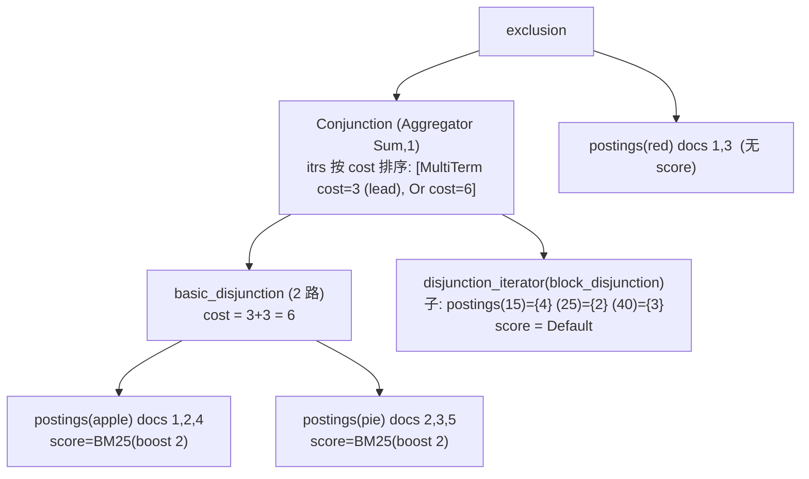

选择理由:
- `OrQuery` 两个子 → **`basic_disjunction`**。
- `MultiTermQuery` 本段 3 个 term、`min_match=1` → `MakeWeakDisjunction` 转 `MakeDisjunction`,3 个子 → `block_disjunction`(估计 cost=3)。
- `AndQuery` 两个子 → `MakeConjunction`:按 cost 排序,**MultiTerm(3) 在前当 lead**,`Or(6)` 在 tail。
- 排除端只有 `red` 一个子 → `make_disjunction` 只有 1 个子,直接返回它(`unary` 不包装)。
- `price` 字段没有 FREQ → 它的 postings 没有 `frequency` 属性 → BM25 给 **Default 分数**(§5.2),所以 `MultiTerm` 子树的 `score.IsDefault()` 成立。

**`_1`**:`apple={1}`、`pie={1}` 都是 `docs_count==1` → `single_doc_iterator`,`basic_disjunction` 照常包;`price` 在 `_1` 只命中 1 个 term(30)→ `MakeDisjunction` size==1 → **直接是那个单文档迭代器**;`red={2}` 单文档。树形与 `_0` 相同,只是叶子换成了 `single_doc_iterator`。

---

## 5. 分数树(score 树)

### 5.1 基本抽象

**`score` 属性 = `ScoreFunction` + 上界**([score.hpp:36-63](core/search/score.hpp#L36-L63)、[score_function.hpp:41-127](core/search/score_function.hpp#L41-L127)):

```cpp
class ScoreFunction {            // 一个"带状态的函数对象",手工虚表
  score_ctx* ctx_;               // 状态
  void (*score_)(score_ctx*, score_t* res);   // 算分:把 score_size 个 float 写到 res
  void (*min_)  (score_ctx*, score_t arg);    // 反向通道:消费者告诉它"当前 top-K 门槛"
  void (*deleter_)(score_ctx*);
};
struct score : attribute, ScoreFunction {
  struct UpperBounds { score_t tail, leaf; } max;   // 这个子树能给出的分数上界(WAND 用)
};
```

三个关键约定:

1. **惰性**:`next()/seek()` 只移动文档游标,**不算分**。只有消费者调用 `(*score)(&v)` 才触发整棵分数树自顶向下求值。因此"没通过过滤的文档从不打分"。
2. **`IsDefault()`**:没有打分器、或该节点不贡献分数时,`score_ == DefaultScore`(把输出清零)。**父节点看到子节点是 Default 就把它整个剪掉**(见 §5.3)。
3. **输出是 `score_t[桶数]`**:多个打分器时一次写出多个 float,合并按"逐桶"进行(`Aggregator::operator()` 对每个桶调用一次 `Merger`)。

### 5.2 叶子:`CompileScore` 把统计 + boost + 迭代器属性绑成一个函数

调用点:`TermQuery::execute`([term_query.cpp:66-71](core/search/term_query.cpp#L66-L71))、`MultiTermQuery::execute`([multiterm_query.cpp:148-155](core/search/multiterm_query.cpp#L148-L155))、`PhraseIterator` 构造([phrase_iterator.hpp:563-571](core/search/phrase_iterator.hpp#L563-L571))、`AllIterator` 等。

[score.cpp:173-198](core/search/score.cpp#L173-L198):

```cpp
void CompileScore(score& s, buckets, segment, field, stats, doc_attrs, boost) {
  if (s.IsDefault()) {                                   // 普通 postings 迭代器
    auto scorers = PrepareScorers(buckets, segment, field, stats, doc, boost);
         // 对每个桶: bucket.prepare_scorer(segment, field.features, stats+offset, doc_attrs, boost)
    if (s.max.tail == max()) s.max.leaf = s.max.tail = scorers.empty() ? 0 : scorers.front().Max();
    s = CompileScorers(std::move(scorers));              // 1 个桶: 原样; 2 个: 打包成 Ctx; N 个: 向量
  } else if (buckets.size() > 1) {                       // wanderator 已自带第 0 桶的分数函数
    auto rest = PrepareScorers(buckets.subspan(1), ...);
    s = CompileScorers(std::move(s) /*wand*/, std::move(rest));
  }
}
```

**BM25 的 `prepare_scorer` 决策树**([bm25.cpp:416-475](core/search/bm25.cpp#L416-L475)):

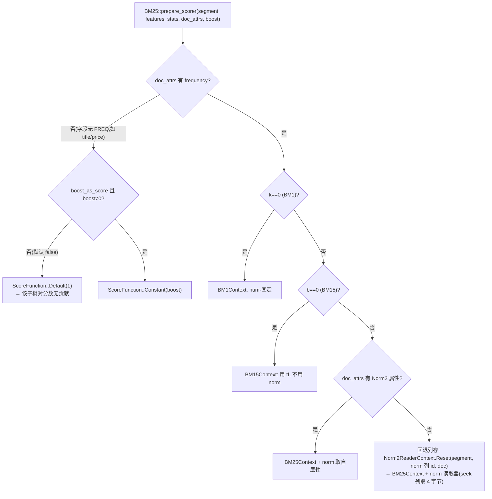

**boost 是在这里"固化"的**:`BM1Context` 构造时 `num = boost·(k+1)·idf`([bm25.cpp:199-201](core/search/bm25.cpp#L199-L201)),所以:
- **`boost` 乘到分子上,boost=0 的子句得分恒为 0**(仍参与匹配)。
- **`price`、`title` 这类无 FREQ 字段上的过滤子句,即使不设 boost=0,也会因 `!freq → Default` 而天然不计分**(`postings_reader::iterator_impl` 用 `field_features & required_features` 选迭代器模板,无 FREQ 字段得到的迭代器根本没有 `frequency` 属性,[formats_10.cpp:3604-3640](core/formats/formats_10.cpp#L3604-L3640))。(这修正了主文档 §5.4 中"需要 boost=0 才不计分"的说法:仅对**有词频**的字段才需要它。)

**叶子函数的最终形态**(`BM25Context<Norm2>`,仅示意):

```
score(doc) = c0 − c0 / (1 + tf / c1)    其中  c0 = num·(filter_boost?) ,  c1 = norm_const + norm_length·len
           = boost·idf·(k+1)·tf / (tf + K)            (K = k(1−b) + k·b·len/avgdl)
       tf  ← 迭代器的 frequency 属性(同一个指针, 迭代器前进它就变)
       len ← Norm2: 由 norm 列 seek(doc) 读 4 字节(或 attrs 里的 Norm2 值)
```

> `filter_boost`(`irs::filter_boost` 属性)是**逐文档的 boost**,模糊匹配(编辑距离)这类过滤器用它表达"越接近得分越高";它乘在 `c0` 上([bm25.cpp:296-306](core/search/bm25.cpp#L296-L306))。

### 5.3 内部节点:如何把子分数合成父分数

#### 5.3.1 `Merger` / `Aggregator`

[scorer.hpp:338-420](core/search/scorer.hpp#L338-L420):`SumMerger`(`dst += src`)、`MaxMerger`、`MinMerger`;`Aggregator<Merger,N>` = 合并函数 + `N` 个 float 的临时缓冲 `temp()`。**`merge_type` 在 `ResoveMergeType` 里变成模板参数**,所以合并逻辑内联、无分支。

#### 5.3.2 合取 `Conjunction`

[conjunction.hpp:76-153](core/search/conjunction.hpp#L76-L153):

```cpp
// MakeConjunction 里: 按 cost 排序后, 收集所有"非 Default"子分数
for (auto& it : itrs) if (!it.score->IsDefault()) scores.emplace_back(it.score);
// ConjunctionBase::PrepareScore:
switch (scores_.size()) {
  case 0: score = Default(Merger::size());                      // 没人打分 → 自己也是 Default
  case 1: score = std::move(*scores_.front());                  // ★ 只有 1 个子打分 → 直接"过户"子的函数, 零开销
  case 2: score.Reset(*this, Score2, min);                      // res = a; temp = b; res ⊕= temp
  default:score.Reset(*this, ScoreN, min);                      // 依次 ⊕
}
```

要点:
- **只有非 Default 的子分数参与**;过滤型子句(无词频字段、`Not` 内)被**整个剪出分数树**。
- **1 个打分子 → 过户**:父的 `score` 里直接装上子的函数对象(`std::move`),**少一层调用**。
- 求值发生在**合取已对齐**之后——此时所有子迭代器都停在同一个 doc 上,各自读自己的 tf/len 即可。

#### 5.3.3 析取 `basic_disjunction` / `small_disjunction` / `block_disjunction`

[disjunction.hpp:287-346](core/search/disjunction.hpp#L287-L346):

```cpp
// 两路: 按两个子是否 Default 分 4 种情形
both scored : res = score(lhs 在当前 doc 的值);  temp = score(rhs ...);  res ⊕= temp
only lhs    : res = score(lhs)
only rhs    : res = score(rhs)
neither     : Default
// score_iterator_impl: 子迭代器没停在当前 doc → seek 过去; 仍对不上 → 贡献 0
```

**关键语义:析取只累加"在当前文档上命中"的子迭代器,没命中的贡献 0**(`memset(res,0)`)。所以 `Sum` 合并就是"命中的子句得分之和"。(提醒:这对 `Max` 合并是自然的;若用 `Min` 合并,未命中子句的 0 会把结果拉成 0,使用 `kMin` 要注意。)

`small_disjunction` 把子迭代器**分区**:Default 的放前、有分数的放后,打分时只遍历后半段([disjunction.hpp:498-545](core/search/disjunction.hpp#L498-L545))。

#### 5.3.3b `MultiTermQuery` 的分数

- 每个 **scored term** 的 postings 自带 `CompileScore`(用自己的 stats 偏移和 `entry.boost·boost_`)。
- 所有 **unscored term** 合成的 `lazy_bitset_iterator` 带一个默认的 `score` 属性([multiterm_query.cpp:49-52](core/search/multiterm_query.cpp#L49-L52))→ **Default**。
- 然后用 `kSum` 的并集合并。所以多 term 查询的分数 = 命中的 scored term 的分数之和,unscored 的贡献 0。

#### 5.3.4 `exclusion`

没有自己的分数,`get_mutable` 转发给 `incl`(§4.3)。被排除的文档本来就不会出现,排除端不存在分数树。

#### 5.3.5 短语 / n-gram / same_position:**分数挂在"短语节点"上,子节点不打分**

[phrase_query.cpp:36-100](core/search/phrase_query.cpp#L36-L100):

- 子 postings 用 `Conjunction<ScoreAdapter<>, NoopAggregator>` 合取(**`NoopAggregator` → 子分数完全不参与**),它们只是提供位置。
- `PhraseIterator` 自己在构造里 `CompileScore(score, buckets, segment, field, stats, *this, boost)`,把**自己**当作 doc_attrs 提供者——此时 `frequency` 属性是"**短语出现次数**",所以 BM25 的 `tf` = 短语频率。
- stats 里的 idf = 各词 idf 之和(§3.3)。

**例:短语 `"apple pie"` 的分数树 vs 合取 `+apple +pie` 的分数树**(数据同主文档 §4.7;`idf=0.575`,未设 boost)

```
短语:  PhraseIterator.score = BM25Ctx{ idf = 0.575+0.575, tf = 短语频率 phrase_freq, len = norm 列 }
        ├─ postings(apple)   (NoopAggregator,不参与分数)
        └─ postings(pie)     (NoopAggregator,不参与分数)

合取:  Conjunction.score = Score2( BM25Ctx{idf .575, tf = apple 词频},  BM25Ctx{idf .575, tf = pie 词频} )
        ├─ postings(apple).score
        └─ postings(pie).score
```

| 文档 | **短语** `"apple pie"` | **合取** `+apple +pie` |
|---|---|---|
| `_0`.doc2(`apple pie`)| tf=1(短语出现 1 次),len=2 → 1.151×1.000 = **1.15** | apple tf=1 → 0.575;pie tf=1 → 0.575 → **1.15** |
| `_1`.b1(`apple pie pie`)| 短语出现 **1** 次(只有 `apple@1 pie@2` 成立),len=3 → 1.151×0.830 = **0.96** | apple tf=1 → 0.478;**pie tf=2 → 0.693** → **1.17** |

→ **同样的两篇命中文档,两种查询排序相反**:合取按"各词独立词频"相加,`b1` 里 `pie` 出现两次占便宜,排第一;短语的 `tf` 是"短语整体出现几次",`b1` 只有 1 次,反而不如 `doc2`。这也说明:**分数树的形状(分数挂在哪个节点上)直接决定了 `tf` 的含义**。位置如何参与命中判定,见 [search_retrieval_pipeline.md §4.7](search_retrieval_pipeline.md)。

### 5.4 例子:Q 的分数树与逐文档走查

#### 分数树(`_0`)

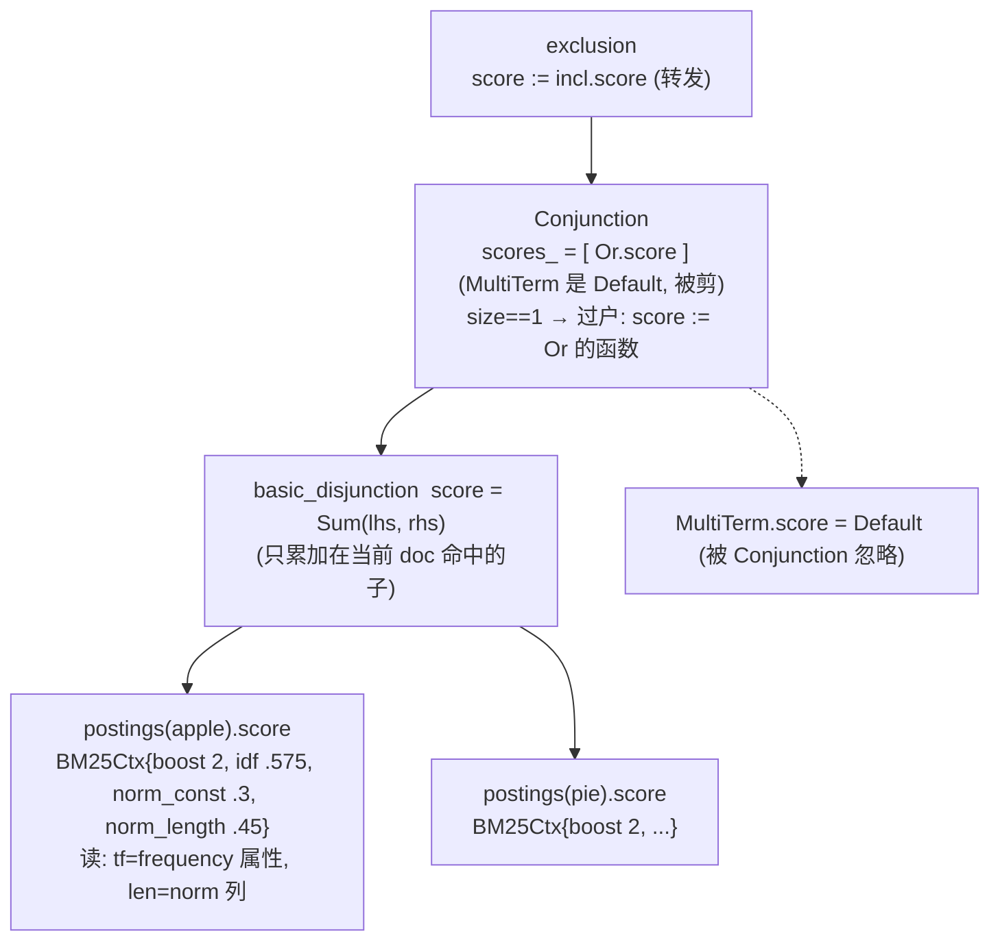

注意:"Conjunction 过户"之后,**对外的 `score` 属性链**是 `exclusion → Conjunction(=Or 的函数) → basic_disjunction`,真正执行的调用栈只有 **`basic_disjunction::score → BM25(apple) + BM25(pie)`** 一层合并。

#### 迭代 + 求值(`_0`)

```
lead = MultiTerm: {2,3,4}   tail = Or: apple{1,2,4} ∪ pie{2,3,5}   excl = red{1,3}

next() → lead=2:  Or.seek(2): apple.seek(2)=2 ✓       → 对齐 doc 2
                  exclusion: red.seek(2)=3 ≠ 2        → 命中 doc 2
          (*score)(): basic_disjunction: apple 在 doc2 命中 → BM25(tf=1,len=2,boost2)
                                         pie   在 doc2 命中 → BM25(tf=1,len=2,boost2)   → 和

next() → lead=3:  Or.seek(3): apple.seek(3)=4 ≠ 3; pie.seek(3)=3 ✓ → 对齐 doc 3
                  exclusion: red 恰在 3 → 排除,incl.next(): lead=4, Or.seek(4): apple.seek(4)=4 ✓
                  excl: red.seek(4)=EOF                → 命中 doc 4
          (*score)(): apple 命中(tf=2,len=2); pie 停在 3, seek(4)=5 ≠ 4 → 贡献 0

next() → lead EOF → 结束
```

`_0` 命中 `{2,4}`,与 §0.3 的期望一致。

#### 数值(`idf = 0.575`,`boost=2`,`score = boost·idf·2.2·tf/(tf+K)`)

| 文档 | apple 项:tf,len,K | apple 得分 | pie 项:tf,len,K | pie 得分 | **总分** |
|---|---|---|---|---|---|
| `_0`.doc2 | tf=1,len=2,K=1.2 | 2×0.575×(2.2×1/2.2)=**1.151** | tf=1,len=2,K=1.2 | **1.151** | **2.30** |
| `_0`.doc4 | tf=2,len=2,K=1.2 | 2×0.575×(2.2×2/3.2)=**1.582** | 未命中 | 0 | **1.58** |
| `_1`.b1(doc1) | tf=1,len=3,K=1.65 | 2×0.575×(2.2/2.65)=**0.955** | tf=2,len=3,K=1.65 | 2×0.575×(4.4/3.65)=**1.387** | **2.34** |

**最终排序**:`_1.doc1`(2.34)> `_0.doc2`(2.30)> `_0.doc4`(1.58)。

> 观察:`_1.b1` 虽然每个词的 tf/len 不占优,但**同时命中 apple 和 pie(pie 出现两次)**,两项相加反超。这正是析取 `Sum` 合并的效果;`range` 子句完全没有改变任何分数。

### 5.5 `merge_type` 对比:Sum vs Max

把例子里的 `Or` 换成 `Or.merge_type(ScoreMergeType::kMax)`,`boost` 取 1,看 `_0`.doc2(apple、pie 各 0.575):

| merge | 机制 | doc2 | doc4(只命中 apple 0.791) |
|---|---|---|---|
| `kSum`(默认)| `SumMerger` | 0.575 + 0.575 = **1.151** | **0.791** |
| `kMax`(dismax 风格)| `MaxMerger` | max(0.575,0.575) = **0.575** | **0.791** |

→ 用 `kMax` 后"同时命中多个同义词"不再比"只命中一个"更高,doc4 反而排在 doc2 前。**`merge_type` 的选择改变的是迭代器模板参数,不是后处理**。

### 5.6 反向通道:`Min`(阈值向下)与 `max`(上界向上)——WAND 的两个方向

分数树不仅有"自顶向下求值",还有两条辅助通道,用来**剪掉不可能进 top-K 的文档/块**:

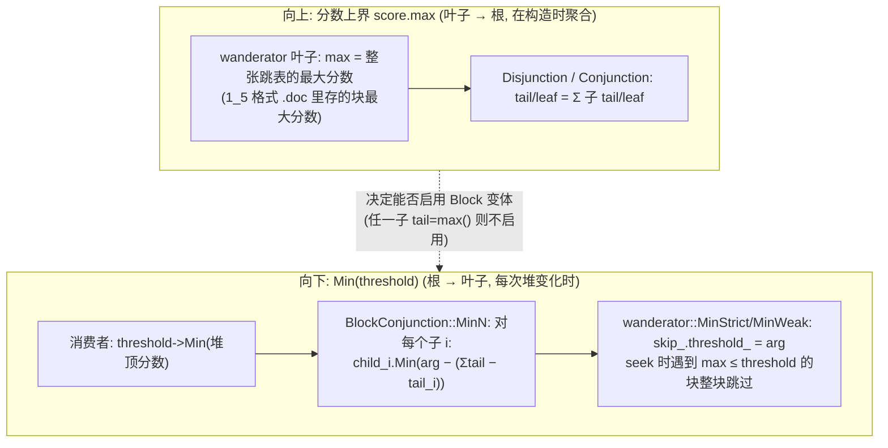

**阈值分摊公式**([conjunction.hpp:347-370](core/search/conjunction.hpp#L347-L370)):

```cpp
static void MinN(BlockConjunction& self, score_t arg) {
  for (auto* score : self.scores_) {                  // scores_ 按 tail 降序
    const auto others = self.sum_scores_ - score->max.tail;   // 其它子能给的最大分之和
    if (arg <= others) return;                        // 其它子就够凑到门槛 → 这个子不必限制,后面更小的也不必
    score->Min(arg - others);                         // 这个子自己至少要贡献 arg − others
  }
}
```

例:两个子 A(tail=1.5)、B(tail=1.0),`sum=2.5`:
- 门槛 `arg=2.0`:A 必须 ≥ 2.0−1.0 = **1.0**;B 必须 ≥ 2.0−1.5 = **0.5**。若 A 的某个块上界只有 0.8,即使 B 拿满分 1.0 也只有 1.8 < 2.0,**整块可跳**。
- 门槛 `arg=1.2`:A:`others=1.0 < 1.2` → `A.Min(0.2)`;B:`others=1.5 ≥ 1.2` → 直接 `return`(B 不受限)。

**启用条件**(三处缺一就悄悄退化成普通迭代器,不报错):
1. 写入时有 wand 数据(1_5 格式 + wand scorers);
2. `IndexReaderOptions::scorers` 与写入配置一致;
3. `ExecutionContext.wand.Enabled()`,且 `MakeConjunction`/`MakeDisjunction` 里 `MakeSubScores` 发现**所有子 `max.tail` 都不是 `max()`**(任一子无上界就放弃,[disjunction.hpp:127-165](core/search/disjunction.hpp#L127-L165))。

> 根节点的特殊性:`ctx.wand.root` 为 true 的节点才能"对外宣布阈值";`MakeScoreAdapters` 在子数>1 时把 `root=false` 传下去,所以**只有最外层那一层保留 root 语义**。本例 Q 的 `price` 无上界(Default)→ 合取整体不启用 Block 变体。

---

## 6. 一张图:同一个 Q 的四种形态并排

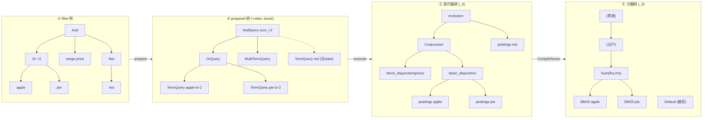

### 6.1 构造时间线(带数据结构)

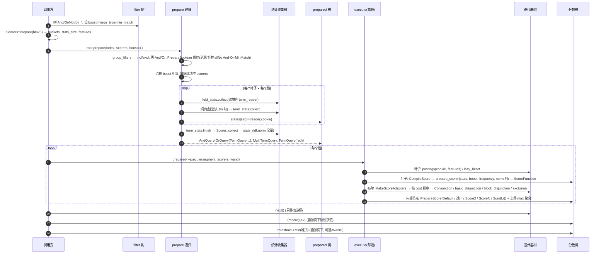

---

## 7. 例子补充:`min_match` 与 `Not` 的几种写法如何落到树上

### 7.1 `Or{a,b,c}.min_match_count(2)`

- `Or::PrepareBoolean`:`adjusted_min_match=2`,`incl.size()=3` → `MinMatchQuery(2)`。
- `execute`:3 个子 `execute`;`min_match_count(2) ≠ size(3)` → `MakeScoreAdapters<false>` → `ResoveMergeType` → **`min_match_iterator`**(弱析取,"至少 2 个子在同一 doc 上")。
- 分数:命中的子分数求和(和 §5.3.3 同理),至少 2 个才出结果。
- 写成 `min_match_count(3)`:`adjusted_min_match==incl.size()` → **`AndQuery`**,走合取。

### 7.2 三种"排除"写法的差别

| 写法 | prepare 后 | 说明 |
|---|---|---|
| `And{ A, Not{B} }` | `AndQuery{incl=[A], excl=[B]}` | 标准形式,`exclusion(A, B)` |
| `Not{B}` 单独 | `AndQuery{incl=[all], excl=[B]}` | `all` 迭代器遍历 `docs_count`,**含已删除文档**(主文档 §0.3)|
| `Or{ A, Not{B} }` | `incl=[A, all(boost=0)]`,`excl=[B]` | `Or` 里补 `all` 以表达"A 或 非B";`all` 的 boost=0 → 不引入分数 |

---

## 8. 附录

### 8.1 速查:谁在哪一步创建了什么

| 对象 | 创建函数 | 代码 |
|---|---|---|
| filter 树 | 调用方 | — |
| `Scorers`(桶) | `Scorers::Prepare` | [scorer.hpp:292-310](core/search/scorer.hpp#L292-L310) |
| 规约 incl/excl | `boolean_filter::group_filters` | [boolean_filter.cpp:92](core/search/boolean_filter.cpp#L92) |
| `AndQuery/OrQuery/MinMatchQuery` | `And/Or::PrepareBoolean` | [140](core/search/boolean_filter.cpp#L140)、[221](core/search/boolean_filter.cpp#L221) |
| 叶子 stats / states | `by_term::prepare` 等 | [term_filter.cpp:92](core/search/term_filter.cpp#L92) |
| 统计收集器 | `field_collectors` / `term_collectors` | [collectors.cpp](core/search/collectors.cpp) |
| 叶子分数函数 | `CompileScore` / `PrepareScorers` / `CompileScorers` | [score.cpp:33,115,173](core/search/score.cpp#L33) |
| BM25 公式 | `BM25::prepare_scorer` / `collect` | [bm25.cpp:416](core/search/bm25.cpp#L416)、[366](core/search/bm25.cpp#L366) |
| 合取分数 | `ConjunctionBase::PrepareScore` | [conjunction.hpp:128](core/search/conjunction.hpp#L128) |
| 析取分数 | `basic_disjunction::prepare_score` 等 | [disjunction.hpp:287](core/search/disjunction.hpp#L287) |
| 迭代器选择 | `make_conjunction` / `make_disjunction` | [boolean_query.cpp:98](core/search/boolean_query.cpp#L98)、[66](core/search/boolean_query.cpp#L66) |

### 8.2 容易想错的点

1. **没有查询语法解析器**,"语法树"是手工拼的 `filter` 对象。
2. **分数树不是单独的树**,是每个迭代器 `score` 属性里的闭包,树形来自迭代器树。
3. **无 scorer ⇒ 没有分数树**(编译期消除),不是"分数都是 0"。
4. **过滤子句不计分的真正原因**:① 在排除端;② 字段无 FREQ → `prepare_scorer` 返回 Default;③ boost=0。**有词频字段上的过滤子句如果不设 boost=0,是会计分的。**
5. **`Conjunction` 的 `score` 可能直接就是某个子节点的函数**(过户),调试时看到的调用栈会比想象的浅;被过户的子节点自己的 `score` 之后是 Default,**不要在外面再单独调用它**。
6. **析取只累加命中当前文档的子句**;`kMin` 合并会被"未命中=0"污染。
7. **`min_match_count(n)` 不一定得到 `MinMatchQuery`**,`n==子句数` 会退化成 `AndQuery`,`n==0` 变 `all`。
8. **同一个 term 在多个子句出现会分别统计**(各自一份 stats),idf 相同只是因为统计口径相同。
9. **短语 idf = 各词 idf 之和,tf = 短语出现次数**;短语的子 postings 不打分。
10. **排除端 prepare 时 `scorers=kUnordered`**,所以 `Not` 子树里的 `by_phrase` 等也不会收集统计。

### 8.3 没能完全确认的点

- **`block_disjunction` 内部的打分缓冲与 WAND 变体细节**我只读了选择逻辑和 `small_disjunction`/`basic_disjunction` 的打分,没有读完 `block_disjunction`(`disjunction.hpp:891+`)。§5.3.3 对 ≥3 路析取的"只累加命中子句"结论是按同族类的一致语义和 `RebindIterator` 推的,没逐行验证。
- **§4.4 里 Conjunction 的 lead 选择**依赖 `MultiTerm` 的 cost(3)与 `Or` 的 cost(6)比较,而 `Or` 的 cost 是 `basic_disjunction` 的 `lhs+rhs` 估计;`MultiTerm` 的 cost 来自 `state->estimation()`。数值是推的。
- (已核实,不再是疑点)无 FREQ 字段不会有 `frequency` 属性:`postings_reader::iterator_impl` 取 `enabled = field_features & required_features`,`price`/`title` 的 `field_features` 不含 FREQ,于是 `enabled=NONE`,落到 `iterator_traits<false,false,false,false>`,迭代器属性里没有 `frequency`([formats_10.cpp:3604-3640](core/formats/formats_10.cpp#L3604-L3640)),BM25 因此走 `!freq → Default` 分支。
- **所有分数**是手算的近似值,没和 `index-search` 实际输出对比。
