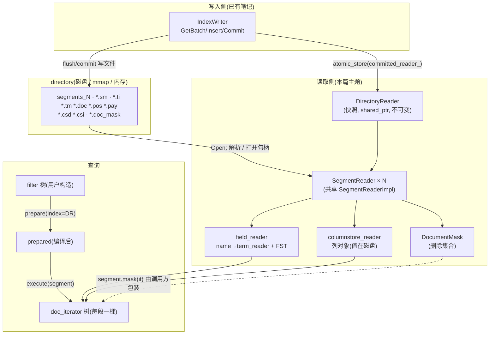
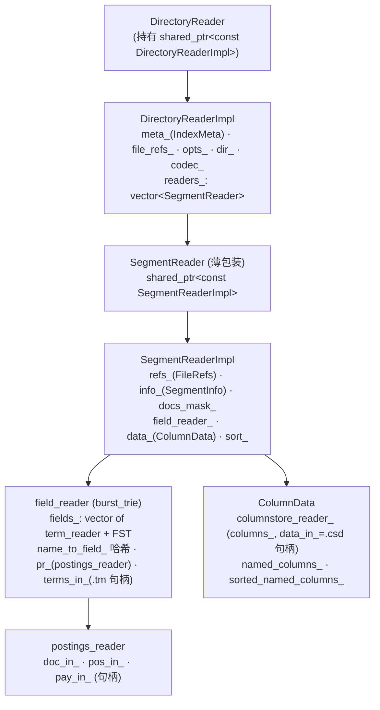
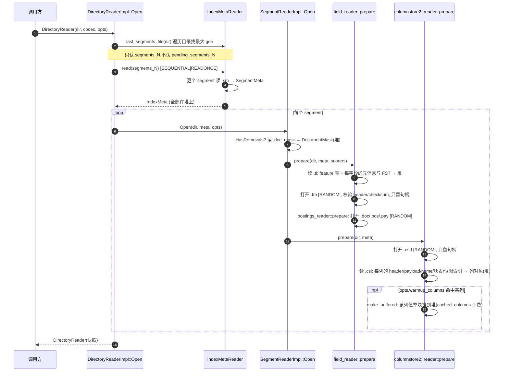
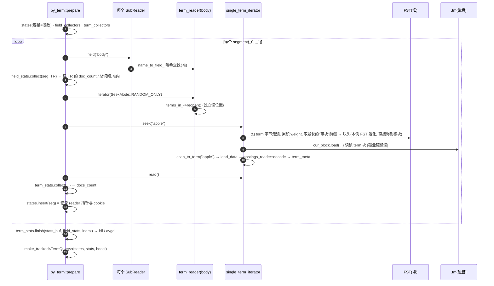
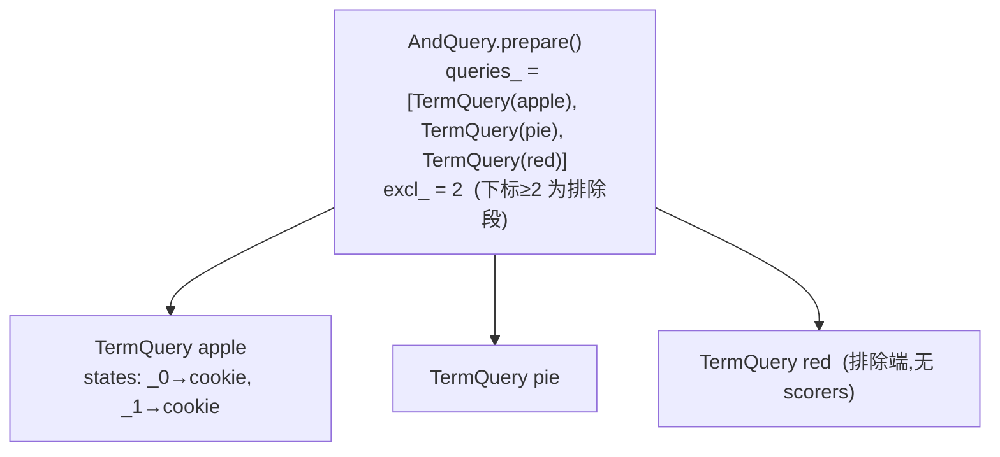
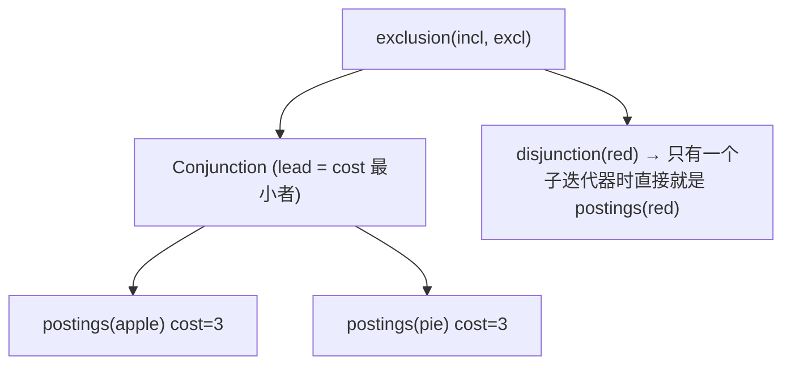
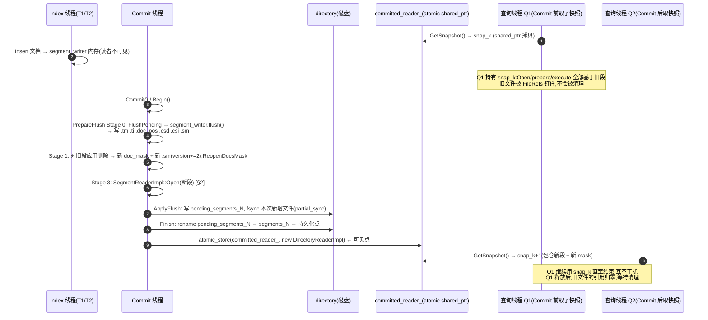
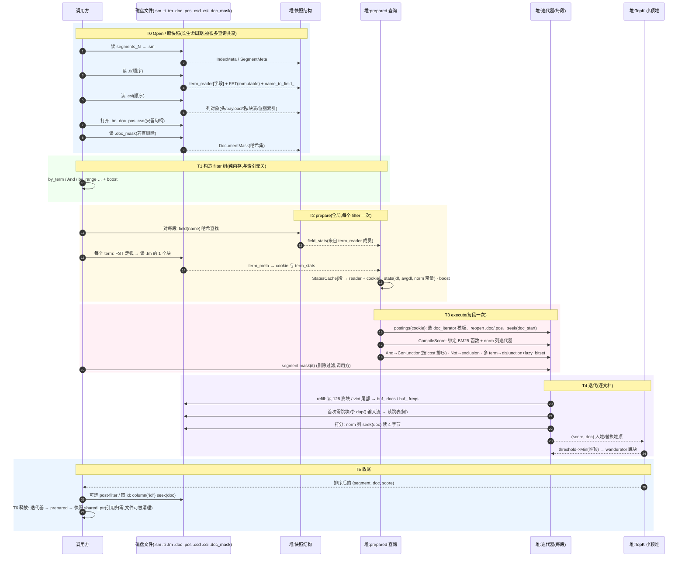
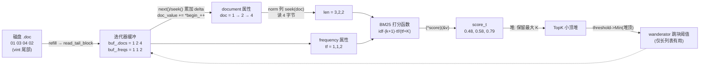

# 检索流程全景笔记:加载 → 查询 → 过滤 → 实时可见

个人学习笔记。整理自 `directory_reader_impl` / `segment_reader_impl` / `formats_burst_trie`(reader 部分) / `formats_10`(postings reader) / `columnstore2`(reader 部分) / `core/search/*` / `index_writer`(Commit 路径),并以 `utils/index-search.cpp` 为主线剧本。写入侧(内存池、flush)已有笔记,本篇只在衔接处引用:[field_write_memory_flush_pipeline.md](field_write_memory_flush_pipeline.md)、[writer_threads_collaboration.md](writer_threads_collaboration.md)、[consolidation_merge_workflow.md](consolidation_merge_workflow.md)。

> **验证说明**:所有结论来自读源码,**没有真正运行 iresearch**。示例里的 doc id、term、跳转轨迹是按源码逻辑手推的;字节级的数值(如 `.doc` 里的 `01 03 04 02`)标了"示意",依据是对应的编码函数,但没有对着真实文件 hexdump 核对。打分数值是按 BM25 公式手算的近似值。
>
> **版本说明**:以 **format 1_4 / 1_5**(`columnstore2`,文件 `.csd/.csi`)为主线。1_0~1_3 用旧列存(`.cs/.cm`),倒排部分(`.ti/.tm/.doc/.pos/.pay`)各版本基本一致。1_5 比 1_4 多存 WAND 用的块最大分数。

---

## 0. 导读

### 0.1 一句话

> 检索 = **打开快照(Open,一次)→ 编译查询(`prepare`,全局一次)→ 逐段执行(`execute`,每个 segment 一棵迭代器树)→ 迭代 + 惰性打分 + 取 TopK**。

整个引擎的"读"是围绕三个不可变对象组织的:**快照**(`DirectoryReader`)、**段**(`SegmentReader`)、**迭代器**(`doc_iterator`)。写入线程只会"换一个新快照",永远不会原地修改一个已打开的段(唯一例外是 `docs_mask`,但它也是"复制出新的 `SegmentReaderImpl`",见 §6)。

### 0.2 章节地图(与你提的 6 个问题的对应)

| 章 | 内容 | 对应问题 |
|---|---|---|
| §1 | 一个 segment 在磁盘上有哪些文件、各存什么 | (铺垫) |
| §2 | 各类文件如何被加载:谁进内存、谁留磁盘、目录类型的影响 | ① |
| §3 | 写入期内存 / 磁盘 / 读取期内存 三种形态的差异 | ② |
| §4 | 一次检索的完整流程,带逐步走查的例子 | ③ |
| §5 | 过滤:range / pre / in / post | ④ |
| §6 | 数据更新后如何被快速检索到(NRT) | ⑤ |
| §7 | 检索全程的数据结构构造/转换时间线图 | ⑥ |
| §8 | 源码索引、易错点、没能确认的点 | (收尾) |

章节顺序是按"依赖关系"排的:先知道磁盘上有什么(§1),才能讲怎么加载(§2),才能讲内存形态和磁盘形态的差别(§3),才能讲查询怎么用它们(§4),过滤是查询的子主题(§5),NRT 是"快照如何被替换"(§6),最后用一张时间线把前面全部串起来(§7)。所以你列的第 6 点放在最后作为总图。

### 0.3 两个必须先说清的前提

**① 本仓库没有 ANN / 向量检索。**
`grep hnsw|knn|prefilter|post-filter` 在 `core/ utils/ tests/` 里没有任何向量检索相关结果(只有 `nearest_neighbors_stream` 这个 fastText 分词器)。"pre-filter / in-filter / post-filter"本是向量检索里的说法,这里没有一一对应的内置算子。§5 的处理方式是:**按这三个词的含义,映射到倒排检索里实际存在的机制**,并明确标出哪些是"内置机制"、哪些只是"用法模式"。

**② 删除掩码不是 `filter::execute` 自动应用的。**
`filter::prepared::execute()` 返回的迭代器**不会**过滤已删除文档。全仓库只有 `proxy_filter` 和 `merge_writer` 主动调用 `SubReader::mask()`([proxy_filter.cpp:52](core/search/proxy_filter.cpp#L52)、[merge_writer.cpp:1651](core/index/merge_writer.cpp#L1651))。连 `all` 过滤器用的都是 `docs_count()` 而不是 `live_docs_count()`([all_filter.cpp:35-39](core/search/all_filter.cpp#L35-L39))。`index-search.cpp` 这个 demo 能直接用,只是因为它的索引没有删除。**生产消费方必须自己对每个段的结果迭代器包一层 `segment.mask(it)`**,见 §5.1。

### 0.4 贯穿全文的示例

两次 Commit 产生两个 segment(段名用 `_0`/`_1` 示意,实际由 `NextSegmentId()` 生成)。**没有 comparator**(这样段内 doc id 就是插入顺序,便于手推),format = 1_4。

| 字段 | 类型 | 说明 |
|---|---|---|
| `id` | STORE | 外部 id,存列存 |
| `title` | INDEX | 整串一个 term,无 FREQ/POS |
| `body` | INDEX | 分词(按空格),`FREQ\|POS`,带 `Norm2`(字段长度,4 字节大端) |
| `price` | INDEX(数值) | `numeric_token_stream`,示意参数 int32、step=8,每个值产生 4 个不同精度的 term |
| `status` | STORE | `ok` / `hide`,存列存,用于后过滤例子 |

**段 `_0`(第 1 次 Commit)**

| doc | id | title | body | price | status |
|---|---|---|---|---|---|
| 1 | a1 | pear | red apple red | 10 | ok |
| 2 | a2 | fig | apple pie | 25 | ok |
| 3 | a3 | plum | red pie | 40 | ok |
| 4 | a4 | apple | apple apple | 15 | hide |
| 5 | a5 | kiwi | pie | 60 | ok |

**段 `_1`(第 2 次 Commit,即 NRT 新增)**

| doc | id | title | body | price | status |
|---|---|---|---|---|---|
| 1 | b1 | apple | apple pie pie | 30 | ok |
| 2 | b2 | lime | red | 5 | ok |

> ⚠ **doc id 是段内局部编号**,从 `doc_limits::min()=1` 开始。全局唯一地址是 `(segment, doc_id)`。上面 `_1` 里的 b1 的 doc id 是 1,和 `_0` 的 doc 1 并不冲突。

`body` 字段的倒排(逻辑值,`(doc, freq)@[位置]`;**位置从 1 开始**:`pos_limits::invalid()=0`、`pos_limits::min()=1`,第一个 token 的位置是 1,见 [type_limits.hpp:64-72](core/utils/type_limits.hpp#L64-L72)):

| term | `_0` | `_1` |
|---|---|---|
| apple | (1,1)@[2] (2,1)@[1] (4,2)@[1,2] | (1,1)@[1] |
| pie | (2,1)@[2] (3,1)@[2] (5,1)@[1] | (1,2)@[2,3] |
| red | (1,2)@[1,3] (3,1)@[1] | (2,1)@[1] |

`Norm2(body)`(字段长度):`_0` = [3, 2, 2, 2, 1],`_1` = [3, 1]。

### 0.5 全景架构图



---

## 1. 磁盘上有什么:一个 segment 的文件清单

先把"原料"列清楚,§2 才好讲哪些被读进内存。文件名规则见 [file_names.cpp:38-48](core/index/file_names.cpp#L38-L48):`<段名>.<扩展名>` 或 `<段名>.<version>.<扩展名>`。

| 文件 | 内容 | 谁写(flush 时) | 常量/代码 |
|---|---|---|---|
| `segments_N` | **索引元数据**(第 N 代):`gen`、`seg_counter`、每个 segment 的 *`.sm` 文件名 + codec 名*、可选 payload。提交时先写 `pending_segments_N` 再 rename | `IndexMetaWriter` | [formats_10.cpp:2827-2829](core/formats/formats_10.cpp#L2827-L2829), 写 [2866-2915](core/formats/formats_10.cpp#L2866-L2915) |
| `<段>.<ver>.sm` | **段元数据**:段名、`version`、`live_docs_count`、`docs_count - live`、`byte_size`、flags(是否有列存/是否有主排序)、排序列 id、**该段的文件列表** `files[]` | `SegmentMetaWriter` | [formats_10.cpp:3067-3135](core/formats/formats_10.cpp#L3067-L3135) |
| `<段>.ti` | **词典索引**:段级 feature 表 + 每个字段一条记录(字段名、features、`terms_count`、`doc_count`、`doc_freq`、min/max term、总词频、`wand_mask`)+ **该字段的 FST**;末尾 `fields_count` + footer | burst_trie `field_writer` | [formats_burst_trie.cpp:960](core/formats/formats_burst_trie.cpp#L960) |
| `<段>.tm` | **词典主体**(block-tree):按字段、按前缀分块的 term 后缀 + 每个 term 的 `term_meta` 编码(`docs_count`、`freq`、`doc_start`、`pos_start`…) | 同上 | [formats_burst_trie.cpp:957](core/formats/formats_burst_trie.cpp#L957) |
| `<段>.doc` | **倒排文档流**:每个 term 一段:若干 128 篇的"文档增量块 + 词频块"(位打包),尾部不足 128 的用 vint,长列表后面跟**跳表**(+ 1_5 的块最大分数) | `postings_writer` | [formats_10.cpp:327](core/formats/formats_10.cpp#L327) |
| `<段>.pos` | 位置流(仅字段含 `POS`) | 同上 | [formats_10.cpp:330](core/formats/formats_10.cpp#L330) |
| `<段>.pay` | payload / offset 流(仅含 `PAY`/`OFFS`) | 同上 | [formats_10.cpp:333](core/formats/formats_10.cpp#L333) |
| `<段>.csd` | **列存数据**:所有列的值块(`STORE` 的值、`Norm2` 的字段长度、排序列) | `columnstore2::writer` | [columnstore2.hpp:182](core/formats/columnstore2.hpp#L182) |
| `<段>.csi` | **列存索引**:每列的压缩算法 id、列头(类型、文档数、偏移)、payload(如 `Norm2Header`)、列名、稀疏位图块索引、块表 | 同上 | [columnstore2.hpp:183](core/formats/columnstore2.hpp#L183) |
| `<段>.<ver>.doc_mask` | **删除集合**:`count` + 每个被删除 doc id 一个 vint。只有发生过删除才有 | `DocumentMaskWriter` | [formats_10.cpp:3221-3262](core/formats/formats_10.cpp#L3221-L3262) |

> `write.lock` 是 IndexWriter 的互斥锁,不属于索引数据。

### 1.1 示例:三次 Commit 之后的目录

```
第 1 次 Commit(5 篇 → _0)               segments_1
                                         _0.0.sm
                                         _0.ti _0.tm _0.doc _0.pos     ← body 含 POS,所以有 .pos;无 PAY/OFFS 所以没有 .pay
                                         _0.csd _0.csi

第 2 次 Commit(2 篇 → _1,NRT 新增)      segments_2   (列出 _0.0.sm, _1.0.sm)
                                         _1.0.sm  _1.ti _1.tm _1.doc _1.pos  _1.csd _1.csi
                                         (_0 的所有文件原封不动)

第 3 次 Commit(删除 a1,即 _0 的 doc 1)   segments_3   (列出 _0.2.sm, _1.0.sm)
                                         _0.2.sm  _0.2.doc_mask              ← 只新增这两个小文件
                                         (_0.ti/.tm/.doc/.pos/.csd/.csi 完全不动)
```

第 3 次的两个关键点,后面 §6 会反复用到:
- 删除 = **新写一个 `doc_mask` 文件 + 新版本的 `.sm`**,`version` 每次 `+= 2`([index_writer.cpp:352](core/index/index_writer.cpp#L352)),不碰倒排和列存文件。
- 旧的 `segments_2`、`_0.0.sm` 在没有任何 reader 引用它们之前不会被删(靠 `FileRefs`,见 §2.1)。

---

## 2. 加载:各类索引文件如何进入内存

### 2.1 Reader 的分层结构



要点:
- **`DirectoryReader` 是值语义的快照句柄**:拷贝/赋值都是对 `shared_ptr` 的 `atomic_load/store`([directory_reader.cpp:45-59](core/index/directory_reader.cpp#L45-L59)),所以多线程可以随便持有、传递。
- **`SegmentReaderImpl` 可被多个快照共享**:新快照里没变化的段,直接复用同一个 `shared_ptr`(§6)。
- **`FileRefs`(`refs_`)**:`SegmentReaderImpl::Update` 和 `DirectoryReaderImpl::Init` 会对段的每个文件、`segments_N` 在目录属性的引用计数表里 `add`([segment_reader_impl.cpp:147-158](core/index/segment_reader_impl.cpp#L147-L158)、[directory_reader_impl.cpp:42-59](core/index/directory_reader_impl.cpp#L42-L59))。目录清理器(`directory_cleaner`)不会删除仍有引用的文件——这就是"读旧快照的查询不受新提交影响"的物理保障。

### 2.2 Open 的完整时间线

入口:`DirectoryReader(dir, codec, opts)` → `DirectoryReaderImpl::Open` → 对每个 segment `SegmentReader{dir, meta, opts}` → `SegmentReaderImpl::Open`。



对应代码:
- 找最新元数据:[directory_reader_impl.cpp:65-182](core/index/directory_reader_impl.cpp#L65-L182);`IndexMetaReader::last_segments_file` [formats_10.cpp:2989](core/formats/formats_10.cpp#L2989)
- Open 主体:[directory_reader_impl.cpp:209-276](core/index/directory_reader_impl.cpp#L209-L276)
- 段打开:[segment_reader_impl.cpp:162-187](core/index/segment_reader_impl.cpp#L162-L187)
- 词典:[formats_burst_trie.cpp:3323-3449](core/formats/formats_burst_trie.cpp#L3323-L3449)
- postings:[formats_10.cpp:3352-3419](core/formats/formats_10.cpp#L3352-L3419)
- 列存:[columnstore2.cpp:1875-1910](core/formats/columnstore2.cpp#L1875-L1910)

### 2.3 核心表:每类文件——读进内存的 vs 留在磁盘的

「**堆**」= 进程堆内存(Open 时一次性构造,常驻);「**磁盘/页缓存**」= 只保留文件句柄(或 mmap 区间),查询时按需读。

| 文件 | Open 时做什么 | **常驻内存(堆)** | **留在磁盘**(查询时按需读) | IOAdvice | 代码 |
|---|---|---|---|---|---|
| `segments_N` | 顺序读完,逐段再读 `.sm` | `IndexMeta{gen, seg_counter, segments[]}`;`SegmentMeta{name, docs_count, live_docs_count, version, byte_size, files, sort, column_store}` | 无(读完即弃;但文件名被 `FileRefs` 引用) | SEQUENTIAL\|READONCE | [formats_10.cpp:3007-3060](core/formats/formats_10.cpp#L3007-L3060) |
| `.sm` | 同上 | 同上 | 无 | SEQUENTIAL\|READONCE | [formats_10.cpp:3147-3199](core/formats/formats_10.cpp#L3147-L3199) |
| **`.ti`** | **顺序读完整个文件**,逐字段解析,**FST 整体反序列化进堆** | ① 每字段一个 `term_reader`:字段名、`field_meta`(features)、`terms_count`、`doc_count`、`doc_freq`、min/max term、总词频、`wand_mask`;② 每字段**一棵 FST**(states/arcs/weights 三个数组);③ `name_to_field_` 哈希表 | 无(读完即弃;mmap 下句柄关闭时 `madvise(DONTNEED)` 释放页缓存) | SEQUENTIAL\|READONCE | [3323-3415](core/formats/formats_burst_trie.cpp#L3323-L3415), FST 读 [immutable_fst.hpp:136-190](core/utils/fstext/immutable_fst.hpp#L136-L190) |
| **`.tm`** | 校验 header、读尾部 checksum(**只是廉价检测,不校验全文件**),`postings_reader::prepare` 读 postings 的 terms header(校验 `block_size`) | 仅一个 `index_input` 句柄(`terms_in_`) | **所有 term 块**(term 后缀、`term_meta` 编码) | **RANDOM** | [3422-3448](core/formats/formats_burst_trie.cpp#L3422-L3448) |
| **`.doc`** | 校验 header + 尾部 checksum | 仅句柄(`doc_in_`) | **全部倒排文档块、跳表、1_5 的块最大分数** | **RANDOM** | [formats_10.cpp:3357-3368](core/formats/formats_10.cpp#L3357-L3368) |
| `.pos` | **仅当段含 `POS` feature** 才打开 | 仅句柄 | 全部位置块 | RANDOM | [3370-3383](core/formats/formats_10.cpp#L3370-L3383) |
| `.pay` | **仅当段含 `PAY\|OFFS`** 才打开 | 仅句柄 | payload / offset | RANDOM | [3385-3400](core/formats/formats_10.cpp#L3385-L3400) |
| **`.csi`** | 顺序读完,每列构造一个列对象 | 每列:列头(类型、`docs_count`、偏移)、`payload`(如 `Norm2Header`)、列名、**稀疏位图块索引**、**块表**(`ManagedVector<column_block>`,稀疏/定长列才有);另有 `columns_`(按 id)、`sorted_columns_`(按名有序)、`named_columns_`(名→列的哈希) | 无(读完即弃) | SEQUENTIAL\|READONCE | [columnstore2.cpp:1746-1873](core/formats/columnstore2.cpp#L1746-L1873) |
| **`.csd`** | 校验 header + 尾部 checksum,**保留 `data_in_`**,每个列对象持有指向它的指针 | 仅句柄;**例外**:`warmup_columns` 回调返回 true 的列,其值块(+位图)被整体拷进 `column_data_`,由 `cached_columns` 资源管理器计费 | **所有列的值**(`STORE` 字段值、norm 值、排序列) | RANDOM(warmup 时另开 `DIRECT_READ`) | [1716-1743](core/formats/columnstore2.cpp#L1716-L1743), [1843-1864](core/formats/columnstore2.cpp#L1843-L1864) |
| `.doc_mask` | **仅 `HasRemovals(meta)`** 才读,全部 vint 读进集合 | `DocumentMask` = `absl::flat_hash_set<doc_id_t>`(`docs_mask_`) | 无 | — | [segment_reader_impl.cpp:168-171](core/index/segment_reader_impl.cpp#L168-L171), [index_utils.cpp:476-484](core/utils/index_utils.cpp#L476-L484) |

### 2.4 用示例算一遍:`_0` 打开后,内存里到底有什么

```
DirectoryReader (快照, gen=1)
 └─ SegmentReader[0]  =  SegmentReaderImpl("_0")
      info_        : {name:"_0", docs_count:5, live_docs_count:5, version:0}
      docs_mask_   : {}                       ← 没有删除, 没读 doc_mask
      field_reader_
        fields_    : [ body , price , title ]   ← 按字段名有序(Open 时会校验有序,乱序抛 index_error)
          body.term_reader   : terms_count=3, doc_count=5, 总词频=10, min="apple", max="red", features={FREQ,POS,norm 列 id}
          body.FST           : 极小(只有 3 个 term, 一个根块, 近乎一个状态)
          price.term_reader  : 5(值)×4(精度) 个 term(去重后更少)
          title.term_reader  : terms_count=5
        name_to_field_ : {"body"→&…, "price"→&…, "title"→&…}
        terms_in_  ─────► _0.tm  (RANDOM 句柄, 0 字节常驻)
        pr_ : doc_in_ ──► _0.doc     pos_in_ ──► _0.pos     (pay_in_ = null)
      data_(ColumnData)
        columns : [ norm(body)  id  status ]   (id 号以实际为准, 均为 column_base 子类对象)
                    ├ header/payload/块表 → 堆
                    └ 值 ───────────────► _0.csd (RANDOM 句柄)
```

**直观结论**:
- 内存里放的是**"导航结构"**(FST、列块表、字段统计),磁盘上放的是**"大块数据"**(term 块、倒排块、位置块、列值)。
- 打开一个段的成本主要取决于 **FST 大小(词典前缀结构)+ 字段数 + 列数 + 删除数**,**不取决于文档数或倒排总长度**。这也是为什么能"秒级打开新段"(§6)。
- 堆内存会被 `ResourceManagementOptions` 分类计量([resource_manager.hpp:61-69](core/resource_manager.hpp#L61-L69)):`readers`(FST、`DocumentMask`、列块表)、`cached_columns`(`warmup` 缓冲的列)、`file_descriptors`(句柄)。FST 在 `ImmutableFstImpl::Read` 里按 `states+arcs+weights` 字节数 `Increase`([immutable_fst.hpp:150-157](core/utils/fstext/immutable_fst.hpp#L150-L157))。

### 2.5 "磁盘上"到底指哪:目录类型决定 `.tm/.doc/.csd` 的物理形态

`index_input` 抽象下有三种实现,决定"留在磁盘"的数据实际位于哪里:

| 目录 | `open()` 行为 | `reopen()`(每个迭代器/每次词典查找都会调) | 说明 |
|---|---|---|---|
| `MMapDirectory` | `mmap` 整个文件,按 `IOAdvice` 做 `madvise`(RANDOM/SEQUENTIAL),`READONCE` 则 `dontneed` | **`dup()`**:共享同一个 `mmap_handle`,几乎零成本 | "留在磁盘"= 页缓存,由 OS 换入换出。[mmap_directory.cpp:60-93](core/store/mmap_directory.cpp#L60-L93)、[171-173](core/store/mmap_directory.cpp#L171-L173) |
| `FSDirectory` | 带缓冲的文件读,带 fd 池(`fd_pool`) | 从池里**再取一个文件句柄**(独立读位置,线程安全) | [fs_directory.cpp:441-490](core/store/fs_directory.cpp#L441-L490);fd 数受 `file_descriptors` 计量 |
| `MemoryDirectory` | 文件整体在内存 | `dup()` | 测试/临时索引用,"磁盘"也在堆里 |

`index-search` 的命令行就是 `--dir-type fs|mmap`,默认 `mmap`([index-search.cpp:900-901](utils/index-search.cpp#L900-L901))。

> **线程安全的实现方式**:读取侧共享的 `field_reader`/FST/列块表是只读的;每次需要"读位置"的地方都 `reopen()` 出一个独立输入流——`single_term_iterator`(精确查词)[formats_burst_trie.cpp:3160-3175](core/formats/formats_burst_trie.cpp#L3160-L3175)、`doc_iterator::prepare` 里 `doc_in->reopen()`([formats_10.cpp:2249-2255](core/formats/formats_10.cpp#L2249-L2255))。所以同一个快照上的多个查询线程互不干扰。

### 2.6 查询时才发生的"按需加载"(预告,细节在 §4)

| 数据 | 触发时机 |
|---|---|
| `.tm` 中的某个 term 块 | `single_term_iterator::seek` / `scan_to_term`,`block_iterator::load` |
| `term_meta`(`docs_count`、`doc_start`…) | 块内解码 `postings_reader::decode` |
| `.doc` 中的倒排块 | `doc_iterator::refill()` 每次 128 篇 |
| 跳表(skip list) | **首次**需要跳过整块时才懒初始化 `seek_to_block`([formats_10.cpp:2368-2420](core/formats/formats_10.cpp#L2368-L2420)) |
| `.pos` | 仅当迭代器请求了位置(`POS`)且调用 `position` |
| norm 值(`.csd`) | 打分函数里 `values->seek(doc)` 读 4 字节 |
| `.csd` 的 `STORE` 值 | 调用方 `column->iterator()` 取值时 |

### 2.7 `IndexReaderOptions`:控制"加载多少"的开关

[index_reader_options.hpp:60-77](core/index/index_reader_options.hpp#L60-L77)

| 开关 | 默认 | 含义 |
|---|---|---|
| `index` | true | 是否打开倒排(`field_reader::prepare`)。false → 只能读列存,Open 更快 |
| `columnstore` | true | 是否打开列存。`PrepareFlush` 里新段也据此打开 |
| `doc_mask` | true | 是否读删除集合。`IndexWriter::PrepareFlush` 对新写入的段显式置 false(新段不可能有 mask)[index_writer.cpp:1857-1859](core/index/index_writer.cpp#L1857-L1859) |
| `scorers` | 空 | **WAND 用的 scorer 列表**。必须与写入时的 `wand` 配置一致,否则 `WandIndex()` 找不到对应的块最大分数,自动退化成普通迭代器(§5.4) |
| `warmup_columns` | 空 | 回调:哪些列要整列拷进堆(加速随机读,代价是占 `cached_columns` 额度) |
| `resource_manager` | kDefault(Noop) | 内存/句柄计量与限额 |

---

## 3. 内存结构 vs 落盘结构:三种形态的对比

先澄清"内存里的数据"其实有**两种**,容易混:

| 形态 | 在哪 | 谁用 | 目标 |
|---|---|---|---|
| **A. 写入期内存** | `segment_writer` 里的 `field_data`、`postings`、`byte_pool_/int_pool_`、`BufferedColumn`… | Index 线程 | **追加快**:来一个 token 就能 O(1) 记录,不关心顺序 |
| **B. 磁盘文件** | `.tm/.ti/.doc/.pos/.csd/…` | flush 产出 | **读取快 + 省空间**:有序、分块、位打包、前缀压缩、可随机定位 |
| **C. 读取期内存** | `field_reader`/FST/列对象/迭代器缓冲 | 查询线程 | **导航快**:只留"索引的索引",大块数据靠 B 按需读 |

A → B 的转换在 [field_write_memory_flush_pipeline.md](field_write_memory_flush_pipeline.md) 和 [writer_threads_collaboration.md §6](writer_threads_collaboration.md) 里;**B → C 是 §2 的加载**。本章重点对比 **B 与 C**,并给出 A 作参照。

### 3.1 总表:同一份数据在三种形态下的样子

| 数据 | A. 写入期内存 | B. 磁盘文件 | C. 读取期内存 | 为什么不同 |
|---|---|---|---|---|
| **词典**(term → posting) | `postings`:`vector<posting>` + 哈希集,term 字节在 `byte_pool_`;**无序**(按首次出现顺序追加) | `.tm`:**有序**、按前缀分块(默认每块 25~48 项)、后缀压缩的 block-tree | **FST**(`.ti` 反序列化,`immutable_byte_fst`:states/arcs/weights 数组,常驻堆)+ **term 块本体仍在 `.tm`**(mmap/按需读) | 追加时哈希最快;读取时需要有序以支持范围/前缀/前缀自动机,FST 只存"前缀→块偏移",体积远小于词典本身 |
| **term 元信息** | `posting` 结构体:`doc/doc_code/freq/pos/size/int_start` | `.tm` 块内的 vint 编码,**相对前一个 term 的增量**(`doc_start += …`);`docs_count==1` 的 term 把唯一 doc 直接内联(`e_single_doc`),**不占 `.doc` 空间** | 查询时才解码成 `version10::term_meta`,**打包进 `cookie`**(`seek_cookie`)缓存在 prepared 查询里 | 增量编码省空间;cookie 让 `execute` 阶段跳过词典查找 |
| **文档 id / 词频** | `byte_pool_` 里的**切片链**(`doc_code = (delta<<1)\|freq==1`,**以 0 为起点**)+ 每 term 最后一篇还留在 `posting` 里没落流 | `.doc`:**128 篇一块**,delta + 位打包(FOR)(SIMD 格式用 SIMD 打包);**尾部不足 128 篇用 vint**:`shift_pack(delta, freq==1)`,**以 `doc_limits::min()=1` 为起点** | **不整体加载**;每个 `doc_iterator` 持有一个 128 个 `uint32` 的解码缓冲 `buf_.docs/freqs` | 位打包解码要成块;写入时无法预知块边界,所以先用简单的切片链 |
| **跳表** | **不存在**(flush 时才构造) | `.doc` 内每个 term 的 postings 之后:多级跳表(`kSkipN=8`,最多 9 级),1_5 起每级附带块最大分数 | `doc_iterator` **懒初始化**:第一次 `seek` 跳过当前块时才 `dup()` 一个输入流去读 | 短列表(≤128 篇)根本不需要跳表 |
| **位置** | `prox` 流(`byte_pool_` 切片 + `int_pool_` cookie) | `.pos`:同样 128 一块,尾部 vint | 迭代器内的 `pos_deltas_[128]` 缓冲,按需读 | — |
| **字段统计** | `field_data` 里的 `terms_count/doc_count/…` | `.ti` 每字段头部 | `term_reader_base` 的成员(`terms_count_`/`doc_count_`/`freq_`/…),**BM25 的 `FieldCollector` 直接读这里,不碰磁盘**([bm25.cpp:52-57](core/search/bm25.cpp#L52-L57)) | — |
| **norm / 字段长度** | `Norm2` writer → `BufferedColumn` 或 `columnstore2::column` 缓冲 | `.csd` 的一列 + `.csi` 里该列 `payload`(`Norm2Header`:版本/编码/min/max) | 列对象(头+块表)在堆;**值在 `.csd`** | 列存按 doc_id 随机取值,不需要词典 |
| **STORE 列** | `BufferedColumn`(有 comparator:要先排序重排)/ `columnstore2::column` 缓冲 | `.csd` 值块(可压缩、稀疏位图 + 增量定址)+ `.csi` 块表 | 同 norm;`warmup` 时整列进堆 | 见 [写入笔记 §2.10](field_write_memory_flush_pipeline.md) |
| **删除** | `SegmentContext::queries_`(待应用的删除条件)+ flush 后的 `DocsMask` | `.doc_mask`:`count` + vint 列表 | `DocumentMask`(哈希集,堆) | — |
| **段元数据** | `SegmentMeta`(`segment_writer` 持有) | `.sm` + `segments_N` | `IndexMeta`/`SegmentInfo`(堆) | — |

### 3.2 对照例子:`body.apple` 在三种形态下

**A. 写入期**(无 comparator 的顺序布局,详见写入笔记 §2):`posting{doc=4, doc_code=…, freq=2, pos=…}` 保存"最后一篇";前面 doc 1、2 已编码进 `byte_pool_` 的 freq 流切片。`doc_code` 的差值**以 0 为起点**,所以 doc 1 的 `doc_code = (1<<1)|1 = 3`。

**B. 磁盘**(flush 后,`body` 字段按 term 字典序 `apple, pie, red`;设 `.doc` 头长为 H,`.pos` 头长为 P;**示意,未 hexdump 核对**):

```
.doc 内容(假设没配置 wand scorer,尾部无额外块):
  [apple]  01 03 04 02      ← 3 篇 < 128,全部走 vint 尾部
             │  │  └──┴── doc4: delta=4-2=2, freq=2 → shift_pack(2,false)=04, 再写 freq 02
             │  └──────── doc2: delta=2-1=1, freq=1 → shift_pack(1,true)=03
             └─────────── doc1: delta=1-1=0 (起点是 doc_limits::min()=1), freq=1 → shift_pack(0,true)=01
  [pie]    03 03 05      ← doc2(Δ1,f1) doc3(Δ1,f1) doc5(Δ2,f1)
  [red]    00 02 05      ← doc1(Δ0,f2→00 02) doc3(Δ2,f1→05)

.pos 内容(1_3 及以后是"零基存储":第一个增量就是位置值本身,不再 −1 修正;尾部 vint;本例 freq<128 全在尾部):
  [apple]  02 01 01 01   ← doc1:[2] → 02 ; doc2:[1] → 01 ; doc4:[1,2] → 01 01(位置增量,每篇文档从 0 重新累加)
  [pie]    02 02 01      ← doc2:[2] doc3:[2] doc5:[1]
  [red]    01 02 01      ← doc1:[1,3] → 01 02 ; doc3:[1] → 01

.tm 的 body 块(只有 3 个 term < 最小块 25 项 ⇒ 一个根块,无子块):
  apple → term_meta{docs_count=3, freq=4, doc_start=H,     pos_start=P}
  pie   → term_meta{docs_count=3, freq=3, doc_start=+4,    pos_start=+4}   ← 相对前一个 term 的增量
  red   → term_meta{docs_count=2, freq=3, doc_start=+3,    pos_start=+3}

.ti 的 body 记录:
  字段名 "body", features={FREQ,POS}, terms_count=3, doc_count=5, doc_freq=…, 总词频=10,
  min="apple", max="red", wand_mask=0, FST(根块指针)
```

注意 A→B 里 **delta 的起点变了**(0 → 1),因为 flush 时 `postings_writer` 是拿 doc id 重新算的差值,不是搬运 A 的字节([formats_10.cpp:636](core/formats/formats_10.cpp#L636) `doc_.block_last = doc_limits::min()`,[665-695](core/formats/formats_10.cpp#L665-L695) 尾部写出)。读取侧对应地在 `seek` 里"若当前 doc 无效则先置为 `min()`"([formats_10.cpp:2323-2325](core/formats/formats_10.cpp#L2323-L2325))。

**C. 读取期**:
- Open 之后:`body.term_reader` + 一棵退化的 FST(只有根块指针)。**apple 本身的任何字节都不在内存里**。
- 一次 `body:apple` 的 `prepare` 之后:`TermQuery` 里的 `states_[seg]` 持有 `{term_reader*, cookie{term_meta{docs 3, freq 4, doc_start H, pos_start P}}}`(见 §4.3)。
- `execute` 之后:一个 `doc_iterator<Freq…>`,持有一个 `doc_in_`(`.doc` 的 `reopen()` 流,定位到 `doc_start=H`),`buf_.docs[128]` 等缓冲。
- `next()` 时才从 `.doc` 读出 `01 03 04 02` 并解码出 `docs={1,2,4}, freqs={1,1,2}`(`read_tail_block`,[formats_10.cpp:1765-1795](core/formats/formats_10.cpp#L1765-L1795))。

### 3.3 数值字段在三种形态下的差异(为 §5 的 range 做铺垫)

数值 `price` 是 `numeric_token_stream`:每个值产生**多个精度级别的 term**(Lucene trie 式)。term = `1 字节(类型魔数+shift)` + `符号翻转后的大端值,低 shift 位清零并截断`([numeric_utils.cpp:124-136](core/utils/numeric_utils.cpp#L124-L136)、[token_streams.cpp:89-103](core/analysis/token_streams.cpp#L89-L103))。示意(int32,step=8,值 `10`→`0x8000000A`):

| shift | term(首字节 + 值字节,十六进制示意) | 含义 |
|---|---|---|
| 0 | `00` + `80 00 00 0A` | 精确值 10 |
| 8 | `08` + `80 00 00` | 10 所在的 256 宽桶 |
| 16 | `10` + `80 00` | 所在的 65536 宽桶 |
| 24 | `18` + `80` | 所在的 2^24 宽桶 |

`_0` 的 5 个价格 {10,25,40,15,60} 都 < 256,所以 **shift ≥ 8 的三个 term 各自包含全部 5 篇文档**(`{1,2,3,4,5}`),shift=0 的 5 个 term 各包含 1 篇。词典里这些 term 因首字节(`00 < 08 < 10 < 18`)天然**按精度分层有序**,这正是 `by_granular_range` 能高效做范围查询的基础(`granularity_prefix` feature 记录前缀长度=1)。

---

## 4. 检索的整体流程

### 4.1 三个角色与两阶段模型

| 对象 | 谁创建 | 生命周期 | 内容 |
|---|---|---|---|
| `filter`(`by_term`、`And`、…) | 调用方 | 可复用,与具体索引无关 | 纯"查询意图":字段名、term、范围、子过滤器、boost |
| `filter::prepared` | `filter::prepare(PrepareContext)` | **绑定到一个快照**;之后可对每个段 `execute` | 已解析出的**每段状态**(`StatesCache`:段 → term_reader + cookie)+ 全局统计 `stats` + boost |
| `doc_iterator` | `prepared::execute(ExecutionContext)` | **一次性**,每个段一个 | 真正按 doc id 递增产出命中;通过 `attribute` 暴露 `document`/`score`/`cost`/`frequency`/`position` |

```cpp
// filter.hpp 里的两个上下文,字段决定了两阶段各需要什么
struct PrepareContext   { const IndexReader& index; IResourceManager& memory;
                          const Scorers& scorers; const attribute_provider* ctx; score_t boost; };
struct ExecutionContext { const SubReader& segment; IResourceManager& memory;
                          const Scorers& scorers; const attribute_provider* ctx; WandContext wand; };
```
([filter.hpp:36-56](core/search/filter.hpp#L36-L56))

**为什么要拆成两阶段**:BM25 的 IDF、平均文档长度要用**整个索引**(所有段)的统计,所以必须先"跨所有段扫一遍"(prepare),再"每段各自迭代"(execute),这样不同段的分数才可比。

### 4.2 主线剧本:`index-search.cpp` 的调用序列

```cpp
// utils/index-search.cpp(精简)
reader = irs::DirectoryReader(*dir, codec, options);          // §2: Open, 587 行
order  = irs::Scorers::Prepare(scorer);                        // 598 行
filter = query.prepare({.index = reader, .scorers = order});   // §4.3 prepare, 706-707 行 → prepareFilter() 240-449 行
for (auto& segment : reader) {                                 // 719 行
  auto docs = filter->execute({.segment = segment,             // §4.3 execute, 720 行
                               .scorers = order, .wand = wand});
  for (; docs->next(); ) {                                     // 740 行
    (*score)(&score_value);                                    // 惰性打分,743 行
    // 维护大小为 limit 的小顶堆 sorted, threshold->Min(堆顶) 反馈给迭代器,745-778 行
  }
}
std::sort(sorted...)                                           // 782 行
```

### 4.3 例子 1:`body:apple`,BM25,top-2,两个段

#### Step 0 — 构造过滤器(无索引访问)

```cpp
irs::by_term q;
*q.mutable_field() = "body";
q.mutable_options()->term = ViewCast<byte_type>(std::string_view{"apple"});
```

#### Step 1 — `prepare`:跨所有段收集"状态"和"统计"

[term_filter.cpp:92-129](core/search/term_filter.cpp#L92-L129):



**这一步产生的数据**(本例):

| 项 | `_0` | `_1` | 合计 |
|---|---|---|---|
| `docs_with_field`(body 的文档数) | 5 | 2 | **7** |
| 总词频(字段 token 总数) | 10 | 4 | **14** ⇒ `avgdl = 14/7 = 2.0` |
| `docs_with_term(apple)` | 3 | 1 | **4** |
| cookie(`term_meta`) | `{docs 3, freq 4, doc_start H, pos_start P}` | `{docs 1, freq 1, **e_single_doc=0**}` | — |

`idf = ln(1 + (N − df + 0.5)/(df + 0.5)) = ln(1 + 3.5/4.5) ≈ 0.575`([bm25.cpp:366-399](core/search/bm25.cpp#L366-L399);`N` 用 `docs_with_field` 而不是总文档数)。

> `_1` 里 `apple` 只有 1 篇文档,`term_meta.docs_count==1` ⇒ doc 被**内联进 term_meta**(`e_single_doc`),`.doc` 里根本没有它的数据。`execute` 会为它创建 `single_doc_iterator`([formats_10.cpp:3503-3508](core/formats/formats_10.cpp#L3503-L3508)),**完全不读 `.doc`**。

**哪些是磁盘访问**:只有 `cur_block.load`(读 `.tm` 里 `body` 的那一个块)。FST 遍历、字段统计、哈希查找全在堆里。

`TermQuery` 的成员([term_query.hpp](core/search/term_query.hpp)):`states_`(`StatesCache<TermState>`:`SubReader*` → `{reader, cookie}`)、`stats_`(`bstring`,存 idf/norm 常量)、`boost_`。

#### Step 2 — `execute(_0)`:构造迭代器

[term_query.cpp:35-74](core/search/term_query.cpp#L35-L74):

```cpp
const auto* state = states_.find(rdr);                  // 以 SubReader* 为键找本段状态
docs = reader->postings(*state->cookie, ord.features()); // 无 wand: 普通 postings 迭代器
CompileScore(*score, ord_buckets, rdr, *state->reader, stats_, *docs, boost_);
```

`postings_reader::iterator` ([formats_10.cpp:3491-3519](core/formats/formats_10.cpp#L3491-L3519)) 的关键点:
1. 按 **字段 features × 请求 features** 在**编译期**选模板实例(`iterator_traits<Freq,Pos,Offset,Payload>` × `FieldTraits`),避免运行期分支。
2. `docs_count==1` → `single_doc_iterator`;否则 `doc_iterator`,`prepare` 里 `doc_in->reopen()` 并 `seek(doc_start)`([formats_10.cpp:2239-2263](core/formats/formats_10.cpp#L2239-L2263))。
3. `docs_count > 128` 才启用跳表(`skip_.Reader().Enable`),此时尚**不读**跳表。
4. `CompileScore` 把 BM25 的打分函数**绑定**到这个迭代器的 `frequency` 属性和该段的 norm 列:
   `BM25::prepare_scorer` 先看迭代器有没有 `Norm2` 属性,没有则 **回退到列存**:`ctx.Reset(segment, norm 列 id, doc)` 打开 norm 列的迭代器([bm25.cpp:456-475](core/search/bm25.cpp#L456-L475))。**这时才第一次触碰 `.csd`/`.csi` 里的列对象**。

#### Step 3 — 迭代:`next()` → `refill()` → 打分

`_0` 的 `apple`:3 篇 < 128 ⇒ `refill()` 走 `read_tail_block()`:从 `.doc` 读 `01 03 04 02`,解成 `docs=[1,2,4]`、`freqs=[1,1,2]`。每次 `(*score)(&v)`:

```
score(doc) = idf · (k+1)·tf / (tf + K),   K = k·(1−b) + k·b·len/avgdl,   k=1.2, b=0.75
```
`len` 来自 `norm 列 seek(doc)` 读 4 字节([bm25.cpp:319-363](core/search/bm25.cpp#L319-L363))。手算:

| 文档 | tf | len | K | tf·2.2/(tf+K) | × idf(0.575) |
|---|---|---|---|---|---|
| `_0`.doc4 | 2 | 2 | 1.2 | 1.375 | **≈ 0.79** |
| `_0`.doc2 | 1 | 2 | 1.2 | 1.000 | **≈ 0.58** |
| `_0`.doc1 | 1 | 3 | 1.65 | 0.830 | ≈ 0.48 |
| `_1`.doc1(b1) | 1 | 3 | 1.65 | 0.830 | ≈ 0.48 |

top-2 = `_0.doc4`(0.79)、`_0.doc2`(0.58)。`_1.doc1` 与 `_0.doc1` 分数相同(**因为 idf/avgdl 是跨段统一的,所以分数可直接比较**——这是 prepare 阶段做全局统计的直接收益)。

**top-K 小顶堆与阈值反馈**(`index-search.cpp:719-780`):堆满后 `threshold->Min(堆顶分数)`,把"当前第 K 名的分数"回写到 `score` 属性里。普通迭代器忽略它;**WAND 迭代器(`wanderator`)会据此跳块**,见 §5.4。本例所有列表都 < 128 篇,不会发生跳块。

#### Step 4 — 结果是 `(segment, doc_id, score)`

要拿到外部 `id`,还要用 `(segment, doc_id)` 读 `id` 列:`segment.column("id")->iterator(ColumnHint::kNormal)` → `seek(doc)` → `payload`。这是**第二次**随机读 `.csd`(第一次是打分读 norm)。

### 4.4 例子 2:布尔查询 `+body:apple +body:pie -body:red`

#### prepare:把过滤树编译成 `BooleanQuery`

[boolean_filter.cpp:57-138](core/search/boolean_filter.cpp#L57-L138):`group_filters` 把子过滤器分成 `incl`(含)和 `excl`(排除,即 `Not` 的内层)两组;`And::PrepareBoolean`([140-210](core/search/boolean_filter.cpp#L140-L210))做若干代数优化(单子节点直接下沉、合并多个 `all`、`Empty` 则整体为空…),最后生成 `AndQuery`,**为每个子过滤器递归 `prepare`**,结果按顺序放进 `queries_`,`excl_` 记录排除段起点([boolean_query.cpp:171-200](core/search/boolean_query.cpp#L171-L200))。

> **排除端不参与打分**:`excl` 里的子过滤器用 `{.index, .memory, .ctx}` 做 prepare,**没传 `scorers`**([boolean_query.cpp:191-198](core/search/boolean_query.cpp#L191-L198));execute 时也用 `Scorers::kUnordered`([boolean_query.cpp:143-145](core/search/boolean_query.cpp#L143-L145))。



#### execute(`_0`):构造迭代器树

[boolean_query.cpp:127-154](core/search/boolean_query.cpp#L127-L154) + [make_conjunction 98-123](core/search/boolean_query.cpp#L98-L123):



1. `MakeScoreAdapters<true>`:对每个子查询调 `execute`;**任何一个是空(`eof`)则整个合取为空**,直接返回([boolean_query.cpp:32-63](core/search/boolean_query.cpp#L32-L63))。同时 `ctx.wand.root=false`,告诉子迭代器自己不是根(WAND 的分数上界由根负责)。
2. `MakeConjunction`:按 `cost`(预估命中数)**升序排序**,`itrs[0]` 是 **lead**,其余是 tail([conjunction.hpp:75-84](core/search/conjunction.hpp#L75-L84)、[440-460](core/search/conjunction.hpp#L440-L460))。
3. 排除端 `make_disjunction(kNoop)`,若本段排除集合为空(`eof`)则直接返回纯 `incl`。

#### 迭代轨迹(`_0`)

`Conjunction::next()` = `front_->next()` 后 `converge()`([conjunction.hpp:187-225](core/search/conjunction.hpp#L187-L225)):**lead 提候选,tail 用 `seek` 去对齐;任何一个对不上就让 lead 跳到它给出的更大值,重来**。

```
apple = {1,2,4}   pie = {2,3,5}   red = {1,3}

next():  lead(apple).next() → 1
  converge(1): pie.seek(1) → 2 (>1) → lead.seek(2) → 2
               restart:   pie.seek(2) → 2 ✓      候选 = 2
  exclusion.next(2): red.seek(2) → 3 ≠ 2          ⇒ 命中 doc 2   ✓(= a2 "apple pie")

next():  lead.next() → 4
  converge(4): pie.seek(4) → 5 (>4) → lead.seek(5) → EOF   ⇒ 结束
```
`_0` 结果 `{2}`。`_1`:`apple={1}`, `pie={1}`, `red={2}` ⇒ 合取得 1;`red.seek(1)=2≠1` ⇒ 命中 `b1`。**总命中 `(_0,2)`、`(_1,1)`**。

**`seek` 的物理含义**:`doc_iterator::seek(target)`([formats_10.cpp:2305-2366](core/formats/formats_10.cpp#L2305-L2366))先看 `skip_.Reader().UpperBound() < target`——若目标已超出当前 128 块的范围,走 `seek_to_block`(用跳表)跳到目标所在的块再 `refill()`;块内则线性 `doc_value += *begin_++`。**这就是 "lead 驱动、tail 跳读" 在存储层的落地**:越长的 posting 列表,跳读收益越大。

### 4.5 例子 3:多 term 查询(前缀/通配/模糊/范围)的差别

这类过滤器(`by_prefix`/`by_wildcard`/`by_edit_distance`/`by_range`/`by_terms`…)在 prepare 阶段要**枚举所有匹配的 term**(FST + 块遍历,配合自动机),所以产出的是 `MultiTermQuery`(而不是 `TermQuery`):

- `states_[seg]` 里是 `MultiTermState`:`scored_states`(要打分的 term 及其统计偏移)+ `unscored_terms`(只记 cookie)([multiterm_state.hpp](core/search/states/multiterm_state.hpp))。
- `limited_sample_collector` 决定哪些 term 打分:**只保留 `scored_terms_limit`(默认 1024)个 `docs_count` 最大的 term 打分**,其余全部放进 `unscored_terms`([limited_sample_collector.hpp:71-117](core/search/limited_sample_collector.hpp#L71-L117))。**如果没有 scorer,`scored_terms_limit` 被置 0,所有 term 都是 unscored**([range_filter.cpp:134-135](core/search/range_filter.cpp#L134-L135))。
- `execute`([multiterm_query.cpp:114-181](core/search/multiterm_query.cpp#L114-L181)):每个 scored term 一个 `postings` 迭代器;**所有 unscored term 合并成一个 `lazy_bitset_iterator`**(首次访问时 `field->bit_union(...)` 把这些 term 的 postings 一次性 OR 进一个位图,[multiterm_query.cpp:36-101](core/search/multiterm_query.cpp#L36-L101));最后用 `min_match_iterator` 做并集(`min_match_=1`)。

`bit_union` 的物理实现([formats_10.cpp:3717-3751](core/formats/formats_10.cpp#L3717-L3751)):顺序解 128 一块的 delta,`set_bit(set[doc/64], doc%64)`——**不打分、不读位置、也不读词频**(跳过 freq 块),极快。

> **想看查询树/分数树是怎么一步步构造出来的**:见 [query_score_tree.md](query_score_tree.md)(语法树 → prepare 规约 → 迭代器树 → 分数树,含 `And/Or/Not` 规约规则、BM25 绑定、WAND 阈值传播)。

### 4.6 "什么在什么时候算"速查

| 事情 | 何时 | 说明 |
|---|---|---|
| 词典查找(FST + 读 `.tm` 块) | **prepare** | 每段一次;结果缓存为 cookie,execute 不再查词典 |
| 字段统计 / term 统计 | **prepare** | 来自堆内字段信息 + 刚读出的 `term_meta` |
| 迭代器构造、`.doc` 句柄 reopen | **execute** | 每段每个 term 一个 |
| 跳表读取 | **首次需要跳块时**(懒) | 短列表永远不读 |
| 倒排块解码 | `next()/seek()` 的 `refill()` | 128 篇一块 |
| norm 读取 | **打分时** | 每个候选一次 `seek` + 读 4 字节 |
| 打分 | **调用 `(*score)(&v)` 时**(懒) | 必须 `next()` 命中**之后**;所以"过滤失败的文档从不打分" |
| 删除掩码 | **调用方包装 `segment.mask(it)`** | §0.3 ② |
| STORE 列取值 | 调用方按 `(segment,doc)` 读 | — |

### 4.7 例子 4:不依赖 pos 的 term 查询 vs 依赖 pos 的短语查询

同一个字段 `body`(写入时 features = `FREQ|POS`,`.pos` 文件存在)上,**term 查询从头到尾不碰 `.pos`,短语查询必须读 `.pos`**。两者的差别不在"查词典"(都一样),而在"迭代器读多少东西"。

> **位置的取值**:引擎里位置从 **1** 开始(`pos_limits::invalid()=0`,`min()=1`,[type_limits.hpp:64-72](core/utils/type_limits.hpp#L64-L72)),`body="red apple red"` 里 `red@[1,3]`、`apple@[2]`。1_3 及以后 `.pos` 是"零基存储":每篇文档内位置增量从 0 起算,第一个增量就是位置本身(`PostingsFormat` 枚举的注释 [formats_10.cpp:283-310](core/formats/formats_10.cpp#L283-L310);1_3 起(1_4、1_5 继承)用 `POSITIONS_ZEROBASED`,[4017](core/formats/formats_10.cpp#L4017))。以下 `.pos` 字节取自 §3.2。

#### 4.7.1 "要不要读 pos"是怎么决定的:三层 features 求交集

```
字段 features   : 写入时由字段决定,存在 .ti 里(body = FREQ|POS ; title/price = NONE)
请求 features   : 查询 + 打分器要求(见下表)
enabled         = 字段 features & 请求 features       ← postings_reader::iterator_impl 取交集
迭代器模板       = iterator_traits<Freq, Pos, Offs, Pay>(enabled)   ← 编译期选择,没有运行期分支
```
([formats_10.cpp:3604-3700](core/formats/formats_10.cpp#L3604-L3700) 的 `iterator_impl`)

| 查询 | 请求 features | `enabled` | 迭代器模板 | 读哪些文件 | 解码什么 |
|---|---|---|---|---|---|
| `body:apple`,**不打分**(`Scorers::kUnordered`) | `NONE` | `NONE` | `<F=0,P=0>` | `.tm`(1 个块)、`.doc` | 只解 doc 增量,**词频字节被跳过** |
| `body:apple` + BM25 | `FREQ`(`BM25::index_features()`)| `FREQ` | `<F=1,P=0>` | `.tm`、`.doc`、`.csd`(norm) | doc 增量 + 词频;**`.pos` 不碰** |
| `title:apple` + BM25(`title` 无 FREQ)| `FREQ` | `NONE`(字段没有) | `<F=0,P=0>` | `.tm`、`.doc` | 只有 doc 增量;BM25 因无 `frequency` 属性返回 Default 分数 |
| `body:"apple pie"`(**任何情况**)| `ord.features() \| FREQ \| POS` | `FREQ\|POS` | `<F=1,P=1>` | `.tm`×2、`.doc`×2、**`.pos`×2**、(打分时 `.csd`)| doc 增量 + 词频 + **位置** |
| 字段**没有** POS 的短语 | — | 不满足 `kRequiredFeatures` | — | prepare 阶段该段被跳过 | 结果为空,**不报错** |

#### 4.7.2 term 查询:不依赖 pos(`body:apple`,`_0`)

`apple` 的 `.doc` 尾部字节是 `01 03 04 02`(§3.2),`.pos` 字节是 `02 01 01 01`。

**(a) 不打分**(只要命中集合,例如作为过滤子句):`enabled=NONE`,迭代器是 `doc_iterator<IteratorTraits<0,0,0,0>, FieldTraits<FREQ,POS>>`。

```
read_tail_block()  (formats_10.cpp:1765-1795; 字段有 FREQ 但迭代器不要 FREQ 的分支):
   vint 01 → shift_unpack: delta=0, 低位=1(freq==1)   → 没有后续字节             → doc 1
   vint 03 → delta=1,        低位=1                    → 没有后续字节             → doc 2
   vint 04 → delta=2,        低位=0(freq≠1)           → 再读一个 vint(02) 并丢弃 → doc 4
结果 docs = {1,2,4};没有 frequency 属性;`.pos` 一个字节都没读
```
`doc_iterator::prepare` 里"是否准备位置读取器"是编译期 `if constexpr (IteratorTraits::frequency() && IteratorTraits::position())`([formats_10.cpp:2268](core/formats/formats_10.cpp#L2268)),这里为假 → **连 `.pos` 的 `reopen()` 都不会调**,`position<…,false>` 是个空壳([formats_10.cpp:1686-1697](core/formats/formats_10.cpp#L1686-L1697))。

**(b) BM25 打分**:`enabled=FREQ`,同一段字节,词频分支生效:

```
01 → doc 1, freq 1(低位=1,隐含 1)
03 → doc 2, freq 1
04 02 → doc 4, freq 2(低位=0,后面的 vint 就是词频)
结果 docs={1,2,4}, freqs={1,1,2};打分再从 .csd 读 norm。.pos 仍然不碰。
```

**(c) 对照 `_1`**:`apple` 只有 1 篇文档 → `docs_count==1` → `single_doc_iterator`,doc 内联在 `term_meta`,**连 `.doc` 都不读**(§4.3)。

> 小结:term 查询的 IO = `.tm` 一个块 + `.doc` 几十字节(+ `.csd` norm)。`.pos` 通常是三个倒排文件里最大的一个,**不需要位置的查询完全绕开它**,这是把"位置"做成可选 feature 的直接收益。

#### 4.7.3 短语查询:依赖 pos(`body:"apple pie"`)

##### prepare([phrase_filter.cpp:434-456, 214-298](core/search/phrase_filter.cpp#L214-L298))

```
by_phrase::Prepare:
   options.size()==1 → 退化成那一项自己的 prepare(即 by_term)          ← 单词短语 = term 查询
   options.simple()  → FixedPrepareCollect   (全是 by_term 项)
   否则              → VariadicPrepareCollect(含前缀/通配/范围等项)
FixedPrepareCollect:
   for 每个段:
       reader = segment.field("body");  Valid(reader)?                    ← 字段必须含 FREQ|POS,否则跳过本段
       field_stats.collect(segment, reader)
       for 每个词: by_term::visit → 记 (cookie, stats 偏移)               ← 每个词一次词典查找(读 .tm)
       有任何一个词不存在 → 本段不建 state(该段不可能含短语)
       states.insert(segment) = { terms[(cookie,stat)...], reader }
   positions = [ apple→0, pie→1 ]   (各项相对第一项的偏移)
   stats:    对每个词依次 term_stats.finish(stats_buf, i, …)               ← idf 累加成各词 idf 之和
```

本例:`_0` 与 `_1` 两个段两个词都存在,各建一个 state。统计:`docs_with_field=7`,`df(apple)=df(pie)=4`,`idf_phrase = 0.575 + 0.575 = 1.151`。

##### execute([phrase_query.cpp:49-98](core/search/phrase_query.cpp#L49-L98))

```cpp
features = ord.features() | FREQ | POS;                      // 位置是必需的,与是否打分无关
for 每个词: docs = reader->postings(cookie, features);       // 迭代器带 position 属性
            pos  = get_mutable<position>(docs);              // 位置读取器(.pos 句柄在此处 reopen, 但尚未读任何字节)
            positions.emplace_back(pos, offset);             // (apple,0) (pie,1)
return ord.empty() ? PhraseIterator<OneShot=true , HasFreq=false>(itrs, positions)
                   : PhraseIterator<OneShot=false, HasFreq=true >(itrs, positions, …CompileScore…);
```

`PhraseIterator` 是**两阶段**迭代器([phrase_iterator.hpp:540-612](core/search/phrase_iterator.hpp#L540-L612)):

| 阶段 | 做什么 | 用到的数据 |
|---|---|---|
| ① 近似 `approx_` | 对所有词的 postings 做**普通合取**(按 cost 排序,lead 驱动,`seek` 对齐),**只比较 doc id** | `.doc`(不看位置) |
| ② 精确 `EvaluateFreq()` | 对 ① 给出的每个候选文档,在位置上验证"词按偏移相邻",数出短语出现次数 | `.pos` |

`FixedPhraseFrequency::NextPosition`([phrase_iterator.hpp:75-146](core/search/phrase_iterator.hpp#L75-L146)):

```
lead = 短语第一个词的位置迭代器(偏移 0)              ← 注意:与 ① 里按 cost 选的 lead 无关
lead.next()
while lead 未耗尽:
    base = lead.value()
    for 每个后续词 (偏移 off):
        target = base + off
        sought = 该词的 position.seek(target)
        sought == eof     → 整个文档无更多匹配,返回当前频率
        sought != target  → 这次对不上: lead.seek(sought − off) 直接跳到可能对上的位置, 重新开始
    全部对上 → phrase_freq++ ;  OneShot 则立刻返回(只要"有没有",不数次数) ; 否则 lead.next()
```

##### `.pos` 是**懒读取**的:`notify` / `pend_pos_` / `skip`

位置读取器不在文档推进时读字节,只**记账**([formats_10.cpp:1569-1684](core/formats/formats_10.cpp#L1569-L1684)):

- `doc_iterator` 每经过一篇文档就 `position.notify(freq)` → `pend_pos_ += freq`("欠"了这么多个位置没读)。
- 只有当位置迭代器真的 `next()/seek()` 时,才先 `skip(pend_pos_ − 当前文档的 freq)` 把前面文档的位置**跳过去**(整块直接 `skip_block`,不解码),再读当前文档的位置。
- 所以:**① 阶段被淘汰的文档,它们的位置字节永远不会被解码**。

##### 例 P1:`"apple pie"`(相邻)

位置表(1 起):`apple`:`_0` d1@[2] d2@[1] d4@[1,2];`_1` b1@[1]。`pie`:`_0` d2@[2] d3@[2] d5@[1];`_1` b1@[2,3]。

**`_0`**:

```
① approx(合取 docs): apple{1,2,4} ∩ pie{2,3,5} = {2}                    (docs 阶段只读 .doc: 01 03 04 02 / 03 03 05)
② 验证 doc2:
   apple 位置迭代器: 经过 doc1(freq1)、doc2(freq1) → pend_pos=2 > freq(1) → skip(1) 丢掉 doc1 的位置
                    (.pos tail 一次性读入 02 01 01 01) → 当前文档 doc2 的位置 = 01 → value=1
   lead = apple@1 ,  base=1
   pie.seek(base+1 = 2): pie 经过 doc2 → pend_pos=1 → 读 02 → value=2 == target ✓
   phrase_freq=1 ; (打分模式) lead.next(): apple 已无更多位置 → eof → 结束
结果:doc2,phrase_freq=1
```
**`_1`**:`apple{1}∩pie{1}={1}`;`apple@1` → `pie.seek(2)`:`pie@[2,3]` 的第一个就是 2 ✓ → freq=1(`pie@3` 前面没有 `apple@2`,不构成第二次)。注意 `_1` 里 `apple`、`pie` 的 `docs_count` 都是 1,走 `single_doc_iterator`(doc 内联在 `term_meta`,不读 `.doc`),但**位置仍然要从 `.pos` 读**:单文档迭代器同样带 `position` 属性([formats_10.cpp:1879](core/formats/formats_10.cpp#L1879))。

**得分**(BM25,`tf=phrase_freq`,`idf=1.151`):

| 文档 | tf | len | K | `tf·2.2/(tf+K)` | × idf | 得分 |
|---|---|---|---|---|---|---|
| `_0`.doc2 | 1 | 2 | 1.2 | 1.000 | 1.151 | **≈ 1.15** |
| `_1`.b1 | 1 | 3 | 1.65 | 0.830 | 1.151 | **≈ 0.96** |

##### 例 P2:`"pie apple"`(顺序反过来)—— 能区分"AND"和"短语"

`+body:pie +body:apple` 的命中和 P1 **完全一样**(`_0`:{2},`_1`:{1}),因为合取只看 doc id。但短语要看位置:

```
_0 doc2: pie@[2], apple@[1]
   ① approx 通过 → ② lead = pie@2, base=2 → apple.seek(2+1=3):
        apple 在 doc2 只有位置 [1], 1<3 且位置耗尽 → eof → 返回 phrase_freq=0 → 被拒绝
_1 b1  : pie@[2,3], apple@[1]
   lead=pie@2 → apple.seek(3) → 耗尽 → eof → 拒绝
结果:无命中
```
→ 两个段都"**通过了 ① 却没通过 ②**",这正是只靠倒排的 doc id 做不到的。

##### 例 P3:带空洞 `"red _ red"`(位置 0 和 2,中间任意一个词)

`by_phrase_options` 是 `map<位置, 词>`,可以用 `insert<by_term_options>(pos)` 在任意位置放词,中间留空就是"通配一个词"([phrase_filter.hpp:41-112](core/search/phrase_filter.hpp#L41-L112))。`positions = [red→0, red→2]`,**同一个词会创建两个独立的 postings/位置迭代器**。

```
① approx: red{1,3} ∩ red{1,3} = {1,3}
② doc1: red@[1,3]   lead = red(偏移0): @1 → 第二个 red.seek(1+2=3) → 3 ✓ → freq=1
                    lead.next() → @3 → 第二个 red.seek(5) → eof → 返回 1
   doc3: red@[1]    lead=@1 → 第二个 red.seek(3) → 耗尽 → eof → 0 → 拒绝
结果:`_0` 只命中 doc1("red apple red"),freq=1
```

#### 4.7.4 对照小结

| | term 查询 `body:apple` | 短语查询 `body:"apple pie"` |
|---|---|---|
| 字段要求 | 任意(无 FREQ 也行) | **必须含 `FREQ|POS`**,否则该段/整个查询为空 |
| 请求 features | 由打分器决定:`NONE` 或 `FREQ` | 固定 `FREQ|POS`(外加打分器的) |
| 迭代器 | `doc_iterator<F,0>` / `single_doc_iterator` | N 个 `doc_iterator<1,1>` + `PhraseIterator` 包装 |
| 触碰文件 | `.tm` `.doc`(+`.csd`) | `.tm`×N `.doc`×N **`.pos`×N**(+`.csd`) |
| 命中判定 | postings 里有就命中 | ① doc 合取 → ② 位置按偏移验证 |
| `frequency` 属性含义 | 词在文档中的出现次数 | **短语在文档中的出现次数** |
| 打分的 idf | 单个词 | **各词 idf 之和** |
| 无打分器时 | 不解词频 | `OneShot`:第一次匹配即返回,不数次数 |
| `.pos` 的读取 | 不读 | 只读通过 ① 的文档的位置;其余文档只记账 |
| 代价 | 随 posting 长度线性,可用跳表 | 额外随"候选文档数 × 词频"增长;高频词组成的短语最贵 |

> 为什么要有 ① 阶段:位置验证很贵(要解码 `.pos`),先用只读 `.doc` 的合取把候选缩小,再做精确验证,是"便宜过滤在前、昂贵验证在后"的典型两阶段。


---

## 5. 过滤功能

### 5.1 先把"过滤"分层:谁在什么时候把文档挡掉


**L0 删除掩码的用法**(`SegmentReaderImpl` 已提供两个迭代器,[segment_reader_impl.cpp:69-145](core/index/segment_reader_impl.cpp#L69-L145)):
- `MaskDocIterator(it, mask)`:包住任意迭代器,`next/seek` 跳过 `mask.contains(doc)` 的文档——**给查询结果迭代器包一层**用的。
- `MaskedDocIterator`:`docs_iterator()` 在有删除时返回它,生成"所有存活文档"。

```cpp
for (auto& segment : reader) {
  auto docs = segment.mask(filter->execute({.segment = segment, ...}));  // ← 必须自己包
  ...
}
```
`mask()` 在没有删除时原样返回(零开销),有删除才包 `MaskDocIterator`([segment_reader_impl.cpp:286-292](core/index/segment_reader_impl.cpp#L286-L292))。

### 5.2 pre / in / post / range 与本仓库机制的映射

先给结论表,再逐个例子。

| 概念(向量检索里的含义) | 在本倒排引擎里的对应物 | 是内置算子吗 |
|---|---|---|
| **pre-filter**:先用过滤条件圈出候选集,再在候选集里打分/排序 | ① 合取里**代价最小的过滤子句当 lead**,只在它产出的候选上做 tail 的 `seek` 和打分;② **物化位图**:`unscored` 多 term 的 `lazy_bitset`、`proxy_filter` 缓存位图;③ 删除掩码 | ①②内置;③调用方包装 |
| **in-filter**:过滤条件在**遍历过程中**与打分/剪枝交织判断 | `Conjunction::converge` 的 leapfrog、`exclusion`(NOT)、`min_match`;**WAND/块最大分数**用 top-K 阈值边遍历边跳块 | 内置 |
| **post-filter**:先取 top-K,再按条件剔除 | 对 `(segment, doc_id)` 读 STORE 列再判断 | **无内置算子**,调用方写 |
| **range-filter** | `by_range`(字典序 term 范围)、`by_granular_range`(数值多精度范围)→ `MultiTermQuery` | 内置 |

### 5.3 range-filter

#### (a) 字符串/字节序范围 `by_range`

`title ∈ ["f", "p")`,字段 `title` 的词典(有序):`apple, fig, kiwi, pear, plum`。[range_filter.cpp:25-110](core/search/range_filter.cpp#L25-L110):

```
VisitImpl:
  seek_min<true>(terms, "f")    → 定位到第一个 ≥ "f" 的 term = "fig"
  collect_terms(cmp: term < "p"):
      "fig"  ✓ → visitor.visit()  (收集 cookie,记 docs)
      "kiwi" ✓
      "pear"  "pear" < "p"? 否("pear" 以 "p" 为前缀且更长,故更大) → 停止
结果 term 集合 = {fig, kiwi} → docs = {2, 5}
```
**这一步是在 FST + `.tm` 上做"seek 到下界,然后顺序 `next()` 直到越过上界"**,所以代价 ∝ 范围内 term 数,与范围内文档数无关。
`prepare` 里还有两个短路:`min==max` 且都闭 → 退化成 `by_term`;`min==max` 不闭 → 空([range_filter.cpp:112-131](core/search/range_filter.cpp#L112-L131))。

#### (b) 数值范围 `by_granular_range`

> 前提:该字段写入时用的是 `numeric_token_stream`(§3.3),词典里每个值有多个精度的 term。

`price ∈ [15, 40]`(闭区间):

1. 边界也用 `numeric_token_stream` 展开成"多精度 term 向量":`set_granular_term(range.min, stream)`,最精确的在 `[0]`,越粗越靠后([granular_range_filter.cpp:535-546](core/search/granular_range_filter.cpp#L535-L546))。
2. `VisitImpl`:`prefix_size = reader.meta().features.count(granularity_prefix)`(这里是 1,即精度前缀的字节数)([granular_range_filter.cpp:480-533](core/search/granular_range_filter.cpp#L480-L533))。
3. `collect_terms_within`:**从最粗层开始对齐 min/max**:若同一精度层上 min、max 的 term 完全相同(说明这一层的桶同时包含两个端点,不能整桶纳入),就继续往更精细层走,直到出现不同——
   - 本例 `price=15` 和 `price=40` 在 shift=24/16/8 三层上 term 完全相同(都 < 256 落在同一桶),**对齐一路下降到 shift=0**;
   - 在 shift=0 层 `seek_ge(term(15))` 命中,顺序收集到 `≤ term(40)`:收到 `15`(doc4)、`25`(doc2)、`40`(doc3);
   - 得到 term 集合 `{15,25,40}` → `_0` 命中 `{2,3,4}`;`_1`(price 30、5)→ `30` ⇒ `{1}`。
4. **范围很宽时的威力**:假设 min=300、max=70000(同样 step=8),则**中间的大段**用 shift=16/24 层的粗 term 整桶覆盖,**两端的零头**才下沉到 shift=0/8 层用精确 term 切边,整体访问 term 数约 `层数 × 2^step`,而不是范围内的值个数。源码里的示意图在 [granular_range_filter.cpp:40-50](core/search/granular_range_filter.cpp#L40-L50)。

#### (c) 执行:无 scorer 的纯过滤 → 单个位图

`MultiTermQuery::execute`:没有 scorer 时 `scored_terms_limit=0`,`{15,25,40}` 三个 term 全进 `unscored_terms`,所以本段只有**一个** `lazy_bitset_iterator`:

```
首次 next()/seek():
  bits = docs_count + 1 位;words = ceil(bits/64)
  bit_union(provider → 依次取 cookie → 从 .doc 解 delta → set_bit):
      term 15 : doc4  → bit4
      term 25 : doc2  → bit2
      term 40 : doc3  → bit3
  位图 = 0b11100 (bit2,3,4)  →  bitset_doc_iterator 按 countr_zero 逐个产出 2,3,4
```
**cost 估计** = 所有 unscored term 的 `docs_count` 之和(这里 3)——这会影响它在合取里是否成为 lead(§5.4)。

### 5.4 pre-filter(过滤先行,再对候选打分)

目标:有一个"又快又选择性强"的过滤条件(例如价格区间、状态),再配一个"又长又贵"的打分条件(例如高频词 `body:pie`),只想对满足过滤的文档打分。

#### 机制 1:合取 lead = 最小 cost 的迭代器

`MakeConjunction` 按 `cost` 升序排,**最小的当 lead**([conjunction.hpp:440-460](core/search/conjunction.hpp#L440-L460))。lead 的 `next()` 提供候选,其他迭代器只做 `seek`。放大到真实规模:

```
filter  price ∈ [..]   cost = 10          ← lead
scored  body:pie       cost = 1,000,000   ← tail

每个 filter 命中的候选 d:  pie.seek(d)   (走跳表: 跳过整块,而不是逐篇扫 100 万)
全部对齐后才 (*score)()   →   ≤ 10 次打分
```
**这就是 pre-filter 的效果:候选集规模由过滤子句决定,而不是由打分子句决定**;打分是惰性的,没通过对齐的文档永远不会打分。

#### 机制 2:让过滤子句**不参与得分**

没有"某个子句不计分"的专用开关。先说一个前提:**无词频(FREQ)的字段上的过滤子句本来就不计分**——`price`、`title` 这类字段的迭代器没有 `frequency` 属性,BM25 的 `prepare_scorer` 走 `!freq → Default` 分支(详见 [query_score_tree.md §5.2](query_score_tree.md))。对**有词频的字段**(如 `body`)上的过滤子句,有两种手段:
- **放进排除端**(`Not`):prepare/execute 都不带 scorers(§4.4)。
- **boost = 0**:BM25 的分子里直接乘 `boost`(`num = boost·(k+1)·idf`,[bm25.cpp:199-201](core/search/bm25.cpp#L199-L201)),`boost=0` ⇒ 得分贡献 0,**但文档仍然参与匹配**。另外,`Or` 里出现 `Not` 子句时,`group_filters` 会补一个 `boost=0` 的 `all` 作占位(`all_docs_zero_boost`,[boolean_filter.cpp:112-127](core/search/boolean_filter.cpp#L112-L127)),说明 "0 boost = 只参与匹配、不贡献分数" 是库内部也在用的约定。

示意代码(**未编译,仅表达用法**):

```cpp
irs::And root;

auto& price = root.add<irs::by_granular_range>();          // 过滤子句
*price.mutable_field() = "price";
auto* r = &price.mutable_options()->range;
irs::set_granular_term(r->min, num_stream_15);             // numeric_token_stream 展开的 15
irs::set_granular_term(r->max, num_stream_40);             // 展开的 40
r->min_type = r->max_type = irs::BoundType::INCLUSIVE;
price.boost(0.f);                                          // 不贡献得分

auto& body = root.add<irs::by_term>();                     // 打分子句
*body.mutable_field() = "body";
body.mutable_options()->term = irs::ViewCast<irs::byte_type>(std::string_view{"pie"});

auto prepared = root.prepare({.index = reader, .scorers = order});
```

小例子手推(`_0`):`price∈[15,40]` 的位图 → `{2,3,4}`(cost 3);`pie` → `{2,3,5}`(cost 3);合取 `{2,3}`;得分只来自 `pie`(`doc2`: tf1,len2 → 0.58 档;`doc3` 同)。

#### 机制 3:物化位图 —— `proxy_filter`

适合"**同一个过滤条件被大量查询复用**(例如固定的权限范围/租户条件)"。[proxy_filter.cpp](core/search/proxy_filter.cpp):

- `set_filter<Impl>(...)` 把真实过滤器包起来并返回一个 `cache_ptr`;之后多个 `proxy_filter` 实例可以 `set_cache(cache)` 共享同一份缓存。
- `prepare`:第一次才真正 `real_filter->prepare(ctx)`,之后只持有 `proxy_query`([proxy_filter.cpp:235-246](core/search/proxy_filter.cpp#L235-L246))。**不支持打分**(`ctx.scorers` 必须为空,否则返回 `empty`)。
- `execute`:以 `&ctx.segment` 为键,首次为该段构造 `lazy_filter_bitset`——内部**对真实迭代器 `segment.mask(filter.execute(ctx))` 惰性地一块一块往位图里填**(`get(word_idx, &data)` 只推进到请求的那个 64 位字所需要的位置),并返回 `lazy_filter_bitset_iterator`([proxy_filter.cpp:38-120](core/search/proxy_filter.cpp#L38-L120))。
- ⚠ **这是全库唯一自动应用删除掩码的过滤器**([proxy_filter.cpp:52](core/search/proxy_filter.cpp#L52))。
- ⚠ **缓存键是 `SubReader*` 地址**,头文件注释要求:索引变化后调用方必须丢弃缓存、重新 `make_cache`([proxy_filter.hpp:36-40](core/search/proxy_filter.hpp#L36-L40))。NRT 场景(§6)里每次 Commit 都会重建 `DirectoryReaderImpl` 及其 `SegmentReader` 向量,地址会变,**不要把 `proxy` 缓存跨快照复用**。

#### 机制 4:`column_existence_filter`

`by_column_existence("status")`:`segment.column("status")->iterator(ColumnHint::kMask)`——直接用**列的文档位图**(sparse bitmap)当迭代器,不需要读值([column_existence_filter.cpp:28-60](core/search/column_existence_filter.cpp#L28-L60))。适合"有没有这个字段"类的过滤;带前缀的版本会枚举多个列做并集。

### 5.5 in-filter(遍历中边过滤边剪枝)

#### (a) 合取的 leapfrog(§4.4 的轨迹就是 in-filter)

过滤条件不是"先算一个集合再用",而是**每个子迭代器在自己的 posting 上 `seek`,互相驱动对方跳转**。对 `And(range, term)`,`range` 的位图迭代器和 `pie` 的 postings 迭代器相互 `seek`,没有物化的中间集合。

#### (b) `exclusion`:NOT 是遍历中的差集

[exclusion.hpp](core/search/exclusion.hpp):`next()` 先从 `incl` 取一个,再调用 `next(target)` 用 `excl.seek(target)` 检查;若 `excl == target` 就让 `incl` 前进,循环直到不相等。**排除集合同样不物化**。

#### (c) `Or` + `min_match`:`MinMatchQuery` 用 `min_match_iterator`(弱 disjunction),"至少命中 N 个子句"([boolean_query.cpp:212-247](core/search/boolean_query.cpp#L212-L247))。

#### (d) 动态剪枝:top-K 阈值 → WAND / 块最大分数

**这是"带分数的 in-filter"**:过滤条件(合取/析取)在遍历时,同时用"当前 top-K 的最低分"去**跳过那些即使命中也进不了 top-K 的块**。

打开方式:
1. 写入时:IndexWriter 配 wand scorers → 1_5 格式在 `.doc` 的跳表里存每个块的最大分数([formats_10.cpp:2128-2236](core/formats/formats_10.cpp#L2128-L2236)),`.ti` 每字段存 `wand_mask`(哪些 scorer 有 wand 数据)。
2. 读取时:`IndexReaderOptions::scorers = {&scorer}`(与写入配置一致,Open 时才能把 `scorers_` 交给 `postings_reader`),`ExecutionContext.wand = {.index=0, .strict=…}`(`index-search --search-mode wand|strictWand`,[index-search.cpp:477-515](utils/index-search.cpp#L477-L515))。
3. `TermQuery::execute`:`ctx.wand.Enabled()` 时调用 `reader->wanderator(...)`([term_query.cpp:49-60](core/search/term_query.cpp#L49-L60));`postings_reader::wanderator` 不满足条件(列表 ≤ 128 篇、该字段没有 wand 数据、scorer 特征不匹配…)自动退回普通迭代器([formats_10.cpp:3521-3533, 3539-3600](core/formats/formats_10.cpp#L3521-L3600))。
4. 消费者每次堆变化就 `threshold->Min(sorted.front().first)`([index-search.cpp:737, 756, 777](utils/index-search.cpp#L737)),`wanderator::MinStrict/MinWeak` 把阈值写进跳表读取器 `threshold_`,**之后 `seek` 遇到最大分数 ≤ 阈值的块就整块跳过**。
5. 合取里 `BlockConjunction` 用各子迭代器的"尾部上界 `score->max.tail`"之和判断能否进 top-K,不能就整块跳([conjunction.hpp:231-440](core/search/conjunction.hpp#L231-L440))。

示例数量级:一个有 10,000 篇的 `pie` 列表 ≈ 79 个 128 块;堆满之后,若某块的最大分数 ≤ 当前第 K 名,`seek_to_block` 直接越过它,**连这一块的 128 篇 delta 解码都省了**。本篇的小例子列表都 < 128,因此不会触发。

### 5.6 post-filter(取完 top-K 再判断)

没有内置算子,但库提供了完整的"按 doc id 随机读 STORE 列"的接口,所以是**调用方的用法模式**:

```cpp
// 示意(基于 tests/index/index_tests.cpp:889-903 的取值写法)
std::vector<Hit> kept;
for (auto& [score, seg_idx, doc] : top_candidates) {         // 来自 §4.3 的小顶堆(按分数降序)
  const auto& segment = reader[seg_idx];
  const auto* col = segment.column("status");
  auto values = col->iterator(irs::ColumnHint::kNormal);
  auto* payload = irs::get<irs::payload>(*values);
  if (values->seek(doc) == doc && to_sv(payload->value) == "ok") {
    kept.push_back({score, seg_idx, doc});
  }
}
// kept.size() 可能 < K → 需要 over-fetch(取 K·α 个候选)或迭代式补取
```

例子:`body:apple`,`K=2`,`status` 过滤 `ok`。BM25 排序 `doc4(0.79,hide) > doc2(0.58) > {_0.doc1, _1.doc1}(0.48)`。top-2 = `{doc4, doc2}` → 后过滤剔除 doc4 → **只剩 1 条,不足 K**,必须继续取第 3、4 名。

**取舍**:
| | pre / in-filter | post-filter |
|---|---|---|
| 结果正确性 | 严格(top-K 一定是满足条件的前 K) | 可能不足 K,要补取 |
| 代价 | 过滤条件必须能表达成 term/range/column 存在等"倒排可索引"的形式 | 任意条件(含需要读值计算的复杂谓词)都行 |
| IO | 在倒排上完成 | 每个候选一次 `.csd` 随机读 |
| 适用 | 选择性强 / 条件可索引 | 选择性弱,或谓词无法索引化 |

### 5.7 其他过滤器一览(同一套 prepare/execute 框架)

| 过滤器 | prepare 产物 | execute 迭代器 | 备注 |
|---|---|---|---|
| `by_term` | `TermQuery` | 1 个 postings | §4.3 |
| `by_terms` | `MultiTermQuery` | scored+unscored 并集,可 `min_match` | |
| `by_prefix` / `by_wildcard` / `by_edit_distance` | `MultiTermQuery` | 同上,枚举 term 用自动机 + FST/块遍历(`automaton_term_iterator`) | `scored_terms_limit` 控制打分项数 |
| `by_range` / `by_granular_range` | `MultiTermQuery` | 同上 | §5.3 |
| `by_phrase` / `by_ngram_similarity` / `by_same_position` | 专用 Query | 合取 + **位置迭代器**(读 `.pos`) | 需要字段含 `POS` |
| `by_nested` | 专用 Query | 父/子文档块关系 | |
| `by_column_existence` | `column_existence_query` | 列位图迭代器 | §5.4 |
| `all` | `all_query` | `AllIterator(docs_count)` | ⚠ 包含已删除文档 |
| `Empty` | `prepared::empty()` | `doc_iterator::empty()` | |
| `And`/`Or`/`Not` | `AndQuery`/`OrQuery`/`MinMatchQuery` | Conjunction/Disjunction/exclusion | §4.4 |
| `proxy_filter` | `proxy_query` | 位图迭代器 | §5.4 |

---

## 6. 数据更新后如何被快速检索到(NRT)

### 6.1 先说结论:没有"可搜索的内存缓冲区"

> **新写入的文档在 `Commit()` 之前对读者不可见**。`GetBatch().Insert()` 只是写进写入期内存(§3 的 A 形态),**读者看到的只能是 `committed_reader_` 快照**。"实时"不是靠搜内存缓冲区实现的,而是靠 **"让 Commit 足够轻、让换快照足够快"**。

可见性由 `segments_N` 里列出了哪些段 + `committed_reader_` 指针决定,**不是由文件是否存在决定**——所以即使段内存满了提前 flush 出文件,没 Commit 前仍然看不见。

### 6.2 快速可见的 7 个设计点

| # | 设计 | 效果 | 代码 |
|---|---|---|---|
| 1 | **每次 Commit 只产生新的小段**,不碰旧段 | 写入量 ∝ 增量,与索引总量无关 | `PrepareFlush` Stage 3 [index_writer.cpp:2137-2256](core/index/index_writer.cpp#L2137-L2256) |
| 2 | **段不可变 + 读者共享**:未变化的段直接复用旧 `SegmentReaderImpl` 的 `shared_ptr` | 新快照构造 O(段数),无需重新打开旧段 | Stage 1 `readers.emplace_back(existing_segment.GetImpl())` [1952-1955](core/index/index_writer.cpp#L1952-L1955);`DirectoryReaderImpl::Open` 的 `reuse_candidates` [directory_reader_impl.cpp:221-259](core/index/directory_reader_impl.cpp#L221-L259) |
| 3 | **删除只写 `doc_mask`**,并用 `ReopenDocsMask` **复用词典和列存** | 删一篇文档不需要重新加载 FST/列块表 | [segment_reader_impl.cpp:207-220](core/index/segment_reader_impl.cpp#L207-L220);Stage 1 [index_writer.cpp:1923-1951](core/index/index_writer.cpp#L1923-L1951) |
| 4 | **新段的 Open 很轻**(§2.4):只读 `.ti` 的 FST + `.csi`,其余只持句柄 | 打开成本≈词典前缀结构大小,与文档数无关 | §2 |
| 5 | **两阶段提交:`Begin()` 做重活,`Commit()/Finish()` 只做 rename + 指针替换** | 可以提前 `Begin`,最终可见点只剩一次 rename + 一次指针替换 | `Start` [2364-2392](core/index/index_writer.cpp#L2364-L2392) / `Finish` [2394-2420](core/index/index_writer.cpp#L2394-L2420);头文件注释 [index_writer.hpp:547-557](core/index/index_writer.hpp#L547-L557) |
| 6 | **读者取快照 = 一次 `atomic_load` 的 `shared_ptr` 拷贝**,无锁无 IO | 查询启动零等待,MVCC 快照隔离 | `GetSnapshot` [index_writer.hpp:481-484](core/index/index_writer.hpp#L481-L484) |
| 7 | **后台 Consolidation 控制段数** | 防止小段越积越多拖慢 prepare/execute(两者都是"每段一遍") | [consolidation_merge_workflow.md](consolidation_merge_workflow.md) |

### 6.3 Commit 路径与读者的交互(时间线)



关键细节:
- **Stage 0 `FlushPending`**([index_writer.cpp:894-957](core/index/index_writer.cpp#L894-L957)):把 `pending_segments_` 里属于本次 Commit tick 范围的 `SegmentContext` 逐个 `Flush()`(→ `segment_writer::flush` 写文件,[971-1005](core/index/index_writer.cpp#L971-L1005))。
- **`partial_sync`/`GetFilesToSync`**:只对"本次新增或变更的文件"做 fsync,旧段文件不再同步。
- **`cached_`**:一个段如果被两次 Commit 分摊(`tick < flushed_last_tick`),它的 `SegmentReader` 缓存起来,下次 Commit 用 `ReopenDocsMask` 复用而不是重新 Open([index_writer.cpp:2180-2202](core/index/index_writer.cpp#L2180-L2202))。
- **`reader_options.doc_mask = false`**:新段不可能有删除,Open 时跳过读 `doc_mask`([1857-1859](core/index/index_writer.cpp#L1857-L1859))。
- **段内存满时提前 flush**:`segment_memory_max` 触发 `FlushRequired`,段会先落盘成"已 flush 但未提交"的 `flushed_` 条目;这些文件**不可见**,直到某次 Commit 把它们编入 `segments_N`。

### 6.4 用示例走一遍:Commit #2(新增 `_1`)和 Commit #3(删除 a1)

| 步骤 | Commit #2 | Commit #3 |
|---|---|---|
| 写入前的快照 | `snap_1 = [_0]` | `snap_2 = [_0, _1]` |
| Stage 1(旧段应用删除) | 无 | 对 `_0` 求出删除集 `{1}` → `docs_mask={1}`;`WriteDocumentMask` → `_0.2.doc_mask`,`_0` 的 `meta.version: 0→2`,`live_docs_count: 5→4`;写 `_0.2.sm`;`_0.GetImpl()->ReopenDocsMask(...)` 得到**新 `SegmentReaderImpl`,共享旧的 `field_reader_` 与列存数据** |
| Stage 3(新段) | `_1` flush 出 `.tm/.ti/.doc/.pos/.csd/.csi/.sm`,`SegmentReaderImpl::Open(_1)` | 无新段 |
| `pending_meta.segments` | `[_0.0.sm, _1.0.sm]` | `[_0.2.sm, _1.0.sm]`(`_1` 的 reader 与 `.sm` 原样复用) |
| 写 `pending_segments_N` + fsync | N=2,新增文件:`_1.*` + `segments_2` | N=3,新增文件:`_0.2.sm`、`_0.2.doc_mask`、`segments_3` |
| 可见点 | `committed_reader_ = DirectoryReaderImpl([_0 共享旧, _1 新])` | `committed_reader_ = DirectoryReaderImpl([_0'(新impl,共享field_reader_), _1 共享旧])` |
| 之后的查询 | `body:apple` 的 `prepare` 会多遍历 `_1`(`docs_with_field=7`),对应 §4.3 | `_0` 的结果迭代器需 `mask` 掉 doc 1;`apple` 的 `docs_with_term` 统计**仍把已删除文档算进去**(统计来自词典里的 `docs_count`,不考虑 mask)——直到 Consolidation 把删除真正物理清除 |

> ⚠ 最后一点是倒排索引的通性:**删除在 Consolidation 之前不会影响 IDF/avgdl 统计**,只影响命中集合(前提是调用方包了 `mask`)。

### 6.5 不是同一进程的读者:`DirectoryReader::Reopen()`

[directory_reader.cpp:79-85](core/index/directory_reader.cpp#L79-L85) → `DirectoryReaderImpl::Open(dir, opts, codec, cached)`:
1. 重新 `LoadNewestIndexMeta`(找最大 gen 的 `segments_N`,读所有 `.sm`)。
2. **`cached->meta_.index_meta == index_meta` → 直接返回旧快照**(没变化)。
3. 否则用"段名 → 下标"建 `reuse_candidates`,**名字相同且 `SegmentMeta` 完全相等(含 `version`)的段复用旧 `SegmentReader`**,只对新增/版本变化的段 `SegmentReader{dir, meta, opts}`([directory_reader_impl.cpp:221-259](core/index/directory_reader_impl.cpp#L221-L259))。

注意:**删除过的段(`version` 变了)不会走复用分支**,会重新 `Open`——这条路径下 `Reopen` 没有用 `ReopenDocsMask`(那是 `IndexWriter` 内部路径的优化,`TODO(MBkkt) on practice only mask file changed` 见 [segment_reader_impl.cpp:226](core/index/segment_reader_impl.cpp#L226))。

### 6.6 NRT 的真实代价与调优

| 代价 | 来源 | 缓解 |
|---|---|---|
| Commit 延迟 | flush 新段(排序/编码/写文件)+ fsync | 减小批次;`Begin` 提前做重活;`segment_memory_max` |
| 段数增长 → 查询变慢 | `prepare`/`execute` 都是"逐段一遍",每段至少一次词典查找 | Consolidation(分层合并策略) |
| 删除不立即释放空间/统计 | 只写 mask | Consolidation 物理清除 |
| 新快照的内存 | 新段的 FST/列块表常驻堆 | 控制段数;`resource_manager.readers` 限额 |
| 缓存失效 | `proxy_filter` 等按 `SubReader*` 缓存 | 每个快照重建缓存 |

---

## 7. 检索全程数据结构构造/转换的时间线图

把前面各章串成一条线。时间轴 T0…T7;左侧是"数据结构的形态",右侧是"它存在哪"。

### 7.1 主时间线(一个查询的完整生命周期)



### 7.2 数据结构生命周期条(哪些活多久)

```
时间 →        T0 Open        T1 建 filter     T2 prepare       T3 execute(每段)    T4 迭代          T5 取结果        T6 释放
              |              |                |                |                   |                |                |
IndexMeta/SegmentMeta   ████████████████████████████████████████████████████████████████████████████████▌(随快照,多查询共享)
term_reader/字段统计    ████████████████████████████████████████████████████████████████████████████████▌
FST(immutable)         ████████████████████████████████████████████████████████████████████████████████▌
列对象(头/块表)         ████████████████████████████████████████████████████████████████████████████████▌
DocumentMask           ████████████████████████████████████████████████████████████████████████████████▌
.tm/.doc/.pos/.csd 句柄 ████████████████████████████████████████████████████████████████████████████████▌
filter 树                              ████████████████████████████████████████████████████▌(可复用)
single_term_iterator                                    ██▌(prepare 内用完即弃)
cookie / term_meta                                       ████████████████████████████████████▌(随 prepared)
StatesCache / stats / boost                              ████████████████████████████████████▌(随 prepared)
doc_iterator 树 + buf_[128]                                              ███████████████████▌
skip 输入流(懒)                                                                  ░░████████▌(仅需要时才出现)
TopK 小顶堆                                                                      ███████████▌
结果 (segment, doc, score)                                                                          ████████▌
```

### 7.3 "形态转换链":同一份 `body:apple` 的倒排,从磁盘字节到分数



### 7.4 与写入线程的交汇(NRT 视角的两条时间线)

```
写入侧  (Index 线程)  Insert→内存 ─────────────┐
        (Commit 线程)           flush → Open新段 → fsync → rename → atomic_store ─┐
                                                                                   ▼ 可见点
读取侧  Q1: GetSnapshot ───────── prepare ─ execute ─ iterate ──────────────── 结束(仍用旧快照)
        Q2:                                              GetSnapshot ─ prepare ─ execute ─ iterate  (用新快照)
```
一个查询的**整个生命周期只用一个快照**(prepare 和 execute 都基于同一个 `DirectoryReader`),因此不会在查询中途"看到一半新数据"。

---

## 8. 附录

### 8.1 源码索引(按阅读顺序)

| 主题 | 位置 |
|---|---|
| 示例主线(查询) | [utils/index-search.cpp](utils/index-search.cpp) `prepareFilter` 240-449,`search` 488-825 |
| 快照 / 打开 | [directory_reader.cpp](core/index/directory_reader.cpp)、[directory_reader_impl.cpp](core/index/directory_reader_impl.cpp)(`LoadNewestIndexMeta` 65、`Open` 209) |
| 段读取 | [segment_reader_impl.cpp](core/index/segment_reader_impl.cpp)(`Open` 162、`ReopenDocsMask` 207、`ColumnData::Open` 294、`MaskDocIterator` 69) |
| 词典读取 | [formats_burst_trie.cpp](core/formats/formats_burst_trie.cpp)(`field_reader::prepare` 3323、`term_reader` 3139、`single_term_iterator::seek` 2652、`cookie` 802) |
| FST | [fstext/immutable_fst.hpp](core/utils/fstext/immutable_fst.hpp)(`Read` 136) |
| postings 读取 | [formats_10.cpp](core/formats/formats_10.cpp)(`postings_reader_base::prepare` 3352、`iterator` 3491、`doc_iterator::seek` 2305、`seek_to_block` 2368、`wanderator` 2426、`bit_union` 3717) |
| 列存读取 | [columnstore2.cpp](core/formats/columnstore2.cpp)(`reader::prepare` 1875、`prepare_index` 1746、`column_base` 322) |
| 目录 | [mmap_directory.cpp](core/store/mmap_directory.cpp)、[fs_directory.cpp](core/store/fs_directory.cpp) |
| 过滤基础 | [filter.hpp](core/search/filter.hpp)、[boolean_filter.cpp](core/search/boolean_filter.cpp)、[boolean_query.cpp](core/search/boolean_query.cpp)、[conjunction.hpp](core/search/conjunction.hpp)、[exclusion.hpp](core/search/exclusion.hpp) |
| term / 多 term | [term_filter.cpp](core/search/term_filter.cpp)、[term_query.cpp](core/search/term_query.cpp)、[multiterm_query.cpp](core/search/multiterm_query.cpp)、[limited_sample_collector.hpp](core/search/limited_sample_collector.hpp) |
| 范围 | [range_filter.cpp](core/search/range_filter.cpp)、[granular_range_filter.cpp](core/search/granular_range_filter.cpp)、[numeric_utils.cpp](core/utils/numeric_utils.cpp) |
| 缓存/特殊 | [proxy_filter.cpp](core/search/proxy_filter.cpp)、[column_existence_filter.cpp](core/search/column_existence_filter.cpp)、[all_filter.cpp](core/search/all_filter.cpp) |
| 打分 | [bm25.cpp](core/search/bm25.cpp)(`collect` 366、`prepare_scorer` 416) |
| NRT | [index_writer.hpp](core/index/index_writer.hpp)(`GetSnapshot` 481)、[index_writer.cpp](core/index/index_writer.cpp)(`FlushPending` 894、`PrepareFlush` 1819、`ApplyFlush` 2317、`Start` 2364、`Finish` 2394) |

### 8.2 容易踩的坑 / 容易想错的点

1. **`execute()` 不过滤删除**(§0.3 ②)。别拿 `index-search` 的结果当"已处理删除"的参考实现。
2. **`all` 过滤器 = `docs_count`,不是存活数**。统计里的 `docs_with_field`、`docs_with_term` 也是物理计数,删除后不变,直到合并。
3. **doc id 是段内局部的**。用 `(segment 下标, doc_id)` 才唯一;`reader[i]` 的 `i` 只在同一个快照内有意义。
4. **`prepare` 绑定快照**。`prepared` 里存的是 `SubReader*` 键,换快照后必须重新 `prepare`。
5. **没有 scorer 时 multi-term 全部 unscored**,会合成一个位图,不会逐 term 迭代。
6. **WAND 需要三处配合**:写入侧配 wand scorer(1_5)、读取侧 `IndexReaderOptions::scorers`、执行侧 `ExecutionContext::wand`。缺一就悄悄退化成普通迭代器,不报错。
7. **`proxy_filter` 不支持打分,缓存按 `SubReader*` 地址索引**,不要跨快照复用。
8. **`.tm/.doc` 的 checksum 只校验尾部**(廉价检测),全文件校验不在 Open 里做。
9. **`index-search` 默认 `--format=1_0`**(旧列存、无 WAND),本篇的 1_4/1_5 细节在它上面不一定都成立。

### 8.3 没能完全确认的点(留待验证)

- **§3.2 的字节级数值**(`01 03 04 02`、`02 01 01 01` 等)是按 `EndTerm`/`read_tail_block` 的编码规则推的,没有对着真实 flush 出的文件 hexdump。建议用 `utils/index-dump` 对一个 5 文档的小索引核对。
- **§3.2 / §2.4 "body 字段 FST 退化为只有根块指针"** 来自对 `single_term_iterator::seek` 与块切分阈值(25~48)的推导,没有 dump FST 验证。
- **§5.3(b) 的数值范围对齐逻辑**我按 `collect_terms_within` 的"逐层比较 min/max 的 term"推演了本例,没有运行 `by_granular_range` 测试。可参考 `tests/search/granular_range_filter_test.cpp`。
- **`prepared::execute` 的并发安全性**:代码上 `execute` 是 `const` 且只读 `states_/stats_`,`index-search` 也是每线程各自 `prepare`;是否保证多线程并发 `execute` 同一个 `prepared`,我没有逐个过滤器核实。
- **`by_granular_range` 的 `boost(0)` 用作"纯过滤子句"** 是依据 BM25 公式里 `boost` 乘在分子上推出来的惯用法;`And::PrepareBoolean` 里对 `boost` 有重算逻辑(§ boolean_filter.cpp:160-200,只对 `all` 过滤器合并时),对普通子句应无影响,但没专门测。
